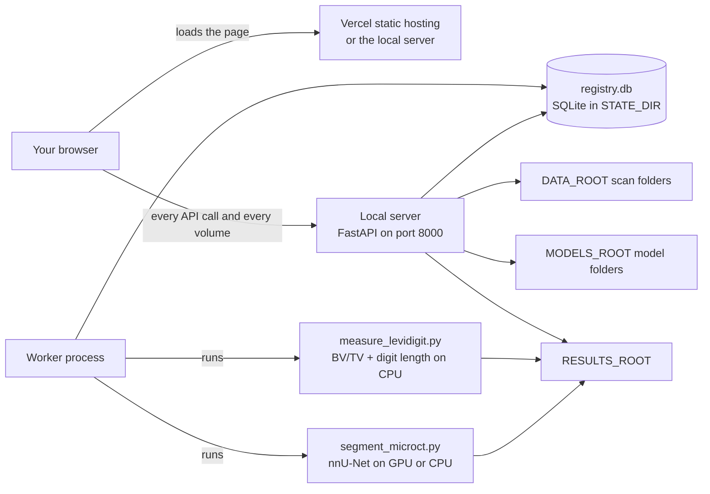

# Administrator Guide

You are the person who keeps the microCT Lab server running. That server is where
everything actually lives — the scans, the trained models, the run outputs, and the
small SQLite registry that ties them together — and the web interface is only a page
that talks to it. This guide covers starting and stopping the processes, every
`.env` setting and its default, pointing the server at storage you already have, the
two kinds of worker, letting colleagues use the hosted page, backups and restores,
moving an install to another machine, and telling a stuck job apart from a slow one.
No systems-administration background is assumed.

---

## Table of contents

1. [What you are running](#what-you-are-running)
2. [Starting and stopping the processes](#starting-and-stopping-the-processes)
3. [The two workers](#the-two-workers)
4. [Configuration reference](#configuration-reference)
5. [Data roots and pointing at existing storage](#data-roots-and-pointing-at-existing-storage)
6. [Optional extras: segmentation and measurements](#optional-extras-segmentation-and-measurements)
7. [Letting colleagues use the hosted page](#letting-colleagues-use-the-hosted-page)
8. [Serving the interface from your own machine](#serving-the-interface-from-your-own-machine)
9. [Backups and restores](#backups-and-restores)
10. [Moving an install to another machine](#moving-an-install-to-another-machine)
11. [Logs and where to look](#logs-and-where-to-look)
12. [Stuck or just slow?](#stuck-or-just-slow)
13. [Measurements: LeviDigit and the bone threshold](#measurements-levidigit-and-the-bone-threshold)
14. [Quick reference](#quick-reference)
15. [FAQ and troubleshooting](#faq-and-troubleshooting)

---

## What you are running

microCT Lab is two halves, and almost every support question is really a question
about which half is misbehaving.

- **The local server** — a Python process (FastAPI on top of uvicorn) that reads
  your scan folders, owns the SQLite registry, serves the API, and hands files to
  the viewer. It runs on your machine and only on your machine.
- **The web interface** — a static page. You can load it from
  `https://microctweb.vercel.app`, or have the local server serve it itself. Once
  loaded it runs in your browser and calls your server directly, so **no data ever
  leaves the machine**. The hosted page never sees a dataset, a mask, or the
  registry.
- **The worker** — a second process that polls the registry for queued jobs and
  actually executes them. The server never runs a job itself; it only enqueues.



The registry is one SQLite file. It holds the dataset catalogue, registered models,
every run with an immutable snapshot of the model that produced it, QC reviews,
projects, and measurements. Losing it loses the catalogue, not the
imaging data — but the catalogue is the part that took a human to build, which is
why [Backups and restores](#backups-and-restores) has its own section.

> Note: the server and the worker read `.env` **once, at startup**. Every
> configuration change in this guide needs both processes restarted before it takes
> effect.

---

## Starting and stopping the processes

The normal running state is two terminal windows, both left open.

### Start the server

From the install folder, with the virtual environment active:

```
.venv\Scripts\activate
microct-web
```

It prints where it is listening, then hands over to uvicorn:

```
microCT Segmentation Lab  ->  http://127.0.0.1:8000
```

If `MICROCT_ALLOWED_ORIGINS` names a non-local origin, the banner also lists those
origins and says plainly whether a token is required. Read that banner — it is the
fastest answer to "what is this server actually configured to allow?"

### Start the worker

In a second window:

```
.venv\Scripts\activate
microct-worker
```

It prints a readiness line naming the job kinds it handles, its poll interval, and
the results root it will write to:

```
[worker] ready (all). polling every 2.0s. results -> D:\microct\results
```

On the packaged `localserver` bundle these two are `start-server.bat` and
`start-worker.bat` instead, and they do exactly the same thing.

### Stop them

Click the window and press `Ctrl+C`. The worker finishes its current poll and exits;
a job that was mid-flight is left as **running** in the registry until the next
worker start, which cleans it up (see [Stuck or just slow?](#stuck-or-just-slow)).

> Note: nothing you queue in the interface will ever start if the worker is not
> running. Jobs sit at **queued** indefinitely, the interface shows no error, and
> nothing in the server window complains. This is the single most common "it is
> broken" report and it is not a bug.

### Confirming the server is healthy

Open `http://127.0.0.1:8000/api/health` in a browser tab. JSON means the server
process is fine, and any remaining problem is browser-side — origins, or a token.
Two more probes are worth knowing:

- **`/api/config`** — the roots the server *actually resolved* from `.env`. Use it
  when you suspect a path is not what you think it is.
- **`/api/system/compute`** — CPU, RAM, and GPU as seen on this machine, plus
  `recommended_device`, which is what a run set to `auto` will pick.

---

## The two workers

There are two job kinds and one worker program that can run either or both.

- **`microct-worker`** — segmentation. Wants an NVIDIA GPU to be practical; without
  one it falls back to CPU and takes hours instead of minutes. Executes
  `scripts/segment_microct.py` per queued run.
- **`microct-measure-worker`** — measurements. CPU only. Executes
  `scripts/measure_levidigit.py` (LeviDigit BV/TV and digit length, the
  official method) over a finished segmentation mask. The older SK drivers,
  `measure_bvtv.py` and `measure_morphometry.py`, still run if a measurement of
  those kinds is queued through the API.

`microct-worker` with no arguments handles **both** kinds. Its `--kind` flag narrows
it:

- **`--kind all`** — the default; segmentation first, then measurements.
- **`--kind segmentation`** — for the GPU box.
- **`--kind measurement`** — CPU only; `microct-measure-worker` is exactly this.

The reason to split them is queueing, not capability. A single `all` worker
processes strictly one job at a time and always drains segmentation first, so a
two-minute measurement can sit behind a four-hour GPU run. Running both
`microct-worker --kind segmentation` and `microct-measure-worker` in separate
windows lets the two queues move independently.

Two workers of the *same* kind on one machine is not a way to go faster. The queue
claim is a plain database update, so two segmentation workers will fight over one
GPU rather than share it.

### What a worker does at startup

Before it starts polling, a worker cleans up after a previous crash — but only for
the job kinds it handles, so a CPU measurement worker never disturbs the GPU
worker's in-flight runs. Anything left at **running** becomes **failed** with the
message `worker restarted while this run was in progress`; anything left at
**canceling** becomes **canceled**.

That recovery is also the only thing that resolves a stranded **canceling** job. If
you cancel a run and then stop the worker before it notices, the run stays at
**canceling** until a worker of that kind starts again.

---

## Configuration reference

All configuration lives in one file, `.env`, in the application folder, and every
key is prefixed `MICROCT_`. Copy `.env.example` to `.env` to start. Anything you
leave out falls back to the default below.

| Key | What it sets | Default |
|---|---|---|
| `MICROCT_DATA_ROOT` | Root scanned for datasets — folders of `*_rec*.bmp` slices plus a `*_rec.log` | `~/microct_lab_data/datasets` |
| `MICROCT_RESULTS_ROOT` | Where per-run and per-measurement output folders are written | `~/microct_lab_data/results` |
| `MICROCT_MODELS_ROOT` | Root holding trained nnU-Net model folders | `~/microct_lab_data/models` |
| `MICROCT_STATE_DIR` | `registry.db` plus a `thumbnails/` subfolder | `~/microct_lab_data/state` |
| `MICROCT_NAS_ROOT` | Shared NAS root as mapped on **this** machine; dataset paths are also stored relative to it so a record survives a different drive letter elsewhere | unset — falls back to `DATA_ROOT` |
| `MICROCT_ANALYSES_ROOT` | Folder holding analysis outputs browsed from **Projects** | unset — `<NAS_ROOT>/Analyses`, else `<STATE_DIR>/analyses` |
| `MICROCT_DB_URL` | Full SQLAlchemy URL, to move the registry or use Postgres | unset — `sqlite:///<STATE_DIR>/registry.db` |
| `MICROCT_SEGMENT_SCRIPT` | Path to the segmentation driver script | `<install>/scripts/segment_microct.py` |
| `MICROCT_PYTHON_EXE` | Interpreter used to launch jobs — point it at the environment that has torch and nnU-Net if that differs | unset — the interpreter running the worker |
| `MICROCT_HOST` | Bind address. `0.0.0.0` exposes the server to your LAN | `127.0.0.1` |
| `MICROCT_PORT` | Port | `8000` |
| `MICROCT_DEFAULT_DEVICE` | Device a new run defaults to: `auto`, `cuda`, or `cpu` | `auto` |
| `MICROCT_POLL_SECONDS` | How often an idle worker checks for new jobs | `2.0` |
| `MICROCT_ALLOWED_ORIGINS` | Comma-separated origins allowed to call this server from a browser, no trailing slash | empty |
| `MICROCT_WEB_DIR` | Serve a different frontend build at `/` instead of the bundled one | unset — the bundled interface |
| `MICROCT_API_TOKEN` | Shared secret required as `Authorization: Bearer <token>` from remote callers | unset — no token required |
| `MICROCT_REQUIRE_TOKEN_LOCAL` | Demand the token from local callers too | `false` |
| `MICROCT_LEVIDIGIT_BONE_THRESHOLD` | Default BV/TV bone threshold, grey 0 to 255 inclusive. **Set this to your lab's value**; see [Measurements: LeviDigit and the bone threshold](#measurements-levidigit-and-the-bone-threshold) | `60` (LeviDigit's README example, not a lab value) |

A few things that are not obvious from the table:

- **Forward or back slashes both work** on Windows. `D:/microct/datasets` and
  `D:\microct\datasets` are equivalent here.
- **`MICROCT_DB_URL` bypasses the backup script.** `scripts/backup_registry.py`
  reads `<STATE_DIR>/registry.db` directly, so if you repoint the database elsewhere
  — or at Postgres — the backup tooling described in this guide no longer applies
  and you would need your own.
- **The measurement driver paths are not configurable.** Unlike the
  segmentation script they are fixed under `<install>/scripts/`
  (`measure_levidigit.py` for the official method); there is no `.env` key for
  them.

> Tip: after editing `.env`, restart the server and then load `/api/config`. It
> echoes the resolved `data_root`, `results_root`, `models_root`, `state_dir`,
> `nas_root`, `analyses_dir`, and `default_device` — which is how you find a typo in
> a path in five seconds instead of five minutes.

---

## Data roots and pointing at existing storage

Nothing has to be copied into the install folder. The four roots are just paths, and
pointing them at storage you already have is the normal case for a lab with scans on
a fast local disk or a share.

The layout each root expects:

- **`DATA_ROOT`** — scanned recursively for any `*_rec.log`. The folder containing
  that log is treated as one dataset, named after the folder, and the reconstructed
  slices beside it are the volume. Slice files whose names contain `_spr` or `_pp`
  are excluded, and a folder with a log but no slices is skipped and counted as
  `skipped_no_slices` in the ingest result.
- **`MODELS_ROOT`** — one folder per trained nnU-Net model. A folder counts as a
  model when it contains `plans.json` and at least one `fold_*` directory.
- **`RESULTS_ROOT`** — written to, not read from. Each run gets
  `<dataset>__<model>__run<id>/`; each measurement gets `<case>__levidigit__m<id>/`
  (older SK measurements: `__bvtv__m<id>`, `__morph__m<id>`).
- **`STATE_DIR`** — holds `registry.db` and `thumbnails/`. Small, and the only root
  that matters for backups.

### Point at existing storage

1. Stop the server and the worker.
2. Edit `.env` and set the roots to the real locations.
3. Restart both, then confirm with `/api/config`.
4. On the **Datasets** page (route: `/datasets`), run the ingest action. It walks
   `DATA_ROOT`, reads each `*_rec.log` for voxel size, dimensions, scanner, voltage
   and current, and makes a thumbnail. Re-running it is safe: a folder already in
   the registry is **updated** rather than duplicated, because datasets are matched
   on their slice-folder path.
5. On the **Models** page (route: `/models`), register a model by path, or use the
   discover action to scan `MODELS_ROOT` and register everything new it finds.

The same two steps are available from the command line as `microct-ingest [root]`
and `microct-register-model <path>`, which is handy when you are setting a machine
up before anyone opens a browser.

> Safety note: because datasets are matched on their absolute slice path, moving a
> scan folder after ingest makes the old record point at nothing and a re-ingest
> create a second record for the same scan. Decide where scans live before you
> ingest, or retarget the registry as described in
> [Moving an install to another machine](#moving-an-install-to-another-machine).

### A NAS shared with other machines

If your scans sit on a share that is `Z:\` here and `\\ultron\share` on a
colleague's PC, set `MICROCT_NAS_ROOT` to the mapping **on this machine**. Dataset
records then also store a NAS-relative path, which resolves correctly against
whatever `NAS_ROOT` each machine has. Leave it unset and everything falls back to
`DATA_ROOT`, which is fine for a single-machine lab.

---

## Optional extras: segmentation and measurements

The base install gives you the interface, the catalogue, the viewer, and everything
already recorded. The two compute paths are separate installs, because both are
large and one is hardware-specific.

**Segmentation** — install a CUDA build of PyTorch first, then the extra:

```
pip install torch --index-url https://download.pytorch.org/whl/cu121
pip install -e ".[seg]"
```

That adds `nnunetv2`, `torch`, and `natsort`. Without it, `microct-worker` will
claim a queued run and then fail it when the segmentation script cannot import its
dependencies.

**Measurements** (LeviDigit BV/TV and digit length) — CPU only, no GPU involved:

```
pip install -e ".[morph]"
```

That adds `nibabel`, `scipy`, `scikit-image` and `matplotlib`, which LeviDigit
needs (matplotlib draws its figures), plus `scikit-learn`, `trimesh`, `pandas`
and `openpyxl` for the older SK morphometry. After installing, set
`MICROCT_LEVIDIGIT_BONE_THRESHOLD` to your lab's value.

Both extras need an internet connection. Without either, the interface still runs
and shows everything already in the registry — you simply cannot start new jobs of
that type.

The `-e` in `pip install -e .` is required, not a preference. The application locates
its own `scripts/` folder and `.env` relative to where the source lives; a
non-editable install copies the code elsewhere and it can no longer find either.

### Splitting compute across machines

Segmentation and measurements do not have to run on the same box, as long as both can
see the same registry and the same `RESULTS_ROOT`. Put `microct-worker --kind
segmentation` on the machine with the GPU, and `microct-measure-worker` on a cheaper
one. Every job records the host it ran on, so the provenance stays honest: a run's
environment debrief names the machine, CPU, RAM, GPU, torch version, and peak memory.

---

## Letting colleagues use the hosted page

The hosted interface at `https://microctweb.vercel.app` is a static page. A
colleague installs the server on their own PC, opens that address, and the page
drives **their** machine. The same build works for everyone because the server
address is a runtime setting held in the browser, not something baked into the
deploy.

### Allow the origin

One line in `.env`, then restart:

```ini
MICROCT_ALLOWED_ORIGINS=https://microctweb.vercel.app
```

That is the whole configuration. **No token is needed by default** — that is the
design, so a colleague has nothing to paste. Only the origins listed here may reach
the server; every other website the browser refuses.

Keep two mechanisms apart in your head. The list above is **CORS**: it decides
which web pages a browser will let talk to this server at all. Whether a caller
needs the **token** is a separate, narrower test, described under
[When to add a token](#when-to-add-a-token) — and it does not treat a missing
`Origin` header as proof of anything on its own.

Comma-separate to allow more than one. The check is exact, on scheme, host, and
port, with no trailing slash — `https://microctweb.vercel.app` and
`https://microctweb.vercel.app/` are the same thing to you and different things to
the browser.

> Note: use the stable `microctweb.vercel.app` address, never a per-deployment
> `microctweb-<hash>.vercel.app` one. Those change on every deploy and the origin
> check will not match tomorrow.

### When to add a token

Add `MICROCT_API_TOKEN` when the machine is shared, or when you do not fully trust
everything else running on it. Generate one:

```
python -c "import secrets; print(secrets.token_urlsafe(32))"
```

```ini
MICROCT_API_TOKEN=<the generated value>
```

Once set, `Authorization: Bearer <token>` is required on every `/api/*` request
**unless the caller is exempt**, and the exemption is exactly two rules:

| The request | Exempt? |
|---|---|
| `Origin` header naming `localhost` or `127.0.0.1`, any port, either scheme | **Yes** — a page served from this machine |
| **No** `Origin` header **and** the client address is loopback | **Yes** — `curl` on this box, or a URL typed into the address bar here |
| No `Origin` header, client address anywhere else | **No** |
| Any other `Origin` — the hosted page included | **No** |

So the built-in interface at `http://127.0.0.1:8000` keeps working with nothing
to configure, and the hosted page asks for the token once in the **Connection**
panel and keeps it in that browser's `localStorage`.

> Safety note: the client-address half of rule two is what makes a token worth
> setting on a LAN-exposed server. A missing `Origin` header proves only that the
> caller is not a cross-origin browser page — it says nothing about where the
> caller is. Without the address check, `MICROCT_HOST=0.0.0.0` would let anyone on
> your network read the entire API unauthenticated just by using a tool that does
> not send the header browsers add on their own. **Do not describe this exemption
> to anyone as "local pages only"**; it is about the origin *and* the address.

Set `MICROCT_REQUIRE_TOKEN_LOCAL=true` to drop the exemption entirely and demand
the token from everyone, the local dashboard included.

`GET /api/health` is the one endpoint that never needs the token, and it reports
`auth_required` **for the caller asking** rather than merely whether a token exists —
so a local page is never told to produce a secret it does not have to send. That
makes it the fastest way to settle an argument about any of the above: load it
from the caller in question and read the boolean.

### Reading the token back

Three ways, all on the server machine:

- **`microct-token`** — prints the token, the base URL, and the allowed origins.
  Reads `.env` directly, so it works whether or not the server is running.
- **`http://127.0.0.1:8000/api/token`** — typed into the address bar of a browser on
  this machine.
- **The startup banner** — `microct-web` prints it when a remote origin is allowed.

That endpoint is deliberately narrow. It refuses any caller that is not on loopback,
so with `MICROCT_HOST=0.0.0.0` a colleague on the LAN cannot read it off the
network. It also refuses any request carrying an `Origin` header, which means no web
page can fetch it — not even one from an allowed origin. That second rule matters
because the localhost exemption permits *any* local port, so without it some other
web app you happen to be running could ask for the token and then drive the whole
API with it.

### The connection panel

In the interface, the connection indicator sits in the header and reads
**Connected**, **Token needed**, **Disconnected**, or **Checking…**. Clicking it
opens **Local server connection**, with an **API base URL** field (default
`http://localhost:8000`) and an **Access token** field with a show/hide toggle.
**Save & reconnect** applies both; **Reset** returns to the defaults. Both values
live only in that browser, under the `localStorage` keys `microct_api_base` and
`microct_api_token`.

> Note: verified working in Chrome and Edge — expect a one-time local-network
> permission prompt on newer Chrome versions, and allow it. Firefox is expected to
> work but has not been verified here. **Safari will likely refuse** to let an HTTPS
> page reach localhost at all; for Safari, use the next section.

---

## Serving the interface from your own machine

The server can serve the interface itself, at `http://127.0.0.1:8000`. Then the page
and the API are the same origin, and none of the browser's cross-origin rules apply
at all — no allowed-origin setting, no private-network preflight, no token, no
dependency on a hosted site being up. This is the reliable path; the hosted page is
the convenient one.

Reach for it when:

- **Safari is the browser** — it will not let a hosted HTTPS page reach localhost.
- **The machine is offline or air-gapped** — nothing needs to be fetched.
- **You would rather not depend on a hosted site** at all.

The server already ships with a working built-in interface, so this needs no
configuration: open `http://127.0.0.1:8000` instead of the Vercel address and leave
`MICROCT_ALLOWED_ORIGINS` unset.

To serve the newer interface locally instead, build its static export and point the
server at it:

```
npm install
npm run build
```

```ini
MICROCT_WEB_DIR=C:/path/to/microctweb/out
```

Restart the server and `http://127.0.0.1:8000` now serves that build.

A stale `MICROCT_WEB_DIR` cannot take the interface down: if the path does not exist
the server silently falls back to the bundled build. So if you point it at a new
build and still see the old interface, check the path before you check anything else.

### Colleagues on your LAN

Set `MICROCT_HOST=0.0.0.0` and restart, and others on your network can open
`http://<this-machine-ip>:8000`. They are then working with **your** data on **your**
machine, not their own — which is a different arrangement from the hosted page,
where each person drives their own server. Remember that `/api/token` refuses
non-loopback callers, so a LAN colleague cannot read the token off the server; you
have to hand it to them.

> Safety note: on `0.0.0.0`, **set `MICROCT_API_TOKEN`**. Without one there is no
> gate at all and anyone who can route to the port can read and drive everything.
> With one, every non-loopback caller must present it — a browser page because of
> its `Origin`, and a script or a `curl` because of its address. That second case
> is the one to check if you are working from a memory of how this used to
> behave.

---

## Backups and restores

The registry is one SQLite file, and it runs in **write-ahead-log mode**. That
detail is the whole reason this section exists.

### The write-ahead-log trap

A committed write does not necessarily live in `registry.db` yet — it can sit in
`registry.db-wal` until a checkpoint. Copying the one file while the server is
running produces a database that is *valid* and *stale*, which is the worst kind of
bad backup: nothing errors, the file opens fine, and you have quietly lost recent
work. On this install that gap was once large enough that a naive copy was missing
the **entire measurements table**.

> Safety note: never back up by copying `registry.db`. Use the script below, which
> uses SQLite's online backup API, is safe against a running server, and always
> folds the WAL in.

### Make a backup

```
python scripts/backup_registry.py --out backup.db
```

Or bundle the thumbnails, which live outside the database in
`<STATE_DIR>/thumbnails`, into a zip:

```
python scripts/backup_registry.py --out bundle.zip --with-thumbnails
```

With no `--out` it writes `registry_backup_<timestamp>.db` (or `.zip`) in the
current folder. The script prints the snapshot size and, for a zip, the number of
thumbnails included.

### Restore a backup

1. **Stop the server** and the worker.
2. Put the backup at `<STATE_DIR>/registry.db`.
3. **Delete any `registry.db-wal` and `registry.db-shm` sitting beside it.** Those
   belong to the *previous* database and would otherwise be replayed over what you
   just restored — the mirror image of the trap above.
4. Start the server and check that a dataset opens and a run shows its mask.

On the packaged `localserver` bundle, `restore-db.bat` does all of this for you from
a file dropped into `restore-db\`, and then checks that the paths recorded in the
restored registry actually exist on this machine.

### What a backup does not contain

The registry is a catalogue, not the data. A backup carries dataset records, models,
runs, QC reviews, projects and measurements — but not the slices, the model weights,
the masks, or the previews. Those are files under your roots and have to travel
separately. A restored registry on a machine that lacks them opens perfectly and
every record points at nothing.

---

## Moving an install to another machine

The registry stores **absolute paths** everywhere: dataset slice folders, model
folders, per-run output directories, mask and preview and log files, thumbnails, and
paths embedded inside the JSON parameter and environment blobs. Those paths have to
resolve on the target machine.

### See what the paths are first

```
python scripts/backup_registry.py --report-paths
```

It groups every recorded path by its root prefix, counts the references, and marks
each one `exists here` or `MISSING here`. Run this on the **target** machine after a
restore and you learn immediately whether the catalogue is usable.

### Retarget while backing up

If the folders differ, rebuild the backup with the prefix rewritten:

```
python scripts/backup_registry.py --out for-you.db --rewrite "C:\their\path=D:\your\path"
```

`--rewrite` is repeatable, so several roots can be moved in one pass. It rewrites the
path columns and substitutes inside the JSON blobs — handling both the raw and the
escaped form of a Windows path — and then re-parses every JSON value it touched. If a
substitution would have produced unparseable JSON the script aborts and **does not
write the backup**, rather than handing you a corrupt catalogue.

### The whole move, in order

1. On the source machine, run `--report-paths` to see what the target will need.
2. Decide the target's roots. Either recreate the same paths, or plan a `--rewrite`.
3. Build the backup, with `--rewrite` and `--with-thumbnails` as needed.
4. Copy the scans, models and results across separately — they are not in the
   backup, and they are the hundreds of gigabytes.
5. Install the server on the target and set its `.env` roots to match.
6. Restore the registry, deleting the leftover `-wal` and `-shm` files.
7. Run `--report-paths` on the target. Nothing should say `MISSING here`.
8. Install the `[seg]` extra and a matching CUDA build of torch if that machine is
   the one doing segmentation.

Model versions and their weight fingerprints travel with the model folders, so a run
stays traceable to the exact model that produced it across a machine move. That is
the point of the immutable model snapshot stored on every run.

---

## Logs and where to look

There are four places, and picking the right one saves a lot of time.

| What | Where | Contains |
|---|---|---|
| Server console | The `microct-web` window | Startup banner, allowed origins, uvicorn request lines and tracebacks |
| Worker console | The `microct-worker` window | `[worker]` lines: readiness, each job claimed, each job's final status |
| Per-run log | `<RESULTS_ROOT>/<dataset>__<model>__run<id>/run.log` | The exact command line, then everything the segmentation script printed |
| Per-measurement log | `<RESULTS_ROOT>/<case>__levidigit__m<id>/measure.log` | The exact command line, then LeviDigit's output |

Neither console writes to a file by default. If you want the server's output kept,
redirect it when you start the process; the startup banner is flushed explicitly so
it arrives immediately rather than sitting in a buffer.

Both job logs are readable from the interface without going to disk — a run's log is
at `/api/runs/{id}/log.txt` and a measurement's at `/api/measurements/{id}/log.txt`,
and each detail page shows it. The first line of either file is the full command that
was executed, which is the fastest way to confirm the worker used the interpreter,
model path and spacing you expected.

When a job fails, the registry also stores a short error on the row: the exit code
followed by the last eight lines of that log. That is what the interface shows you
first; open the full log when those eight lines are not enough.

A failure whose log ends in an import error is almost always a missing optional
extra — `[seg]` for segmentation, `[morph]` for measurements — or a
`MICROCT_PYTHON_EXE` pointing at an interpreter that does not have them.

---

## Stuck or just slow?

Segmentation on a CPU legitimately takes hours; on this install a run over a
1128 by 1128 by 459 volume took 6,582 seconds on CPU. So "it has been running a long
time" is not evidence of anything. Here is how to actually tell.

### Read the status first

The six run statuses, and what each one means for you:

- **queued** — accepted, waiting for a worker. If it never leaves this state, no
  worker is running that handles this job kind.
- **running** — a worker has claimed it and the subprocess is alive.
- **succeeded** — finished; outputs written and metrics folded back into the row.
- **failed** — the subprocess exited non-zero, or its result file was missing. The
  row carries the exit code and the log tail.
- **canceling** — you asked it to stop; the worker kills the process tree within a
  few seconds and then finalizes it.
- **canceled** — stopped, either by you or by a worker restart finding it stranded.

### Then read the progress

Each run exposes live progress, and the run detail page (route: `/runs?id=1`) shows
it as a banner. It reports a phase, a percentage, whether the bar is determinate, and
a detail string, all derived by parsing the run log:

- **converting** (2 to 15%) — stacking the BMP slices into a volume; the detail names
  the slice number.
- **loading** (15%) — reading the model weights.
- **predicting** (15 to 90%) — nnU-Net's sliding-window inference. The detail is the
  patch count, `patch 41/220`, which is the most honest measure of compute done. If
  the patch count cannot be parsed yet the bar goes indeterminate but still names the
  phase.
- **finalizing** (90 to 100%) — writing the mask, the preview, and the per-slice mask
  BMPs.

A **running** job whose patch count is still advancing is slow, not stuck. A
**running** job whose log has not grown in a long time is worth investigating.

### The four things that are actually stuck

- **Queued forever, no worker.** Look for a `[worker] ready` line. If there is no
  worker window, that is the answer.
- **Queued forever, wrong worker kind.** A `microct-measure-worker` will never pick
  up a segmentation run, and a `--kind segmentation` worker will never pick up a
  measurement. Check the kind in the readiness line.
- **Stranded at canceling.** The worker was stopped between your cancel and its next
  poll. Start a worker of that kind and its startup recovery finalizes the job to
  **canceled**. Until then the row simply sits there — on this install, run 2 has
  been at **canceling** since mid-July for exactly this reason.
- **Left at running after a crash.** Same fix. The next worker start marks it
  **failed** with `worker restarted while this run was in progress`.

> Note: if a run has genuinely stalled, cancel it from the interface rather than
> killing the worker window. Cancel sets **canceling**, the worker kills the whole
> process tree, and the run is finalized cleanly with its log intact. Killing the
> window skips all of that and leaves a row for the next startup to clean up.

---

## Measurements: LeviDigit and the bone threshold

BV/TV and digit length come from **LeviDigit**
([`levi_digit_model`](https://github.com/snehakorlakunta/levi_digit_model)),
vendored unmodified into `scripts/levidigit_vendor/` and driven by
`scripts/measure_levidigit.py`. It is the official method and the only one the
site shows.

**Set the bone threshold to your lab's value.** BV counts mask voxels whose grey
value (0 to 255) is at or above the threshold, so the threshold decides BV/TV.
LeviDigit has no default of its own; the server's default of **60** is only the
example from LeviDigit's README. Set it once in `.env` and restart:

```ini
MICROCT_LEVIDIGIT_BONE_THRESHOLD=<your lab's grey value>
```

Scientists can still type a different value per measurement, and every
measurement stores the threshold it used, so changing the default never alters
a past result. `GET /api/config` reports the value in force as
`levidigit_bone_threshold`.

What LeviDigit enforces, and what it cannot:

- **It refuses** scans that are not 4 µm isotropic (within 1%), intensities
  outside 0 to 255, and masks that are not binary or do not match the volume.
  Those measurements fail with LeviDigit's message.
- **It measures digit length only on digit datasets.** On a dataset whose
  subtype is not `digit`, the server runs BV/TV only and records why.
- **It reports no digit length, never zero,** when it finds no defensible
  concavity on the mask.
- **It cannot tell a wrong mask from a right one.** BV/TV and length are
  computed inside whatever the segmentation produced. A human has to confirm
  the mask before a number goes into a figure.

**The older methods are kept, tagged SK.** The interim threshold BV/TV
(`bvtv_thresh_v1`, 800 HU converted per scan) and the perios digitpipe
morphometry (`digitpipe_v5`) still exist in the registry and the API, where every
measurement carries `source_tag` (`LeviDigit` or `SK`) and `official`. The site
does not show SK measurements, and statistics and BV/TV normalization use only
LeviDigit values. SK BV/TV is not comparable with LeviDigit's: different
threshold, different method.

The scientist-facing details are in the
[BV/TV & Digit Length Guide](/help/levidigit-guide).

---

## Quick reference

**Commands**

| Command | Does |
|---|---|
| `microct-web` | Start the API and serve the interface at `/` |
| `microct-worker` | Work both job kinds |
| `microct-worker --kind segmentation` | Segmentation only — the GPU box |
| `microct-measure-worker` | Measurements only (BV/TV, digit length) — CPU |
| `microct-token` | Print the access token, base URL and allowed origins |
| `microct-ingest [root]` | Scan a data root and register or update datasets |
| `microct-register-model <path>` | Register a trained nnU-Net model folder |
| `python scripts/backup_registry.py --out backup.db` | Consistent registry backup |
| `python scripts/backup_registry.py --report-paths` | List the absolute paths the registry depends on |

**Probes**

| URL | Tells you |
|---|---|
| `/api/health` | Server is up; whether **this** caller needs a token |
| `/api/config` | The roots actually resolved from `.env` |
| `/api/stats` | Dataset, model and run counts, plus runs by status |
| `/api/system/compute` | CPU, RAM, GPUs, and the device an `auto` run would pick |
| `/api/runs/{id}/progress` | Phase, percent, elapsed and estimated time for one run |

**Pages**

| Page | Route |
|---|---|
| Overview | `/` |
| Projects | `/projects` |
| Datasets | `/datasets` |
| Models | `/models` |
| Runs | `/runs` |
| Timeline | `/timeline` |
| QC and Insights | `/insights` |

Detail views use a query string — `/runs?id=5`, `/projects?id=3` — and **Compare** is
reached at `/compare?ids=1,2` rather than from the navigation.

**Statuses**

| Kind | Values |
|---|---|
| Run status | queued, running, succeeded, failed, canceled, canceling |
| QC outcome | unreviewed, pass, minor, fail |

---

## FAQ and troubleshooting

**Everything I queue just sits at "queued" and nothing happens.**
The worker is not running. Open a second terminal, activate the virtual environment,
and run `microct-worker`. You should see a line beginning `[worker] ready`. If a
worker *is* running, check its kind — a `microct-measure-worker` will never pick up a
segmentation run.

**The page says it cannot reach the local lab server.**
Work through it in order. Is `microct-web` still running in its window? Open
`http://127.0.0.1:8000/api/health` in a tab — if that shows JSON, the server is fine
and the problem is `MICROCT_ALLOWED_ORIGINS`. Check the origin matches exactly, with
no trailing slash and not a per-deployment Vercel hostname. And restart the server
after editing `.env`; it only reads it at startup.

**It says "Connected, but the token is missing or wrong".**
The token in the **Connection** panel does not match `MICROCT_API_TOKEN`. Run
`microct-token` on the server machine to read the real one, paste it, and choose
**Save & reconnect**. Remember the server has to be restarted after `.env` changes.

**Requests fail in the browser but `curl` works fine.**
That is the signature of a cross-origin or private-network rejection rather than a
server error — `curl` enforces neither. Open the browser's network panel and look at
the failed `OPTIONS` preflight; its response names what was disallowed.

**Nothing works in Safari.**
Expected. Safari will not let a hosted HTTPS page talk to your own machine. Use
`http://127.0.0.1:8000`, which serves the interface from your own server, or use
Chrome or Edge.

**I set a token and now I cannot tell whether the local dashboard needs it.**
It does not, unless you also set `MICROCT_REQUIRE_TOKEN_LOCAL=true`. A page whose
`Origin` is `localhost` or `127.0.0.1` is exempt, as is a caller that sends no
`Origin` from a loopback address. `GET /api/health` answers this for the caller
doing the asking — load it from the page or tool in question and read
`auth_required`. Note that a script on **another** machine is not exempt even
though it sends no `Origin`; see
[When to add a token](#when-to-add-a-token).

**The interface loads but is completely empty.**
That is correct for a fresh install. Point `MICROCT_DATA_ROOT` at your scans, then
run the ingest action on the **Datasets** page. Nothing is discovered automatically.
[Getting started](/help/getting-started) walks through the first scan end to end.

**I restored a backup and every dataset shows nothing.**
The registry stores absolute paths and yours differ from the source machine's. Run
`python scripts/backup_registry.py --report-paths` — anything marked `MISSING here`
is the problem. Ask for the backup to be rebuilt with `--rewrite "OLD=NEW"`, or
recreate the paths.

**Can I just copy `registry.db` to back it up?**
No, and this one matters. SQLite runs the registry in write-ahead-log mode, so recent
commits can still be sitting in `registry.db-wal`. A plain copy opens fine, looks
healthy, and is missing the newest records — on this install a naive copy once lost
an entire table. Use `scripts/backup_registry.py`.

**A run has been going for hours. Is it stuck?**
Probably not, if it is on CPU — a full volume can genuinely take several hours. Open
the run detail page and read the progress banner. If the phase is **predicting** and
the patch count is still climbing, it is working. If the log has not grown in a long
time, cancel it from the interface rather than killing the worker window.

**I canceled a run and it is still showing "canceling".**
The worker was not running when you canceled, or was stopped before its next poll.
Start a worker of that kind — its startup recovery finalizes stranded jobs, turning
**canceling** into **canceled** and a crashed **running** into **failed**.

**Can I run two workers to go twice as fast?**
Not for the same kind of job. Two segmentation workers will contend for one GPU
rather than share it. What *is* worth splitting is the two kinds: run
`microct-worker --kind segmentation` and `microct-measure-worker` separately so a
two-minute measurement does not queue behind a four-hour run.

**Can I delete a run I no longer want?**
No — runs are the immutable provenance record and can only be **archived**, which
removes them from the default views without losing them. Deleting a dataset behaves
the same way: a dataset with any runs attached is archived rather than deleted, so
nothing a run points at can disappear underneath it. Only a dataset with no runs is
actually removed.

**Every lab machine gives a slightly different BV/TV for the same scan.**
Check `levidigit_bone_threshold` in `/api/config` on each. If one machine still
has the default of 60 and another has the lab's value, their BV/TV will differ.
Set `MICROCT_LEVIDIGIT_BONE_THRESHOLD` the same everywhere. See
[Measurements: LeviDigit and the bone threshold](#measurements-levidigit-and-the-bone-threshold).

**Where do the run outputs actually go?**
`<RESULTS_ROOT>/<dataset>__<model>__run<id>/`, holding the stacked input volume, the
mask, a preview PNG, `run.log`, a result JSON, a per-slice mask BMP folder, and
cached downsampled copies the viewer uses. Measurements go to
`<RESULTS_ROOT>/<case>__levidigit__m<id>/`.

**Does any of this send data anywhere?**
No. The hosted page is only HTML and JavaScript; once it loads, every request goes to
the server on your own machine and the large volumes travel over loopback. If you
would rather not load the page from the internet at all, serve it locally — see
[Serving the interface from your own machine](#serving-the-interface-from-your-own-machine).

**Where do the scientists' instructions live?**
Day-to-day use — ingesting, queueing runs, QC review, measurements — is covered in the
[User Guide](/help/user-guide). This guide deliberately stops at the point where the
server is running and configured correctly.
