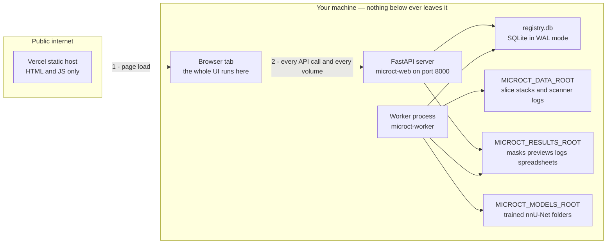
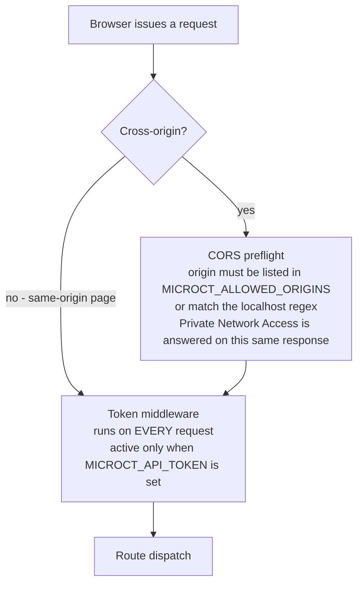
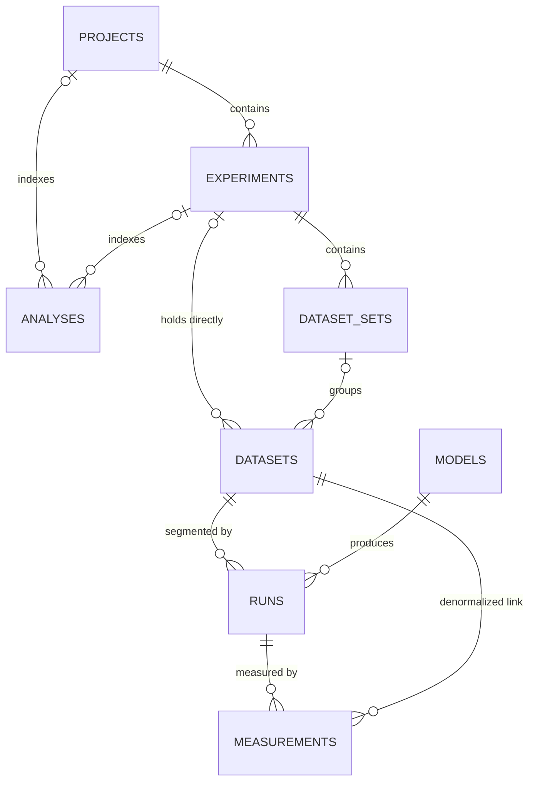
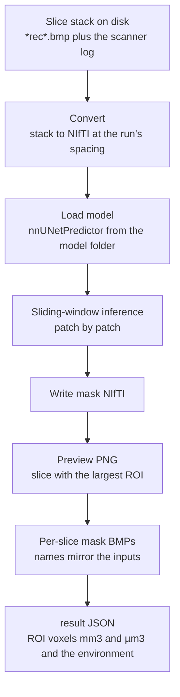
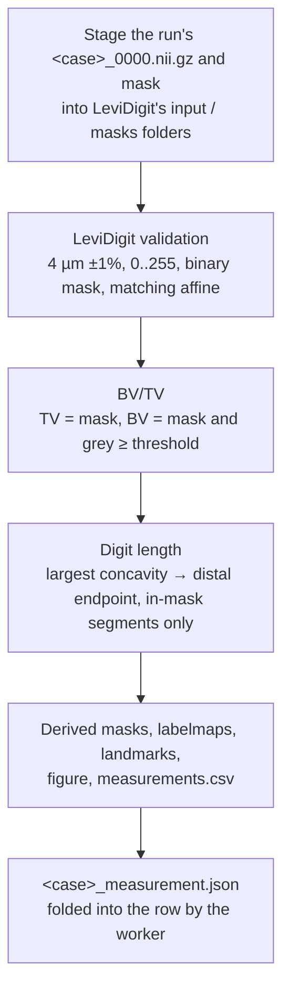
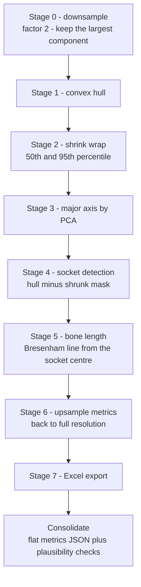

# Architecture & Data Model

microCT Lab is two programs that never share a process: a **local server** that
holds every byte of your data and does every second of the computation, and a
**web interface** that is only a page. This guide is the technical reference for
whoever has to change either one — how the halves talk, why the frontend does no
server-side fetching, how the job queue works, what every column in the registry
means, the full REST surface, and what a job leaves on disk. It assumes you can
read Python and TypeScript, but not that you know anything about nnU-Net,
microCT, or this codebase. Where a design choice looks odd, the reason is given
rather than left for you to rediscover.

---

## Table of contents

1. [The system in one diagram](#the-system-in-one-diagram)
2. [Why the frontend is a static export](#why-the-frontend-is-a-static-export)
3. [The request path: CORS and Private Network Access](#the-request-path-cors-and-private-network-access)
4. [The job queue](#the-job-queue)
5. [The database schema](#the-database-schema)
6. [How the tables relate](#how-the-tables-relate)
7. [Design decisions worth knowing](#design-decisions-worth-knowing)
8. [The REST API surface](#the-rest-api-surface)
9. [What a run writes to disk](#what-a-run-writes-to-disk)
10. [The segmentation pipeline](#the-segmentation-pipeline)
11. [The measurement pipeline: LeviDigit](#the-measurement-pipeline-levidigit)
12. [The SK morphometry pipeline (not shown on the site)](#the-sk-morphometry-pipeline-not-shown-on-the-site)
13. [Backups and moving a registry](#backups-and-moving-a-registry)
14. [Quick reference](#quick-reference)
14. [FAQ and troubleshooting](#faq-and-troubleshooting)

---

## The system in one diagram

Three processes and four directories, all but one of them on your own machine.



Read the arrows carefully, because the security story is entirely in them.
Arrow 1 is the only thing that crosses the internet and it carries no data — the
Vercel deployment is a static bundle of HTML, CSS, and JavaScript. Arrow 2 and
everything below it stay on loopback. Vercel's servers never see a dataset, a
mask, or the registry; they *cannot*, because nothing in the deployed app runs on
a server at all. The same is true of the alternative deployment, where the local
server itself serves the interface: then even arrow 1 is local.

The three processes divide as follows.

- **The server** (`microct-web`) — FastAPI. Owns the registry, answers the API,
  streams files to the viewer, and mounts the frontend build at `/`. It never
  runs a segmentation itself.
- **The worker** (`microct-worker` / `microct-measure-worker`) — a plain polling
  loop. It is the only thing that executes compute. If it is not running, work
  you queue stays at **queued** indefinitely.
- **The browser** — every page, every fetch, every NIfTI render.

> Note: the server and the worker share nothing but the SQLite file. You can run
> the worker on the same machine in a second terminal, which is the normal case,
> and the split exists so a GPU box and a CPU box can each take the job kind they
> are suited to.

The four data roots are set in `.env` and reported verbatim by `GET /api/config`,
so if you are ever unsure where an install is pointed, ask it rather than guess.

---

## Why the frontend is a static export

`microctweb` is a Next.js app built with `output: "export"`. That is not a
packaging preference; it is forced by the deployment shape, and the constraint
propagates into the routing.

Vercel's servers sit on the public internet. The API they would need to call
lives at `http://localhost:8000` — on the *user's* machine, which Vercel cannot
reach and never should. So there is no server-side data fetching anywhere in the
app: no `fetch` in a Server Component, no Route Handler proxying the API, no
`getServerSideProps`, no server actions.

The invariant the project actually enforces is a rule rather than a count, and it
lives in `scripts/verify-client-only.mjs`, run by `npm run verify`: **every file
containing a `fetch(` call must carry a `"use client"` directive**, there must be
no route handlers and no `getServerSideProps` / `getStaticProps`, and
`next.config` must keep `output: "export"`. Four files hold a real call site
today — `src/lib/api/client.ts` (the JSON client), `src/lib/api/use-file-url.ts`
(authenticated binary assets), `src/components/help/GuideView.tsx` and
`src/lib/helpSearch.ts` (both fetching static Markdown out of `public/help`). The
rule is what keeps that list safe to grow; do not add a fifth without the
directive.

Two consequences you will run into immediately.

**The API base URL is resolved at runtime, not build time.** There is no
`NEXT_PUBLIC_` constant naming the server, because the same bundle ships to
Vercel *and* onto a USB stick, and every user's server has its own host and port.
The connection lives in `localStorage` under `microct_api_base` and
`microct_api_token`, defaulting to `http://localhost:8000` and an empty token.
Both are exposed through a small external store so that editing either one
re-renders every consumer and invalidates every React Query key — the connection
is literally part of each cache key.

**Detail pages use query strings, not dynamic segments.** A route like
`/runs/[id]` would need `generateStaticParams`, which would mean hitting the API
at build time — impossible, since the API is on a machine the build has never
heard of. So the entity pages read their id from the query string instead:
`/runs?id=5`, `/projects?id=3`, and the two-up comparison at `/compare?ids=1,2`.
The **Compare** page is the only one not in the left nav; you reach it by
selecting runs elsewhere.

`trailingSlash: true` is set so the export emits `out/runs/index.html` rather
than `out/runs.html`. That makes the build servable by any plain static file
server with no rewrite rules — FastAPI's `StaticFiles(html=True)`, `python -m
http.server`, or nginx — which is what makes the offline USB mode work.

---

## The request path: CORS and Private Network Access

A request from the hosted page to your machine passes three gates in order, and
knowing which one rejected you is most of the debugging.



Read the middleware box carefully: it is a plain `app.middleware("http")` wrapper
and it runs for **every** request, same-origin included. A same-origin page is
not routed around it — it reaches it and is then *exempted*, by the rule in gate
three below. With `MICROCT_REQUIRE_TOKEN_LOCAL=true` that exemption disappears
and the same box starts returning 401 to the bundled dashboard, which is why the
diagram puts it on both branches.

**Gate one: the origin.** `MICROCT_ALLOWED_ORIGINS` is a comma-separated list of
exact origins — scheme, host, and port, no trailing slash. For the hosted UI that
is one line:

```ini
MICROCT_ALLOWED_ORIGINS=https://microctweb.vercel.app
```

In addition, a regex always permits `localhost` and `127.0.0.1` on any port over
**either scheme** — the pattern is `https?://(localhost|127\.0\.0\.1)(:\d+)?` —
so local tooling needs no configuration, and a local app served over HTTPS is
permitted too. `allow_credentials` is deliberately **off**: authentication is a
bearer token, never a cookie, so the browser never attaches ambient credentials
cross-origin and there is no CSRF surface to reason about.

**Gate two: Private Network Access.** A public HTTPS page reaching a loopback
address is the exact pattern browser vendors have been tightening. Chrome sends
`Access-Control-Request-Private-Network: true` on the preflight and the server
must answer `Access-Control-Allow-Private-Network: true`. That is handled by
`allow_private_network=True` on the CORS middleware in `main.py`. It is not a
second, separate round trip: the answer rides on the **same** CORS preflight
response, which is why it is a flag on that middleware and not a step of its own.
Do not try to attach the header from your own middleware — Starlette rejects the
PNA preflight internally with a 400 before custom middleware ever sees it, so the
header lands on an already-failed response and the browser still blocks. The flag
is the only correct fix.

**Gate three: the token, which is optional.** By default there is none, and that
is the intended configuration: a colleague installs the server, opens the hosted
page, and it connects with nothing to paste. Setting `MICROCT_API_TOKEN` makes
`Authorization: Bearer <token>` mandatory on every protected path unless the
caller passes the **local caller** test in `_is_local_caller()`, which is two
rules and not a hand-wave about "this machine":

- **An `Origin` header that matches the localhost regex** — a page served from
  this machine. Exempt. A browser attaches the page's real origin to every
  cross-origin request, so a public website cannot forge this.
- **No `Origin` header at all** — `curl`, a script, or a top-level navigation.
  Exempt **only if the client address is loopback** (`127.0.0.1`, `::1`, or the
  IPv4-mapped form).

Both halves matter. An absent `Origin` says the caller is not a cross-origin
browser page; it says nothing about *where* it is. Without the address check,
`MICROCT_HOST=0.0.0.0` would let anyone on the LAN read the entire API
unauthenticated simply by not sending a header browsers add on their own — no
`Origin`, no token, real dataset JSON. So state the boundary precisely: the token
stops cross-origin browser pages **and** every non-loopback caller.
`MICROCT_REQUIRE_TOKEN_LOCAL=true` removes the exemption entirely and demands the
token from everyone, the bundled dashboard included.

Two endpoints sit outside the token gate. `GET /api/health` is public so the UI
can tell "server is down" apart from "server is up and my token is wrong"; it
reveals only the app name, version, and two booleans. Critically,
`auth_required` describes *this caller*, not merely whether a token exists, so a
local page is never told to produce a secret it does not need.
`GET /api/token` guards itself twice: loopback clients only, and it refuses any
request carrying an `Origin` header at all — which means no web page can read it,
not even one from an allowed origin. That second rule matters because the
localhost origin regex permits *any* local port, so without it any other web app
you happen to be running could ask for the token and then drive the whole API.

> Note: the token middleware reads the ASGI scope path via `get_route_path`, not
> `request.url.path`. Starlette rebuilds the latter by parsing the `Host` header,
> so a `Host` value containing a slash shifts the parsed path and a prefix test
> on it fails open while routing still reaches the endpoint. That would be an
> unauthenticated read of every dataset from one attacker-controlled header.

**Browser support is not uniform.** Chrome and Edge are verified working, with a
one-time local-network permission prompt on recent versions. Firefox is expected
to work and is not yet verified here. **Safari will likely refuse** — it does not
implement PNA and is stricter about HTTPS pages reaching localhost. The fallback
is to serve the same static build from the local server by pointing
`MICROCT_WEB_DIR` at `microctweb/out`; then everything is same-origin and none of
this section applies. Treat hosted as the convenient path and local serving as
the reliable one.

---

## The job queue

Both job kinds run on one loop in `worker.py`, and the queue is the `runs` and
`measurements` tables themselves. There is no Redis, no Celery, no broker.

The loop is deliberately small. On start it recovers jobs left mid-flight by a
crash — anything **running** becomes **failed** with "worker restarted while this
run was in progress", anything **canceling** becomes **canceled** — but only for
the kinds *this* worker handles, so a CPU measurement worker never touches a GPU
worker's in-flight runs. Then it polls: claim the oldest **queued** row, flip it
to **running**, stamp `started_at`, shell out to the driver script with output
streamed to a log file, and fold the driver's result JSON back into the row.
Segmentation is preferred over measurement when both are pending. The poll
interval is `MICROCT_POLL_SECONDS`, default 2.

Cancellation works by writing to the database, because the API process cannot
signal the worker's subprocess directly. `POST /api/runs/{id}/cancel` sets a
queued run straight to **canceled**; a running one goes to **canceling**. While
the subprocess runs, the worker wakes every two seconds and re-reads that status
on a *fresh session* — a cached one would never see the API's commit — and on
seeing `canceling` it kills the process tree via `psutil` and finishes the row as
**canceled**.

Why a database-backed queue at all? The design constraints are unusual and they
all point the same way.

- **The deployment is a scientist's laptop, not a cluster.** Every extra service
  is another thing to install, start, and explain in the setup guide. The install
  is already Python plus a virtualenv; a broker would double it.
- **The queue is already durable and already backed up.** Job state lives in the
  same file as its provenance, so a crash, a reboot, or a restore leaves the
  queue and the results consistent with each other by construction. With an
  external broker they can disagree.
- **Throughput is irrelevant.** A single segmentation on this hardware took
  6,582 seconds. Polling every two seconds costs nothing against that.
- **It is cross-platform with no packaging work.** Windows, macOS, and Linux get
  the same loop.

The honest cost: the claim is a plain `SELECT` then `UPDATE` without a locking
clause, so two workers of the same kind pointed at one registry could in
principle claim the same row. The intended topology is one worker per kind, and
the split flags (`--kind segmentation`, `microct-measure-worker`) exist so a
second worker takes a *different* kind rather than competing for the same one.

> Tip: **queued forever is almost never a bug.** It means no worker is running
> for that kind. This is the single most common support report on the project.

---

## The database schema

One SQLite file at `<MICROCT_STATE_DIR>/registry.db`, opened in WAL mode with
`foreign_keys=ON` and a 5-second busy timeout. Tables are created by SQLAlchemy
`create_all()` when the app is imported, so a fresh install needs no setup step.

The tables below describe what `models.py` **declares**. Every table carries
`created_at`; every table that represents work carries `archived`.

> Safety note: read the `FK` and `indexed` notes as ORM intent, not as a promise
> about the file on disk. `create_all()` builds constraints and indexes only for
> tables it creates from scratch. Columns retrofitted through `_ADDED_COLUMNS`
> arrive as a bare `ALTER TABLE ... ADD COLUMN`, which SQLite cannot use to add a
> foreign key or an index — so an **upgraded** registry is missing both for those
> columns, permanently, while a registry created fresh from the current
> `models.py` has them. Each affected table says below exactly which ones are
> absent in the seeded registry shipped with this project. See
> [There is no migration tool](#there-is-no-migration-tool-and-columns-need-care).

`foreign_keys=ON` is also narrower than it looks. It is a **per-connection**
pragma, set by the engine's `connect` listener in `database.py`. The application
therefore enforces whatever constraints exist; the `sqlite3` CLI, a backup
script, or any other tool that opens the same file gets SQLite's default of
**off** unless it sets the pragma itself.

### projects

The top of the organizational hierarchy. Purely a container — it holds no data
paths of its own.

| Column | Type | Notes |
|---|---|---|
| `id` | int PK | |
| `name` | str(200) | indexed |
| `description` | text | nullable |
| `tags` | JSON | list of strings |
| `archived` | bool | default false |
| `created_at` | datetime | indexed, UTC |

`Project.experiments` and `Project.analyses` are declared
`cascade="all, delete-orphan"`, but the experiment half of that cascade is
**unreachable through the API**: `DELETE /api/projects/{id}` refuses with
**409 `project has experiments; remove them first`** whenever `p.experiments` is
non-empty, so the only project that can ever be deleted is one that already has
none. Analyses attached to an otherwise-empty project *are* cascade-deleted.

The deletes further down the hierarchy are the ones worth knowing, and they
unlink rather than destroy:

- `DELETE /api/experiments/{id}` — sets `experiment_id` and `set_id` to null on
  every dataset attached to it, then deletes the experiment, which **does**
  cascade to its sets.
- `DELETE /api/sets/{id}` — sets `set_id` to null on the set's datasets, then
  deletes the set.

No dataset, run or measurement is ever removed by any of these.

### experiments

A modality-typed grouping inside a project, for example `Experiment_002 [uCT]`.

| Column | Type | Notes |
|---|---|---|
| `id` | int PK | |
| `project_id` | int FK -> `projects.id` | indexed, required |
| `name` | str(200) | indexed |
| `type` | str(32) | `uct` \| `scrna` \| `spatial` \| `omics` \| `other`; default `uct` |
| `description` | text | nullable |
| `tags` | JSON | list of strings |
| `created_at` | datetime | indexed |

### dataset_sets

A named group of datasets inside an experiment, for example `Set1 [R13 treated]`.
This is the level the two-set statistical comparison operates on.

| Column | Type | Notes |
|---|---|---|
| `id` | int PK | |
| `experiment_id` | int FK -> `experiments.id` | indexed, required |
| `name` | str(200) | indexed |
| `description` | text | nullable |
| `tags` | JSON | list of strings |
| `created_at` | datetime | indexed |

### datasets

28 columns. A scan on disk, plus everything the ingest step read out of the
scanner's `*_rec.log`.

| Column | Type | Notes |
|---|---|---|
| `id` | int PK | |
| `name` | str(200) | indexed; the slice folder's name at ingest |
| `slices_path` | str(1024) | **unique** — the natural key for re-ingest |
| `pattern` | str(64) | slice glob, default `*rec*.bmp` |
| `type` | str(32) | modality; default `uct`. Declared indexed |
| `organism` | str(64) | nullable. Declared indexed |
| `set_id` | int, declared FK -> `dataset_sets.id` | nullable — ingest starts unassigned |
| `experiment_id` | int, declared FK -> `experiments.id` | nullable |
| `nas_relpath` | str(1024) | path relative to the NAS base, forward slashes |
| `scanner` | str(128) | from the log |
| `voxel_size_um` | float | from the log; **rewritten on re-ingest** |
| `width` / `height` / `slices` | int | dimensions; `slices` is a file count |
| `bit_depth` | int | from the log |
| `source_voltage_kv` | float | from the log |
| `source_current_ua` | float | from the log |
| `filter` | str(64) | from the log |
| `scan_date` | str(64) | stored as text, as the scanner wrote it |
| `study` | str(200) | indexed, from the log |
| `tags` | JSON | list of strings |
| `log` | JSON | the raw parsed log, kept verbatim |
| `thumbnail` | str(1024) | absolute path under `<state>/thumbnails` |
| `size_bytes` | int | summed slice sizes |
| `notes` | text | free text |
| `flagged` | bool | user flag |
| `archived` | bool | hidden from default lists |
| `created_at` | datetime | |

`nas_relpath` exists so a record survives a different drive-letter mapping of the
shared NAS on another machine. It resolves through `registry.resolve_nas()`
against `settings.nas_base`, which is `MICROCT_NAS_ROOT` when that is set and
falls back to `MICROCT_DATA_ROOT` when it is not — so on an install with no NAS
configured these paths still resolve, just against a different root than the name
suggests.

> Note: **`datasets` is the table where declaration and reality diverge most.**
> In the seeded registry `pragma foreign_key_list(datasets)` returns zero rows —
> the table has no foreign keys at all, where `runs`, `measurements`,
> `experiments`, `dataset_sets` and `analyses` all have theirs. The only indexes
> present are `ix_datasets_name`, `ix_datasets_study` and the unique index behind
> `slices_path`; `type`, `organism`, `set_id` and `experiment_id` have none.
> All six of those columns arrived through `_ADDED_COLUMNS`.
>
> The consequence to plan around: a dataset can hold a `set_id` or
> `experiment_id` pointing at a row that no longer exists and nothing will reject
> it. Referential integrity for the hierarchy is enforced by application code —
> `projects.py` unlinks by hand in `delete_experiment` and `delete_set` — not by
> the database. And `GET /api/datasets` filters on `type`, `organism`, `set_id`
> and `experiment_id` without the indexes this table documents, as does every
> default list view on `archived`.

### models

16 columns. A registered nnU-Net model folder.

| Column | Type | Notes |
|---|---|---|
| `id` | int PK | |
| `name` | str(200) | **unique**, indexed; display name, editable |
| `family` | str(200) | groups revisions of the "same" model; indexed |
| `version` | str(32) | revision label, auto-assigned `v1`, `v2`, … |
| `fingerprint` | str(64) | hash of the model bits; indexed |
| `path` | str(1024) | absolute folder containing `plans.json` and `fold_*` |
| `configuration` | str(64) | default `3d_fullres` |
| `labels` | JSON | label map read from the model folder |
| `channels` | JSON | input channel map |
| `training_spacing_mm` | float | spacing the model was trained at |
| `cross_val_dice` | float | reported cross-validation Dice |
| `source_dataset` | str(200) | nnU-Net source dataset name |
| `num_training_cases` | int | |
| `description` | text | free text |
| `archived` | bool | |
| `created_at` | datetime | |

Registration is idempotent on `fingerprint`: registering the same weights twice
returns the existing row rather than creating a duplicate.

### runs

34 columns — the largest table, because a run is the provenance record for
everything downstream.

| Column | Type | Notes |
|---|---|---|
| `id` | int PK | |
| `dataset_id` | int FK -> `datasets.id` | indexed |
| `model_id` | int FK -> `models.id` | indexed |
| `status` | str(16) | indexed; see the status list below |
| `params` | JSON | `folds`, `tta`, `step`, `device`, `spacing_mm`, `pattern` |
| `device_used` | str(16) | what the driver actually chose |
| `model_version` | str(32) | indexed; copied at enqueue |
| `model_snapshot` | JSON | **immutable** copy of the model's identity |
| `created_at` / `started_at` / `ended_at` | datetime | UTC |
| `duration_sec` | float | computed on finish |
| `roi_voxels` | int | segmented voxel count |
| `roi_mm3` / `roi_um3` | float | the same volume in physical units |
| `best_slice` | int | slice index with the largest ROI, used for the preview |
| `env` | JSON | full compute debrief |
| `host` | str(128) | indexed |
| `gpu` | str(200) | nullable |
| `peak_ram_mb` / `peak_gpu_mb` | float | |
| `torch_version` | str(32) | |
| `output_dir` | str(1024) | absolute |
| `input_nii` / `mask_nii` / `preview_png` / `log_path` | str(1024) | absolute |
| `error` | text | exit code plus the last eight log lines on failure |
| `qc_status` | str(16) | indexed; `unreviewed` \| `pass` \| `minor` \| `fail` |
| `qc_tags` | JSON | failure-mode keys from the vocabulary |
| `rating` | int | reviewer score, 1 to 5. **Nothing writes it — see below** |
| `flagged` | bool | flag for retraining |
| `review_note` | text | |
| `archived` | bool | declared indexed; **`ix_runs_archived` does not exist** in the seeded registry, because this column came through `_ADDED_COLUMNS` |

Run statuses are **queued**, **running**, **succeeded**, **failed**,
**canceled**, and the transient **canceling**.

> Note: `rating` is **not built**. The column exists and
> `POST /api/runs/{id}/review` accepts the field, but no interface ever sends
> one: `qc-review-form.tsx` posts `qc_status`, `qc_tags`, `review_note` and
> `flagged` and nothing else, and no guide mentions a rating. Every row's
> `rating` is null. Do not build a report against it expecting data.

### measurements

32 columns. **One row per measurement attempt** over a finished segmentation.
`pipeline_version` says which method: `levidigit_v1` (LeviDigit BV/TV + digit
length, the **official** method and the only one the site shows), or one of the
older methods tagged **SK**, `bvtv_thresh_v1` (interim threshold BV/TV) and
`digitpipe_v5` (perios morphometry). The tag is not stored: the API derives
`source_tag` (`LeviDigit` / `SK`) and `official` from `pipeline_version` on every
response, so old rows needed no migration.
There is no unique constraint on `(run_id, pipeline_version)` — not in
`models.py`, not in the registry — and `POST /api/measurements` performs no
duplicate check: it validates the run's status and the presence of its files,
then inserts. Re-measuring is unlimited and by design: the site's **Measure
again** (for example at another threshold) depends on it. Older registries hold
SK rows with `pipeline_version = digitpipe_v5` or `bvtv_thresh_v1`.

| Column | Type | Notes |
|---|---|---|
| `id` | int PK | |
| `run_id` | int FK -> `runs.id` | indexed |
| `dataset_id` | int FK -> `datasets.id` | indexed; denormalized from the run |
| `status` | str(16) | the same six values as a run |
| `pipeline_version` | str(64) | indexed; `levidigit_v1` for new measurements (the API default) |
| `params` | JSON | `case`, `skip_viz`, `spacing_um`, `mask_nii`, `input_nii`; LeviDigit adds the frozen `bone_threshold` and `bvtv_only` |
| `error` | text | |
| `created_at` / `started_at` / `ended_at` | datetime | |
| `duration_sec` | float | |
| `socket_volume_voxels` / `socket_volume_mm3` | float | promoted metric (SK digitpipe only) |
| `socket_radius_voxels` / `socket_radius_mm` | float | promoted metric |
| `socket_centroid` | JSON | `[i, j, k]` in voxels |
| `phalanx_volume_voxels` / `phalanx_volume_mm3` | float | promoted metric |
| `bone_length_voxels` / `bone_length_mm` | float | promoted metric |
| `euclidean_distance_voxels` / `euclidean_distance_mm` | float | promoted metric |
| `metrics` | JSON | the full flat metric dict. LeviDigit: `bv_tv_percent`, `bv_tv`, `bv_mm3`, `tv_mm3`, `digit_length_mm`/`_um`, `digit_length_status`, landmarks, `files` (CSV, figure). digitpipe: 81 keys |
| `output_dir` / `log_path` | str(1024) | absolute |
| `annotated_nii` | str(1024) | LeviDigit's audit labelmap (6 labels), or digitpipe's 7-class volume |
| `xlsx_path` | str(1024) | digitpipe's spreadsheet (SK only) |
| `env` | JSON | compute debrief |
| `host` | str(128) | indexed |
| `notes` | text | |
| `flagged` | bool | |
| `archived` | bool | indexed |

The **eleven** promoted columns belong to the SK digitpipe method; LeviDigit
promotes none and its values are read from `metrics`, which is why no column was
added for it. They are duplicated out of `metrics` so that filtering
and aggregation need no JSON extraction — the ten numeric ones listed above plus
`socket_centroid`, which is a JSON `[i, j, k]` rather than a number.
`GET /api/measurements/stats?source=sk` aggregates the **ten numeric** ones:
`METRIC_COLUMNS` in `routers/measurements.py` names exactly those and excludes
`socket_centroid`, which `worker.py` promotes separately for the same reason —
you cannot take a mean of a coordinate triple. `dataset_id` is denormalized from
the run for a different reason: "all measurements for dataset X" is the common
query and this way it needs no join.

### analyses

An analysis artifact — R code plus generated figures — living in the shared
Analyses folder, with this row indexing it.

| Column | Type | Notes |
|---|---|---|
| `id` | int PK | |
| `project_id` | int FK -> `projects.id` | nullable, indexed |
| `experiment_id` | int FK -> `experiments.id` | nullable, indexed |
| `title` | str(300) | indexed |
| `type` | str(64) | free label, for example `R13 vs CTL` |
| `description` | text | |
| `files_relpath` | str(1024) | folder relative to the Analyses root |
| `dataset_ids` / `set_ids` / `run_ids` | JSON | loose id references |
| `tags` | JSON | |
| `created_at` | datetime | indexed |

Those three id lists are a prototype-friendly many-to-many: no join tables, no
referential integrity, and stale ids are simply ignored by the readers.

> Safety note: `files_relpath` is user-supplied. The router resolves it against
> the Analyses root and rejects anything that escapes — an absolute path or a
> `..` chain — so the file-listing endpoints cannot be turned into an
> arbitrary-directory reader.

---

## How the tables relate



The `|o` on the parent side of four of these is deliberate and load-bearing:
`Dataset.set_id`, `Dataset.experiment_id`, `Analysis.project_id` and
`Analysis.experiment_id` are all `nullable=True`, so the parent is optional —
*zero or one*, not exactly one. `Experiment.project_id` and
`DatasetSet.experiment_id` are required, which is why those two keep `||`.

Two things about this shape are worth stating plainly.

**The hierarchy is optional.** A dataset arrives from ingest with `set_id` and
`experiment_id` both null and works perfectly well that way — it appears on the
**Datasets** page, can be segmented, and can be measured. Organizing it into a
project comes later, if ever. The taxonomy endpoint groups by `type` then
`organism` precisely so unassigned data is still browsable.

**A dataset can attach to an experiment without a set.** Setting `set_id` through
`PATCH /api/datasets/{id}` also sets `experiment_id` from the set, keeping the
two consistent; clearing the experiment clears the set too. A dataset with an
experiment and no set is a legitimate state, and the project tree renders those
under the experiment directly.

---

## Design decisions worth knowing

### The immutable model snapshot

When a run is enqueued, the model's identity is copied into `runs.model_snapshot`
as JSON — id, name, family, version, fingerprint, path, configuration,
`cross_val_dice` — and `runs.model_version` is set alongside it. The `model_id`
foreign key remains, so you can still navigate to the current Model row, but the
snapshot is what the result is *traceable to*.

This matters because the Model row is mutable: a name can be edited, a
description rewritten, a row archived. Without the snapshot, renaming a model
would silently rewrite the apparent provenance of every result it ever produced.
With it, a run from six months ago still reports the exact model bits that made
it. A live example from the seeded registry:

```json
{"id": 1, "name": "Dataset501_Glioblastoma v1", "version": "v1",
 "fingerprint": "3a8ba4080d513345", "configuration": "3d_fullres",
 "cross_val_dice": 0.9677693858212837}
```

### Fingerprints

`models.fingerprint` is a hash over the model folder's plans, dataset
fingerprint, and checkpoint sizes — a stable identity for *the weights*, not for
the folder path or the display name. Registration looks up by fingerprint first
and returns the existing row on a match, so re-registering the same model from a
second path is a no-op rather than a duplicate. It is also what lets you tell two
identically-named folders apart when a colleague sends you one.

### Archive vs delete

`DELETE /api/runs/{id}` is wired to raise **405** unconditionally, with a message
pointing at `POST /api/runs/{id}/archive`. The endpoint exists only so an old
client gets a clear answer instead of a 404.

The same principle propagates outward through deliberate omissions in the ORM.
`Dataset.runs` and `Run.measurements` are relationships **without**
`delete-orphan` cascade, so a run survives its dataset and a measurement survives
its run. The delete endpoints enforce it from the other side:

- `DELETE /api/datasets/{id}` — 409 if any run is in flight; **archives** the
  dataset if it has any runs at all; only actually deletes a run-free dataset,
  and never touches files on disk.
- `DELETE /api/models/{id}` — **archives** a model that has runs; deletes only a
  run-free one.
- `POST /api/runs/{id}/archive` and `POST /api/measurements/{id}/archive` — 409
  on an in-flight job. Stop it first.

Archived rows are hidden from default list views and returned by passing
`include_archived=true`.

### There is no migration tool, and columns need care

`init_db()` calls `Base.metadata.create_all(engine)`, which creates **new tables**
and never alters an existing one. So adding a whole new table to `models.py` just
works on an existing install; adding a **column** to an existing table does not,
and the app fails at query time with a missing-column error.

The backstop is a hand-maintained list in `database.py`:

```python
_ADDED_COLUMNS = {
    "models":   [("archived", "BOOLEAN NOT NULL DEFAULT 0")],
    "datasets": [("type", "VARCHAR(32) NOT NULL DEFAULT 'uct'"), ...],
    "runs":     [("archived", "BOOLEAN NOT NULL DEFAULT 0")],
}
```

`_add_missing_columns()` runs after `create_all()` and issues an idempotent
`ALTER TABLE ... ADD COLUMN` for anything absent. **If you add a column to an
existing table, add it here in the same commit.** Nothing will remind you, and
the failure appears only on someone else's older database. Note that
`measurements` is not listed at all — that table was introduced whole, so
`create_all` handles it, but the first column ever added to it will need a new
entry.

**The mechanism adds a column and nothing else.** SQLite's `ADD COLUMN` cannot
attach a foreign key, cannot attach a unique constraint, and cannot create an
index, and there is no second pass here that does. So `index=True` and
`ForeignKey(...)` in `models.py` take effect only through `create_all()` on a
**fresh** database. Every upgraded install — the seeded registry included —
carries those columns as plain, unconstrained, unindexed integers and text. The
practical fallout is listed under [datasets](#the-database-schema) and `runs`
above: no FKs on `datasets` at all, and no `ix_runs_archived`.

Two databases claiming the same schema version can therefore differ structurally,
which is worth knowing before you reason about a query plan or rely on the
database to reject a bad reference. If a constraint or an index genuinely
matters, the only way to get it onto an existing registry is to rebuild the table
— which is what a real migration tool would do, and what this project has chosen
not to carry.

### WAL mode

The engine sets `PRAGMA journal_mode=WAL` on every connect so readers never block
the writer — which is what lets the API serve list requests while the worker is
committing job progress. The cost lands on backups; see
[Backups and moving a registry](#backups-and-moving-a-registry).

### Timestamps are UTC and serialized with a Z

Columns default to `datetime.utcnow()`, which produces a **naive** value that
pydantic would render as `2026-07-16T03:51:46.017532` with no zone — and
JavaScript parses a bare datetime like that as *local* time, silently shifting
every displayed time by the viewer's offset. The `UtcDateTime` annotation in
`schemas.py` fixes this at serialization by appending `Z`, which corrects rows
already in the database as well as new ones.

---

## The REST API surface

Everything lives under `/api`. Responses are JSON except where noted. The
frontend's typed mirror of these shapes is in `src/lib/api/resources/`.

### System

| Method | Path | What it does |
|---|---|---|
| GET | `/api/health` | Public. `ok`, `app`, `version`, `auth_required` for this caller, `auth_configured`. |
| GET | `/api/token` | Loopback only, and refuses any request carrying an `Origin`. |
| GET | `/api/stats` | Dataset/model/run counts, `model_families` (distinct families), `runs_by_status`, the 8 most recent runs. |
| GET | `/api/config` | The four data roots, NAS root, analyses dir, default device. |
| GET | `/api/system/compute` | CPU, cores, RAM, GPUs, torch availability, `recommended_device`. |
| POST | `/api/ingest` | Walk a root for `*_rec.log` folders and create or update datasets. |
| POST | `/api/system/discover-models` | Scan the models root for `plans.json` folders and register new ones. |
| POST | `/api/system/open-folder` | Open a folder in the local file manager. Confined to the configured roots. |
| GET | `/api/timeline` | Merged chronological feed of datasets, runs, and projects. `?limit=200`. |

### Datasets

| Method | Path | What it does |
|---|---|---|
| GET | `/api/datasets` | Filter by `q`, `study`, `scanner`, `type`, `organism`, `tag`, `set_id`, `experiment_id`, `unassigned`, `flagged`, `include_archived`; sort with `sort` and `order`. |
| GET | `/api/datasets/facets` | Distinct studies, scanners, types, organisms, tags. |
| GET | `/api/datasets/taxonomy` | Browse tree grouped by type then organism. |
| GET | `/api/datasets/{id}` | Detail, including the raw parsed scanner `log`. |
| GET | `/api/datasets/{id}/thumbnail` | PNG. |
| GET | `/api/datasets/{id}/view_volume.nii.gz` | Downsampled volume of the raw stack, cached under `<state>/cache`. |
| PATCH | `/api/datasets/{id}` | Rename, retype, retag, move in the hierarchy, flag, archive. |
| DELETE | `/api/datasets/{id}` | Archives if it has runs; 409 if any run is in flight. |
| GET | `/api/datasets/{id}/local-path` | Resolve the NAS-relative path on this machine and report whether it exists. |

### Models

| Method | Path | What it does |
|---|---|---|
| GET | `/api/models` | Ordered by family then version. `?include_archived`. |
| POST | `/api/models/register` | Register a folder. Idempotent on fingerprint. |
| GET | `/api/models/{id}` | Detail. |
| GET | `/api/models/{id}/folds` | Which `fold_*` directories actually exist. |
| PATCH | `/api/models/{id}` | Rename, describe, archive. 409 on a name clash. |
| DELETE | `/api/models/{id}` | Archives if it has runs. |

### Runs

| Method | Path | What it does |
|---|---|---|
| GET | `/api/runs` | Filter by `status`, `dataset_id`, `model_id`, `qc_status`, `qc_tag`, `flagged`, `archived`, `include_archived`. Newest first. |
| GET | `/api/runs/vocab` | The failure-mode vocabulary — key and label for each. |
| GET | `/api/runs/facets` | Failure-mode counts, QC status counts, flagged total. |
| POST | `/api/runs` | Enqueue one run per dataset id. Body: `dataset_ids`, `model_id`, `folds`, `tta`, `step`, `device`, `spacing_mm`. |
| GET | `/api/runs/{id}` | Detail. |
| POST | `/api/runs/{id}/review` | Set `qc_status`, `qc_tags`, `rating`, `flagged`, `review_note`. |
| POST | `/api/runs/{id}/cancel` | Queued goes straight to canceled; running goes to canceling. |
| POST | `/api/runs/{id}/archive` | Terminal runs only, otherwise 409. |
| POST | `/api/runs/{id}/unarchive` | Bring it back into default views. |
| DELETE | `/api/runs/{id}` | Always 405. Archive instead. |
| GET | `/api/runs/{id}/progress` | Phase, percent, determinate flag, detail, elapsed, ETA. |
| GET | `/api/runs/{id}/log.txt` | Plain text. |
| GET | `/api/runs/{id}/input.nii.gz` | Full-resolution input volume. |
| GET | `/api/runs/{id}/mask.nii.gz` | Full-resolution mask. |
| GET | `/api/runs/{id}/view_input.nii.gz` | Downsampled to a 512-voxel max axis, cached. |
| GET | `/api/runs/{id}/view_mask.nii.gz` | Downsampled, cached. |
| GET | `/api/runs/{id}/preview.png` | The best-slice overlay. |
| GET | `/api/runs/{id}/bmp_status` | Whether the per-slice mask BMP stack exists. |
| POST | `/api/runs/{id}/export_bmp` | Write or reuse the BMP stack. `?force=true` regenerates. |

The `progress` endpoint deserves a note: it works by parsing the run log, because
nnU-Net offers no progress callback. It maps the three logged phases onto one
percentage — converting the slice stack at 2 to 15 percent, sliding-window
inference at 15 to 90, finalizing at 90 to 100 — and inside inference it reads the
completed-patch count, which is the most faithful measure of compute done. When
that count cannot be parsed it returns `determinate: false` and the UI shows an
indeterminate bar rather than a made-up number.

### Measurements

| Method | Path | What it does |
|---|---|---|
| GET | `/api/measurements` | Filter by `run_id`, `dataset_id`, `status`, `include_archived`, and `source` = `official` / `sk` / `all` (default all). |
| GET | `/api/measurements/stats` | mean, sd, min, max, n, sem. Default `source=official`: LeviDigit `bv_tv_percent`, `bv_mm3`, `tv_mm3`, `digit_length_mm`/`_um`. `source=sk`: the ten digitpipe columns. Never pooled. `?dataset_id`. |
| POST | `/api/measurements` | Enqueue one per `run_ids` entry. `pipeline_version` defaults to `levidigit_v1`; `bone_threshold` (0 to 255) overrides the server default. Rejects non-succeeded runs and missing files up front. No duplicate check — re-measuring is allowed. |
| GET | `/api/measurements/{id}` | Detail, including the whole `metrics` blob. |
| PATCH | `/api/measurements/{id}` | `notes`, `flagged`, `archived`. |
| POST | `/api/measurements/{id}/cancel` | The same semantics as a run. |
| POST | `/api/measurements/{id}/archive` | Terminal only. |
| GET | `/api/measurements/{id}/log.txt` | Plain text. |
| GET | `/api/measurements/{id}/metrics.json` | Just the metric dict. |
| GET | `/api/measurements/{id}/annotated.nii.gz` | The annotated label volume (LeviDigit audit labelmap, or digitpipe's 7 classes). |
| GET | `/api/measurements/{id}/export.xlsx` | digitpipe's spreadsheet (SK). |
| GET | `/api/measurements/{id}/export.csv` | LeviDigit's `measurements.csv`. |
| GET | `/api/measurements/{id}/figure.png` | LeviDigit's publication figure, unless queued with `skip_viz`. |

> Safety note: the file endpoints resolve the stored path and then require it
> to sit **inside** that measurement's own `output_dir`. The paths are written by
> the worker rather than by a client, but the containment check means a tampered
> or stale row still cannot turn these into an arbitrary-file reader.

### Projects, experiments, sets, analyses

| Method | Path | What it does |
|---|---|---|
| GET / POST | `/api/projects` | List with counts; create. GET takes `?include_archived`. |
| GET / PATCH / DELETE | `/api/projects/{id}` | DELETE is 409 unless the project has no experiments. |
| GET | `/api/projects/{id}/tree` | The full nested hierarchy for the Projects view. |
| GET / POST | `/api/experiments` | `?project_id` to scope the list. |
| PATCH / DELETE | `/api/experiments/{id}` | DELETE unlinks its datasets and cascades to its sets. |
| GET | `/api/experiments/{id}/stats` | Per-experiment aggregate. |
| POST | `/api/experiments/{id}/export` | Build a zip under `<results>/exports`. `?include_masks`. |
| GET | `/api/experiments/{id}/export/download` | Download it by `?name=`. |
| GET / POST | `/api/sets` | GET takes `?experiment_id` to scope the list. |
| PATCH / DELETE | `/api/sets/{id}` | DELETE unlinks its datasets and keeps them. |
| GET | `/api/sets/compare` | Two-set comparison. Required: `?a=` and `?b=`. |
| GET / POST | `/api/analyses` | `?project_id`, `?experiment_id`. |
| GET / PATCH / DELETE | `/api/analyses/{id}` | |
| GET | `/api/analyses/{id}/files` | Folder listing split into figures and other files. |
| GET | `/api/analyses/{id}/file` | Serve one file by `?name=`, images inline. |

Binary endpoints — thumbnails, previews, `*.nii.gz`, the spreadsheet — cannot
carry an `Authorization` header when used as a bare ``, an
`<a download>`, or a URL handed to NiiVue: the browser issues those requests
itself and there is no way to attach a header to a request you did not make.

**This is solved, in `src/lib/api/use-file-url.ts`.** The `useFileUrl` and
`useFileUrls` hooks issue the request themselves with the header, hand back a
`blob:` URL over the downloaded bytes, and revoke it on effect cleanup so the
object URL cannot pin memory after unmount. When the server needs **no** token
the hooks return the plain URL untouched, which keeps native streaming and range
requests for the one case where a large file might be fetched directly. The
file's header comment records why a signed query parameter was rejected: it would
put a credential into a URL, and therefore into browser history, referrer headers
and proxy logs, to save buffering assets that are deliberately small — roughly
11 MB for a downsampled volume, a few KB for a thumbnail.

`fileUrl` in `client.ts` is now a two-line passthrough to `apiUrl` and is no
longer a funnel; the resource modules use it to *build* a path, and the hooks are
what make that path fetchable under a token.

---

## What a run writes to disk

Everything a job produces lands under `MICROCT_RESULTS_ROOT` in a directory named
by convention, and the database stores absolute paths to the individual files.

**A segmentation run:** `<results>/<dataset>__<model>__run<id>/`

```
R4__Dataset501_Glioblastoma_v1__run2/
  R4_0000.nii.gz          input volume, the slice stack converted to NIfTI
  R4.nii.gz               the mask  (runs.mask_nii)
  R4_preview.png          best-slice overlay  (runs.preview_png)
  R4_result.json          the driver's result, folded into the run row
  R4_mask_bmp/            per-slice mask BMPs mirroring the input filenames
  view_input.nii.gz       downsampled input, written on first viewer request
  view_mask.nii.gz        downsampled mask, written on first viewer request
  run.log                 the streamed driver output  (runs.log_path)
  _env/                   empty nnUNet_raw / preprocessed / results dirs
```

The `_env` directory exists because nnU-Net insists those three environment
variables point at real paths even for pure inference. The two `view_*` files are
built lazily by the viewer endpoints and cached — full microCT volumes blow the
browser's WebGL and ArrayBuffer limits, so the viewer gets a copy shrunk to a
512-voxel maximum axis while the full-resolution files stay available.

**A LeviDigit measurement:** `<results>/<case>__levidigit__m<id>/`

```
R2__levidigit__m5/
  levidigit/derived_masks/bv/         BV mask (authoritative, binary)
  levidigit/derived_masks/concavity/  the largest concavity
  levidigit/derived_masks/digit_length_counted/   the counted length line
  levidigit/visualization_labelmaps/  standard and audit labelmaps (viewer only)
  levidigit/landmarks/<case>.json     concavity centroid and distal endpoint
  levidigit/figures/                  publication figure (PNG, TIFF)
  levidigit/measurements.csv          LeviDigit's table
  levidigit/label_definitions.json    labelmap values and colours
  <case>_measurement.json             the envelope the worker folds into the row
  measure.log                         command line + LeviDigit's output
```

**An SK morphometry measurement:** `<results>/<case>__morph__m<id>/`

```
R2__morph__m2/
  labels/<case>.nii.gz              the mask, staged as the pipeline expects
  images/<case>.nii.gz              the input volume, staged likewise
  metrics/*.json                    the pipeline's per-stage metrics
  labelsBoneLength_v2/              the 7-class annotated volume, full resolution
  labels*_ds/                       per-stage downsampled label volumes
  output.xlsx                       the pipeline's own spreadsheet
  R2_measurement.json               the consolidated flat result this app reads
  measure.log                       streamed output  (measurements.log_path)
```

The `_ds` suffixed directories are the pipeline's working grid — stages 1 to 5
run at a downsample factor of 2, so those volumes and their metrics are in
downsampled voxels. Only `labelsBoneLength_v2` and the metrics file without the
`_ds` suffix are full resolution.

> Note: nothing prunes these directories. A measurement keeps every intermediate
> label volume it produced, and archiving a row does not delete its files.
> Reclaiming space is a manual, deliberate act.

---

## The segmentation pipeline

Driver: `scripts/segment_microct.py`, invoked by the worker with the run's
`params` as command-line flags.



A few details that will save you time.

**Spacing comes from the run, not the dataset.** `enqueue_runs` writes
`params["spacing_mm"]` at enqueue time — from the caller's override, else the
dataset's `voxel_size_um / 1000`, else `0.004` — and that value is baked into the
mask's NIfTI geometry and used for the run's own `roi_mm3`. It is an immutable
snapshot. `Dataset.voxel_size_um` is not: an operator can override spacing per
run for a binned reconstruction, and re-ingesting a dataset rewrites the column
in place. Deriving physical units from the dataset later would describe a mask at
one scale using a spacing from another, with every volume off by the cube of the
ratio and nothing raising an error. `registry.spacing_um_for()` is the single
place that encodes this, and measurements use it too.

**Device selection is `auto` by default**, resolving to CUDA when torch reports
it available and CPU otherwise. CPU works and is slow — the seeded R2 run took
6,582 seconds on 24 logical cores with no GPU. `GET /api/system/compute` reports
`recommended_device` and the devices the machine can actually offer, so the UI
can warn before you queue a week of CPU work.

**BMP export never fails a run.** It is wrapped so an exception there is logged
and skipped, because the mask NIfTI is the real output. Older runs can be
back-filled with `POST /api/runs/{id}/export_bmp`.

**Success requires both a zero exit code and a `<case>_result.json` on disk.**
Anything else finishes the row as **failed**, with the exit code and the last
eight lines of the log written into `runs.error`.

---

## The measurement pipeline: LeviDigit

Driver: `scripts/measure_levidigit.py`, wrapping the vendored LeviDigit package
under `scripts/levidigit_vendor/` (MIT, unmodified; commit and re-vendoring
steps in its `PROVENANCE.md`). CPU only. It is the **official** BV/TV and
digit-length method and the only measurement the site shows.



The driver calls `levidigit.bvtv.analyze_bvtv`, the same entry point LeviDigit's
own `postprocessing/analyze_bvtv.py` uses, so the numbers are LeviDigit's code,
not a port. On a non-digit dataset the server queues it with `bvtv_only`, and
the driver calls `measure_case` instead (BV/TV, no length).

**The bone threshold** is an inclusive grey value, 0 to 255. LeviDigit has no
default; the server's is `MICROCT_LEVIDIGIT_BONE_THRESHOLD`, shipped as 60 (the
example in LeviDigit's README) and meant to be **set to the lab's value**. A
runtime override lives in `app_settings` (`levidigit_bone_threshold`), and each
measurement freezes the value it used into `params.bone_threshold`.

**Failure semantics.** LeviDigit's input checks raise, and the driver exits 2
with LeviDigit's message, so the measurement is **failed** with a reason. A digit
length LeviDigit cannot compute is different: the measurement **succeeds** with
`digit_length_status = "failed: …"` and `digit_length_mm = null`. It is never
written as zero.

**Normalization.** `POST /api/analyses/normalize-bvtv` reads LeviDigit
`metrics.bv_tv` only. It does not fall back to an SK value, because those use a
different threshold and method.

## The SK morphometry pipeline (not shown on the site)

> This is the older in-app method, tagged **SK**. It still runs when queued
> through the API with `pipeline_version=digitpipe_v5`, and existing results stay
> in the registry, but the site no longer shows it. It is documented here for
> anyone reading those rows.

Driver: `scripts/measure_morphometry.py`, wrapping the vendored `digitpipe_v5`
pipeline under `scripts/perios/`. CPU only, which is why it can be worked by a
separate `microct-measure-worker` alongside GPU segmentation.



**There is no stage 8, and `--skip-viz` is a no-op.** `run_pipeline.py` builds a
fixed eight-element `stages` list running `stage_0_downsample` through
`stage_7_excel`, and `main()` declares `--skip-viz` with `add_argument` and then
never reads `args.skip_viz` again. There is no visualisation stage for it to
skip. An `08_visualization.ipynb` notebook sits in the vendored folder and is not
part of the executed pipeline. The flag is still passed through — the checkbox
that sets it is in the interface — so leave it plumbed, but do not offer it to
anyone as a performance lever.

**The exit code proves nothing.** `run_pipeline.py` catches every per-stage
exception, prints a failure line, and still exits 0. The driver therefore tees
the pipeline's stdout and scans it for the exact failure strings, treats a
crashed stage as a **failed** measurement rather than a partial one, and
independently validates that `metrics/` exists and holds readable JSON. A stage
that died silently while the run reported success would be the worst available
outcome: the gap is invisible and `GET /stats` quietly averages over a smaller n
as though the sample had simply not been measured.

**Units are the easiest thing to get wrong.** Stages 1 to 5 emit `_ds`-suffixed
files in downsampled voxels; converting up means volumes times the factor cubed
and lengths times the factor. `bone_length_metrics_v2.json` without the `_ds` is
already full resolution because stage 6 scaled it, so the driver prefers that
file. Millimetre values are recomputed from `--spacing-um` rather than trusted
from the pipeline, which hard-codes 4.0 µm in its own spreadsheet.

**A specimen with no detectable socket is a valid result, not an error.** The
driver sets `metrics.no_socket_detected` in that case, and it distinguishes a
genuinely socketless bone from a crashed convex hull by checking that the hull
actually encloses the shrink-wrapped mask — the vendored hull code swallows every
exception, including `MemoryError`, and a failed hull also yields a socket volume
of zero.

### The caveat that matters more than everything else here

The vendored pipeline is built for **one anatomy**: a mouse terminal phalanx at
roughly 4 µm isotropic. Point it at anything else and **it does not fail**. It
runs all eight stages, exits cleanly, and emits a full set of confident,
ordinary-looking numbers. Stage 4 will happily label whatever concavity it finds
as "the basal socket".

That is not hypothetical. Measurement 2 in the seeded registry ran the pipeline
over R2 — a glioblastoma-model segmentation, not a phalanx — and returned
`status=succeeded` with:

| Warning code | Severity | Result |
|---|---|---|
| `socket_fragmented` | high | `socket_num_components` = 10 disconnected components; a basal socket is one region |
| `socket_fraction` | high | Socket is 38.9 percent of phalanx volume, against a reference of about 7 percent |
| `outlier_socket_volume_mm3` | high | `socket_volume_mm3` = 0.30714 — **+68 SD** from the reference mean of 0.012795 |
| `outlier_socket_radius_mm` | medium | `socket_radius_mm` = 0.41855 — +19 SD |
| `outlier_phalanx_volume_mm3` | medium | `phalanx_volume_mm3` = 0.78937 — +19 SD |
| `weak_major_axis` | medium | `major_axis_explained_variance` = 86.3 percent, below the 90 percent an elongated bone gives |

**Six warnings: three high and three medium.** The two +19 SD outliers are medium
and not high because `morphqc.py` escalates an outlier to high only past 20 SD —
which is worth checking against, because miscounting the high ones is the easiest
mistake to make about this example. These exact severities are readable live at
`GET /api/measurements/2/metrics.json`.

Nothing in the pipeline or the worker flagged any of it.

`morphqc.py` exists because of that run. It scores each result against a
reference cohort of **n=20** real mouse terminal phalanx samples reported by the
perios authors, and emits advisory warnings at two severities: **high** for
things that are near-certainly wrong anatomy, **medium** for things worth a human
glance. The thresholds are deliberately loose — 5 SD before an outlier warning,
escalating to high past 20 SD — because real biological variation should pass
quietly; what these checks are trying to catch misses by one to two orders of
magnitude.

The warnings are **advisory and never fatal**. A tripped measurement is still
recorded and still shown, because the reviewer decides what is real. But the UI
treats them as the loudest thing on the page: they render above the metrics,
always expanded, never behind a disclosure, and a high-severity set gates the
numbers behind an explicit acknowledgement so nobody reads a value without first
reading why it may be nonsense.

One subtlety in the data model is easy to miss and important. The driver writes
**both** `metrics.qc_warnings` and `metrics.qc_checked` on every run, including
when nothing tripped. Writing the key only on failure would make "checked, all
clear" and "never checked" byte-identical to a reader, and the UI could not then
tell an all-clear from an unknown — it would show a clean bill of health over
numbers nothing ever examined. The frontend treats anything other than an
explicit `qc_checked === true` as **unchecked** and says so in amber, which is
also how a result from a server predating the flag degrades.

> Safety note: these reference constants are species-, anatomy-, and
> resolution-specific. If this app is ever pointed at a different structure with
> a purpose-built pipeline, the values in `morphqc.REFERENCE` must be
> **replaced, not stretched**.

---

## Backups and moving a registry

The registry runs in WAL mode, so a committed write does not necessarily live in
`registry.db` yet — it can sit in `registry.db-wal` until a checkpoint. Copying
the one file while the server is running produces a database that is *valid* and
*stale*, which is the worst kind of bad backup: nothing errors, you quietly lose
recent work. On this install that gap was once large enough that a naive copy was
missing the entire `measurements` table.

Use the script, which goes through SQLite's online backup API and is safe against
a running server:

```bash
python scripts/backup_registry.py --out backup.db
python scripts/backup_registry.py --out bundle.zip --with-thumbnails
python scripts/backup_registry.py --report-paths
```

The second problem is paths. The registry stores **absolute** paths in a dozen
columns across four tables — `datasets.slices_path` and `thumbnail`,
`models.path`, `runs.output_dir` / `input_nii` / `mask_nii` / `preview_png` /
`log_path`, and `measurements.output_dir` / `log_path` / `annotated_nii` /
`xlsx_path` — plus paths embedded in JSON columns. Moving the database to a
machine where those paths do not exist gives you a catalogue whose every record
points at nothing. Either recreate the layout, or retarget as you copy:

```bash
python scripts/backup_registry.py --out moved.db --rewrite "C:\old\root=D:\new\root"
```

To restore: stop the server, put the file at `<state>/registry.db`, and **delete
any `registry.db-wal` and `registry.db-shm` beside it**. Those belong to the
previous database and would otherwise be replayed over what you just restored.

---

## Quick reference

| Thing | Value |
|---|---|
| Server default | `http://127.0.0.1:8000` |
| Registry | `<MICROCT_STATE_DIR>/registry.db`, SQLite, WAL |
| Run statuses | `queued`, `running`, `succeeded`, `failed`, `canceled`, `canceling` |
| Measurement statuses | the same six |
| QC outcomes | `unreviewed`, `pass`, `minor`, `fail` |
| Failure-mode vocabulary | 11 keys from `GET /api/runs/vocab` |
| Segmentation worker | `microct-worker` — wants a GPU |
| Measurement worker | `microct-measure-worker` — CPU only |
| Both kinds in one process | `microct-worker` with no `--kind` |
| Poll interval | `MICROCT_POLL_SECONDS`, default 2 |
| Run output dir | `<results>/<dataset>__<model>__run<id>/` |
| Measurement output dir | `<results>/<case>__levidigit__m<id>/` (SK: `__bvtv__`, `__morph__`) |
| Official measurement | `levidigit_v1` — LeviDigit BV/TV + digit length |
| Bone threshold | `MICROCT_LEVIDIGIT_BONE_THRESHOLD`, grey 0 to 255; set to the lab's value (shipped 60) |
| Viewer downsample target | 512-voxel maximum axis |
| SK digitpipe downsample factor | 2, over stages 1 to 5 |
| SK reference cohort | n=20 mouse terminal phalanx at about 4 µm |
| SK outlier thresholds | 5 SD warns, past 20 SD becomes high severity |
| Console entry points | `microct-web`, `microct-worker`, `microct-measure-worker`, `microct-token`, `microct-ingest`, `microct-register-model` |
| Config keys | `MICROCT_DATA_ROOT`, `MICROCT_RESULTS_ROOT`, `MICROCT_MODELS_ROOT`, `MICROCT_STATE_DIR`, `MICROCT_NAS_ROOT`, `MICROCT_ANALYSES_ROOT`, `MICROCT_DB_URL`, `MICROCT_SEGMENT_SCRIPT`, `MICROCT_PYTHON_EXE`, `MICROCT_ALLOWED_ORIGINS`, `MICROCT_API_TOKEN`, `MICROCT_REQUIRE_TOKEN_LOCAL`, `MICROCT_WEB_DIR`, `MICROCT_HOST`, `MICROCT_PORT`, `MICROCT_DEFAULT_DEVICE`, `MICROCT_POLL_SECONDS`, `MICROCT_LEVIDIGIT_BONE_THRESHOLD` |
| Easily-missed config key | `MICROCT_ANALYSES_ROOT` — surfaced by `GET /api/config` as `analyses_dir` and the confinement root for the analyses file endpoints. Unset, it defaults to `<nas_root>/Analyses`, else `<state_dir>/analyses` |

---

## FAQ and troubleshooting

**Everything I queue just sits at "queued" and nothing happens.**
No worker is running for that kind. The server accepts and records jobs; only
`microct-worker` (segmentation) and `microct-measure-worker` (measurements)
execute them. Start one in its own terminal. This is the most common report on
the project and it is not a bug.

**Why is the queue in SQLite instead of Redis?**
Because the deployment is one scientist's laptop, jobs take hours so polling
costs nothing, and putting job state in the same file as its provenance means a
crash or a restore can never leave the two disagreeing. See
[The job queue](#the-job-queue) for the full reasoning, including the cost: the
claim is not locked, so run one worker per kind.

**I added a column to `models.py` and it works on my machine but blows up on my
colleague's.**
`create_all()` creates new tables and never alters existing ones. Your fresh
database got the column; theirs did not. Add it to `_ADDED_COLUMNS` in
`database.py` in the same commit — that list is issued as an idempotent
`ALTER TABLE ... ADD COLUMN` on every startup and is the only migration mechanism
the project has.

**Can I delete a run I no longer want?**
No. `DELETE /api/runs/{id}` returns 405 by design; use
`POST /api/runs/{id}/archive`, which hides it from default views. The same
principle archives datasets and models that have runs. Runs are the provenance
record, and a result that can vanish is a result you cannot cite.

**Why does a run keep a copy of the model instead of just a foreign key?**
It keeps both. `model_id` points at the current row so you can navigate; the
`model_snapshot` JSON is what the result is traceable to. Model rows are mutable
— renamed, described, archived — and without the snapshot a rename would rewrite
the apparent provenance of every result that model ever produced.

**The UI works in Chrome and fails in Safari.**
Expected. Safari does not implement Private Network Access and is stricter about
an HTTPS page reaching localhost. Serve the interface from the local server
instead: set `MICROCT_WEB_DIR` to the `microctweb/out` build and open
`http://127.0.0.1:8000`. Same-origin, so no CORS and no PNA at all.

**`curl` works but the browser does not.**
That is the signature of a CORS or PNA rejection rather than a server error —
`curl` enforces neither. Open the devtools Network tab and look at the failed
`OPTIONS` preflight; its response names what was disallowed. Usually the origin
in `MICROCT_ALLOWED_ORIGINS` does not match exactly: scheme, host, port, no
trailing slash. Vercel preview deployments get per-deployment hostnames, so they
will not match a production alias.

**JSON calls succeed but images and volumes come back 401.**
Binary endpoints cannot carry an `Authorization` header when used as a bare
`` or handed to NiiVue as a URL, so they have to be fetched with the
header and turned into blob URLs. The frontend already does this, through the
`useFileUrl` / `useFileUrls` hooks in `src/lib/api/use-file-url.ts`. If you are
seeing a 401 on a binary asset, the component rendering it is building a URL by
hand instead of going through one of those hooks. Note the deliberate
short-circuit: with **no** token configured the hooks return the plain URL and no
blob is created, so this failure only ever appears on a token-protected server.
Pasting a `blob:` address into a fresh tab also 401s, which is expected — the
bytes belong to the page that fetched them.

**A run is stuck at "canceling" and I cannot archive it.**
`canceling` is resolved by the worker: it re-reads the status every two seconds
while a subprocess runs and kills the process tree when it sees the flag. If the
worker died before doing so, nothing else clears the status — cancel is
idempotent at that point, and archive returns 409 because the run still counts as
in flight. Starting a worker of that kind resolves it on the next startup sweep,
which turns stale `canceling` rows into `canceled`. There is no API-only way out.

**An SK measurement has warnings but was written before `qc_checked` existed. What
did the UI do?**
It shows the red warning banner and gates the metrics — you will *not* see the
"Plausibility checks did not run" note alongside them. The two come from
different keys and the panel treats them as mutually exclusive:
`SucceededBody` renders the banner when `metrics.qc_warnings` is non-empty, the
grey all-clear note when the list is empty and `metrics.qc_checked === true`, and
the amber unchecked note **only** when the list is empty and the flag is not an
explicit `true`. Gating is separate and stricter — `blocked = hasHighSeverity ||
!checked` — so a pre-flag measurement is gated whatever its warnings say.
Measurement 2 in the seeded registry is exactly this case: six warnings in
`metrics`, no `qc_checked` key, and it renders the banner. Re-running the
measurement on a current server writes both keys and removes the ambiguity.

**How do I know the BV/TV and digit-length numbers are real?**
LeviDigit guarantees its inputs were in range (4 µm, 0 to 255, a binary mask) and
that a length it could not compute is reported as missing, not zero. It cannot
know whether the mask is the right structure or the threshold is the lab's. A
human has to confirm the segmentation, and the threshold recorded on the
measurement, before the numbers are used for anything. See
[The measurement pipeline: LeviDigit](#the-measurement-pipeline-levidigit).

**Where does the data actually go?**
Nowhere. Every dataset, mask, log, and database row stays under the four roots on
your machine, which `GET /api/config` will print back to you. The hosted page is
static HTML and JavaScript; the only thing that ever crosses the internet is the
page itself, and only if you chose the hosted deployment rather than serving the
same build locally.
