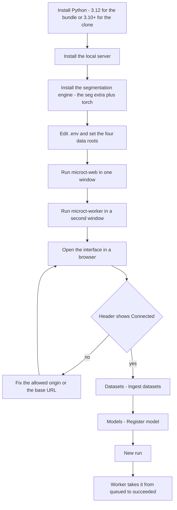

# Getting Started

microCT Lab keeps a catalogue of your microCT scans, runs nnU-Net segmentation
over them, and records exactly which model version produced every result. It
runs entirely on your own machine: a small server does the work and holds the
data, and the page you are reading this in is only an interface talking to it.
This guide takes you from an empty machine to a first segmentation run —
prerequisites, installing the server, installing the segmentation engine that
does the actual work, editing one configuration file, starting the server and its
worker, connecting the interface, then ingesting a scan, registering a model and
queueing a run. No Python, web or systems background is assumed; every command is
given in full, and the things that commonly trip people up are called out where
they happen.

---

## Table of contents

1. [The two halves: server and interface](#the-two-halves-server-and-interface)
2. [Before you start](#before-you-start)
3. [Install the local server](#install-the-local-server)
4. [Install the segmentation engine](#install-the-segmentation-engine)
5. [Configure the server](#configure-the-server)
6. [Start the server and the worker](#start-the-server-and-the-worker)
7. [Open the interface](#open-the-interface)
8. [Confirm you are connected](#confirm-you-are-connected)
9. [Ingest your first scan](#ingest-your-first-scan)
10. [Register a model](#register-a-model)
11. [Queue your first run](#queue-your-first-run)
12. [Before you trust a measurement](#before-you-trust-a-measurement)
13. [Quick reference](#quick-reference)
14. [Where to go next](#where-to-go-next)
15. [FAQ and troubleshooting](#faq-and-troubleshooting)

---

## The two halves: server and interface

It is worth ten seconds to understand the shape of the system, because almost
every setup problem is really a misunderstanding of this split.

- **The local server** — a Python program that runs on *your* PC. It reads your
  scan folders, runs segmentation and measurements, and keeps a small SQLite
  database called the **registry** that records every dataset, model, run, QC
  review and measurement. This is the half that owns your data and does the
  computation, and it is what you install below.
- **The interface** — the pages you click through: **Overview**, **Datasets**,
  **Models**, **Runs** and the rest. It is only HTML and JavaScript. It holds no
  data of its own. Once it has loaded, every request it makes goes to the server
  on your own machine.

Because of that split you have a choice about where the interface comes from.
You can open the hosted copy at `https://microctweb.vercel.app`, which is already
built and needs nothing installed, or you can have your own server serve the
interface at `http://127.0.0.1:8000`. Both are the same application and both talk
only to your machine.

**Your data never leaves the machine.** Even with the hosted page, the scans,
masks and the registry stay on local disk. The hosted address delivers the
interface once; after that, the large volumes travel over loopback to
`localhost`, not over the internet. Nothing is uploaded anywhere.

Here is the whole path from nothing installed to a finished run:



---

## Before you start

You need three things on the machine, and a fourth only if you take the Git route
in the next section.

1. **Python — and the version depends on which install route you take.** Get it
   from <https://www.python.org/downloads/>, 64-bit, and during installation tick
   **"Add python.exe to PATH"**. That box is easy to miss and nothing else works
   without it. Confirm afterwards by opening a terminal and running:

   ```
   python --version
   ```

   | Install route | Version you need |
   |---|---|
   | **Route A**, the portable bundle | **Python 3.12 specifically** |
   | **Route B**, clone the repository | Python **3.10 or newer** |

   Route A is pinned because its offline wheelhouse is prebuilt: 9 of its 32
   wheels — numpy, Pillow, pydantic-core, SQLAlchemy, greenlet, httptools,
   PyYAML, watchfiles and websockets — are compiled `cp312` binaries for 64-bit
   Windows and will not install on any other Python. On 3.10 or 3.11 the offline
   step fails and `install.bat` silently falls back to installing from PyPI,
   which needs the internet the bundle exists to avoid. Check the version
   **before** you run it, not after.

2. **A supported browser.** Chrome and Edge are verified working. Firefox is
   expected to work but has not been verified here. **Safari is likely to
   refuse** to let an HTTPS page reach your own machine, so on Safari use the
   locally served interface described in
   [Open the interface](#open-the-interface).

3. **Disk space, on a local disk.** Reconstructed scans run to hundreds of
   megabytes each — the two scans in the sample catalogue are 654 MB and 584 MB —
   and segmentation results sit alongside them. Working from a network share or a
   USB stick is possible but noticeably slower.

4. **Git, plus access to the repository** — only if you install from source. Git
   comes from <https://git-scm.com/downloads>. The repository is private, so your
   GitHub account has to be added as a collaborator first; without that the clone
   fails with an authentication error rather than a clear "no access" message.

An NVIDIA GPU is **not** required to install or explore microCT Lab. It is
required to run segmentation at a practical speed. The catalogue, the viewer and
everything you can read work fine on a CPU-only machine; segmentation on CPU
works but is slow, and measurements are CPU-only by design. See
[Queue your first run](#queue-your-first-run).

Do not read that as "a CPU machine needs nothing extra", though. The segmentation
engine is a separate install on **every** machine, GPU or not — it is
[its own step](#install-the-segmentation-engine) below, and it needs the
internet once.

---

## Install the local server

There are two routes. Take the first unless you have a reason not to.

### Route A: the portable bundle

Ask for the self-contained `localserver` folder. It needs no Git and no
repository access, and it installs the **application** with no internet at all,
because it carries every package the app itself needs as bundled wheels. It does
**not** carry the segmentation engine — see
[Install the segmentation engine](#install-the-segmentation-engine) — so plan on
being online once for that part.

1. Copy the whole `localserver` folder to the target machine. Put it on a local
   disk — running it from a USB stick works but is much slower.
2. Double-click **`install.bat`**.

That creates a `.venv` alongside the app, installs everything offline from the
bundled wheels, and writes an `app\.env` file already pointing at the `data`,
`results`, `models` and `state` folders sitting beside it. It also pre-allows the
hosted interface's origin, so there is nothing further to configure if you are
happy with those locations.

> Tip: the bundle is code plus a catalogue, not imaging data. Your scans, results
> and trained models are not inside it and have to be copied across separately.

### Route B: clone the repository

Use this if you want to track changes to the source, or if you were pointed at
the Git repository rather than the bundle.

1. Pick a folder and clone into it:

   ```
   mkdir C:\microct
   cd C:\microct
   git clone https://github.com/snehakorlakunta/microct-tools.git
   cd microct-tools
   ```

2. Create a virtual environment so the project's packages stay separate from the
   rest of your Python install:

   ```
   python -m venv .venv
   .venv\Scripts\activate
   ```

   Your prompt should now begin with `(.venv)`. On macOS or Linux the activation
   line is `source .venv/bin/activate`.

3. Install the package:

   ```
   pip install -e .
   ```

4. Make the four folders the server will use:

   ```
   mkdir data results models state
   ```

> Note: the `-e` in `pip install -e .` is required, not a preference. The
> application locates its own `scripts/` folder and its `.env` file relative to
> where the source lives. A normal install copies the code elsewhere and it can no
> longer find either.

Route B downloads roughly 100 MB and needs an internet connection.

---

## Install the segmentation engine

**Neither route above installs the thing that actually segments.** This step is
not optional and it is not only for GPU machines — skip it and your first run
will fail with `ModuleNotFoundError: nnunetv2`. It is worth understanding why the
split exists: nnU-Net and PyTorch are large and hardware-specific, so the app
ships without them and you add the build that suits your machine.

What the base install gives you on its own is real but narrower than it looks:
the interface, the catalogue, ingest, model registration, the viewer, QC review,
and everything already recorded in a registry. It cannot start a **new**
segmentation, and it cannot take a **new** BV/TV or digit-length measurement.

Everything below goes into the **same environment the server and worker run in**,
and all of it needs the internet. Start by activating it with
`.venv\Scripts\activate` — from the cloned folder under Route B, or from the
`localserver` folder under Route A. The only other difference is what you name:
Route B installs `.` because you are standing in the project, while Route A
installs `app` because the project is the `app` subfolder beside `install.bat`.

**Segmentation.** On a machine with an NVIDIA GPU, install a CUDA build of
PyTorch first so pip does not pull the CPU-only wheel:

```
pip install torch --index-url https://download.pytorch.org/whl/cu121
pip install -e ".[seg]"        (Route A: pip install -e "app[seg]")
```

On a CPU-only machine, skip the first line and run the second on its own. **You
still need it.** The `[seg]` extra — `nnunetv2`, `torch`, `natsort` — is what
performs the inference, on whatever device is available. "No GPU" means slow, not
"nothing further to install".

**BV/TV and digit length** (LeviDigit, the official measurement), only if you
intend to measure:

```
pip install -e ".[morph]"      (Route A: pip install -e "app[morph]")
```

That adds `nibabel`, `scipy`, `scikit-image` and `matplotlib`, which LeviDigit
needs, plus a few packages used by the older SK methods. You can add it later;
segmentation does not need it.

Then set the **bone threshold** to your lab's value in `.env`:

```ini
MICROCT_LEVIDIGIT_BONE_THRESHOLD=<your lab's grey value, 0 to 255>
```

BV counts mask voxels at or above this grey value. The shipped default, 60, is
only the example from LeviDigit's own instructions, not a validated lab value;
leaving it unset measures at 60.

> Note: install these into the environment the **worker** runs in. If
> `MICROCT_PYTHON_EXE` points at a different interpreter, that is the one that
> needs them — the server never imports either.

To confirm before you queue anything, in the same activated environment:

```
python -c "import nnunetv2, torch; print(torch.__version__, torch.cuda.is_available())"
```

An error here is the same failure your first run would hit, arriving twenty
minutes earlier. Deeper coverage — CUDA versions, splitting the work across
machines — is in the [Administrator Guide](/help/admin-guide).

---

## Configure the server

The server reads a single file called `.env` at startup. Under Route A it is at
`app\.env` and `install.bat` has already written it; under Route B you create it
by copying the example:

```
copy .env.example .env
```

Open it in any text editor. Four settings say where things live, and every one of
them is an absolute path:

- **`MICROCT_DATA_ROOT`** — where your scans are. One folder per scan, containing
  the reconstructed slices and the `*_rec.log` file the scanner wrote.
- **`MICROCT_RESULTS_ROOT`** — where run output goes: masks, previews and logs.
- **`MICROCT_MODELS_ROOT`** — where trained nnU-Net model folders live.
- **`MICROCT_STATE_DIR`** — where `registry.db` and the dataset thumbnails live.

A working example:

```ini
MICROCT_DATA_ROOT=C:\microct\microct-tools\data
MICROCT_RESULTS_ROOT=C:\microct\microct-tools\results
MICROCT_MODELS_ROOT=C:\microct\microct-tools\models
MICROCT_STATE_DIR=C:\microct\microct-tools\state

MICROCT_HOST=127.0.0.1
MICROCT_PORT=8000
MICROCT_DEFAULT_DEVICE=auto
```

These do not have to sit inside the install. If your scans already live on
another drive or a share, point `MICROCT_DATA_ROOT` there rather than copying
hundreds of gigabytes around.

### Letting the hosted page connect

If you intend to use `https://microctweb.vercel.app` rather than the interface
served by your own machine, find this line near the bottom of `.env` and
uncomment it by deleting the leading `#`:

```ini
MICROCT_ALLOWED_ORIGINS=https://microctweb.vercel.app
```

That single line is what permits the hosted page to talk to your server; the
browser blocks it otherwise. The check is exact, so use the plain
`microctweb.vercel.app` address — a per-deployment address like
`microctweb-a1b2c3.vercel.app` will not match, and those change on every deploy.

Leave `MICROCT_API_TOKEN` commented out. **No token is needed by default.** If
you later want one — on a shared machine, say — setting it makes every caller
supply it except a page whose `Origin` is `localhost` or `127.0.0.1`, and a
caller that sends no `Origin` from a loopback address. That is an administrator
topic; see the [Administrator Guide](/help/admin-guide).

> Note: the server reads `.env` only at startup. After any edit, stop it with
> `Ctrl+C` and start it again.

---

## Start the server and the worker

You need **two** windows, both left open, and this is the step people skip.

### Start the server

Under Route A, double-click **`start-server.bat`**. Under Route B, in an
activated terminal:

```
.venv\Scripts\activate
microct-web
```

It prints where it is listening and who may reach it:

```
microCT Segmentation Lab  ->  http://127.0.0.1:8000

  A remotely-hosted UI may connect to this server:
    https://microctweb.vercel.app

    No token required — open the page and it connects.
```

If you did not uncomment `MICROCT_ALLOWED_ORIGINS`, the "remotely-hosted UI"
block is absent — which is your confirmation that the hosted page will not be
able to connect yet.

### Start the worker

Open a **second** window. Under Route A, double-click **`start-worker.bat`**.
Under Route B:

```
cd C:\microct\microct-tools
.venv\Scripts\activate
microct-worker
```

The server accepts jobs; the **worker** is what actually executes them. There are
two kinds, and they are deliberately separate so slow GPU work cannot block quick
CPU work:

- **`microct-worker`** — takes both kinds by default. Pass `--kind segmentation`
  to restrict it to segmentation, which is the GPU half.
- **`microct-measure-worker`** — measurements only (BV/TV, digit length), CPU-only. Run it in a third
  window if you plan to take measurements, so measurement jobs do not queue
  behind segmentation.

> Safety note: with no worker running, anything you queue sits at status
> **queued** forever. This is the single most common "it's broken" report and it
> is not broken — it is a missing second window.

To stop either process, click its window and press `Ctrl+C`.

---

## Open the interface

You have two equivalent ways in. Pick either.

**The hosted page.** Go to <https://microctweb.vercel.app>. Nothing to install,
nothing to build. This requires the `MICROCT_ALLOWED_ORIGINS` line from
[Configure the server](#configure-the-server). If Chrome asks for permission to
access devices on your local network, allow it — that prompt is the browser
confirming the page may talk to your own machine.

**Served by your own machine.** Go to <http://127.0.0.1:8000> instead. The server
ships with a working built-in interface, so this needs no extra setup and no
`MICROCT_ALLOWED_ORIGINS` at all. Because the page and the server share an
address, none of the browser's cross-origin rules apply.

Use the local route if you are on **Safari**, if the machine has no internet, or
if you would rather not depend on a hosted site at all.

### Serving this newer interface locally

The built-in interface at `http://127.0.0.1:8000` is the older one. To serve
*this* interface — the one these help pages describe — from your own machine, you
need the frontend repository (also private), Node.js 20 or newer, and a build:

```
git clone https://github.com/snehakorlakunta/microctweb.git
cd microctweb
npm install
npm run build
```

Then add the path to the build output to the server's `.env` and restart it:

```ini
MICROCT_WEB_DIR=C:\microct\microctweb\out
```

`http://127.0.0.1:8000` now serves this interface directly from your machine. If
the configured path does not exist the server quietly falls back to the built-in
interface, so a stale value cannot take the UI down.

---

## Confirm you are connected

At the right of the header on every page sits the **Connection** indicator: a
coloured dot and a word. It is the first thing to read when something looks
wrong.

| Indicator | Dot | What it means |
|---|---|---|
| **Checking…** | grey, pulsing | Still probing the server. |
| **Connected** | green | The server answered. You are done. |
| **Token needed** | amber | The server answered but rejected the request — a token is set and yours is missing or wrong. |
| **Disconnected** | red | Nothing answered at the address shown. |

A green **Connected** is the whole of the setup check. There is no login and
nothing to paste.

Click the indicator to open the **Local server connection** panel. It has two
fields:

- **API base URL** — where the server is listening. Defaults to
  `http://localhost:8000`. Change it if you set a different `MICROCT_PORT`, or if
  the server is on another machine on your network.
- **Access token** — leave it empty unless your server sets `MICROCT_API_TOKEN`.
  The panel labels the field as required or optional based on what the server
  itself reports, so you do not have to guess.

Use **Save & reconnect** to apply, **Reset** to go back to the default address
and no token. Both values live in this browser only, under the localStorage keys
`microct_api_base` and `microct_api_token`. They are never part of the deployed
build, which is why the same hosted page works against anyone's machine.

If you get **Disconnected** instead, the app replaces the page body with a
three-step panel naming the three things that are ever wrong: the server is not
running, it was started without allowing this page's origin, or the base URL is
wrong. The quickest test is to open `http://127.0.0.1:8000/api/health` directly in
a tab. If that returns JSON, the server is fine and the problem is the
allowed-origin setting.

> Tip: try `127.0.0.1` in place of `localhost` in the base URL. Some machines
> resolve the two differently, and that alone can be the difference between
> **Disconnected** and **Connected**.

---

## Ingest your first scan

**Ingesting** means reading a folder of scans and creating catalogue records for
them. It does not copy, move or modify anything; your files stay where they are
and the registry stores the path.

1. Put a scan into your `MICROCT_DATA_ROOT` folder — the whole folder of
   reconstructed slices plus its `*_rec.log`.
2. Open the **Datasets** page (route: `/datasets`).
3. Click **⟳ Ingest datasets** in the header.

The server walks the data root recursively looking for `*_rec.log` files. For
every one it finds, it reads the sibling slices and pulls the scan's metadata out
of the log: voxel size, width, height, bit depth, source voltage and current,
filter, scanner and scan date. It counts the slices, sums their size, and makes a
thumbnail from the middle slice. A toast reports the result, in the form
`Ingest: +2 new, 0 updated`.

Slices may be `.bmp`, `.tif` or `.tiff`, and must have `rec` in the filename;
files with `_spr` or `_pp` in the name are ignored. A folder that has a
`*_rec.log` but no usable slices is skipped and counted separately.

Re-running ingest is safe and is how you refresh the catalogue. Datasets are
matched on their folder path, so an existing record is updated rather than
duplicated.

Each ingested scan appears as a card showing its study, voxel size, dimensions,
scanner and scan date, with a run count once it has runs. From a card you can
click **◉ Visualize** to open the raw scan, or **▶ Run** to start a segmentation
with that dataset preselected. The **🌳 Tree** button in the toolbar swaps the
grid for a type-and-organism tree.

For reference, the sample catalogue holds two datasets, `R2` and `R4`: SkyScan
1272 scans at 4.000059 µm, 1128 and 1200 pixels square, 459 and 454 slices, both
from the study `BDNF-R-T3_rec`.

> Note: the catalogue stores **absolute paths**. If you move your scans, or
> restore someone else's registry backup onto a machine with different folders,
> the records point at paths that no longer exist. Retargeting them is covered in
> the [Administrator Guide](/help/admin-guide).

---

## Register a model

A **model** is a trained nnU-Net folder. Registering one records where it is and
reads its metadata so that every run can be attributed to an exact model version
forever.

1. Open the **Models** page (route: `/models`).
2. Click **＋ Register model**.
3. Paste the **Model folder path** — the folder that *directly* contains
   `plans.json`, `dataset.json` and `fold_0` … `fold_4`. The placeholder shows
   your configured models root as a hint.
4. Optionally set a **Name**, **Family** and **Version**. All three are optional
   and are filled in for you if left blank.
5. Click **Register**.

The alternative is **Scan models root**, the other button in the same dialog. It
walks `MICROCT_MODELS_ROOT` and registers everything it recognises, reporting how
many were registered and how many skipped. Use it when you have several models
already in place.

Registration reads the folder and stores the configuration, the label map, the
input channels, the training spacing, the cross-validation Dice, the number of
training cases, and a **fingerprint** of the weights. The registered model in the
sample catalogue, `Dataset501_Glioblastoma v1`, is a `3d_fullres` configuration
with labels `background` and `ROI`, trained on 55 cases at 0.004 mm spacing, with
a cross-validation Dice of 0.968.

**Family and version.** A family groups successive versions of the same model. If
you leave **Version** blank, the next version in that family is assigned
automatically — `v1`, then `v2`, and so on. On a model card, **＋ Version**
reopens the dialog with the family pre-filled, which is the intended way to add a
retrained model without breaking the link to its predecessors.

**Registering the same weights twice does nothing.** The fingerprint is checked
first, and an identical folder returns the model that already exists rather than
creating a duplicate. This is deliberate — it keeps the run history honest — but
it does mean that if you expected a new `v2` and got no new card, the weights
were byte-identical to something already registered.

**✎ Rename** changes only the display name and description. It does not touch the
folder on disk, and it does not affect which model a past run was attributed to.

---

## Queue your first run

A **run** is one model applied to one dataset. You can queue several at once —
one run is created per dataset.

1. Click **＋ New run** at the bottom of the sidebar. (The **▶ Run** button on a
   dataset card and **Run…** on a model card open the same dialog with that
   choice already made.)
2. In **New segmentation run**, pick the **Model & version**. The dropdown shows
   each model's family, version and Dice.
3. Tick one or more **Datasets**. The heading counts your selection.
4. Review the settings, or leave them alone:
   - **Folds** — `0` is a single fold and is the fast default; `0 1 2 3 4`
     ensembles all five and is slower but usually a little better.
   - **Device** — `auto`, or an explicit choice. The dropdown is built from what
     the server actually detected, and shows what `auto` will resolve to.
   - **Step (overlap)** — the sliding-window step, `0.5` by default. Smaller means
     more overlap and a slower, slightly smoother result.
   - **Test-time augmentation** — off by default. Improves results somewhat at a
     substantial cost in time.
5. Click **Queue run(s)**. You are taken to the **Runs** page (route: `/runs`).

The **Compute available** block in the dialog tells you what you are about to run
on: the machine name, CPU and thread count, RAM, any GPUs detected, and what
`auto` will pick. If it says `none detected` and `auto → cpu`, segmentation will
work but will be slow — the sample run in the reference catalogue took 6,582
seconds, close to two hours, on CPU for a 459 × 1128 × 1128 volume.

A run moves through these statuses:

| Status | Meaning |
|---|---|
| **queued** | Created, waiting for a worker to claim it. |
| **running** | A worker is executing it now. |
| **succeeded** | Finished; a mask and an ROI volume exist. |
| **canceling** | You pressed stop and the worker is winding it down. |
| **canceled** | Stopped before it finished. |
| **failed** | It stopped with an error, which the run report shows. |

If the status stays at **queued** and never moves, the worker is not running. Go
back to [Start the server and the worker](#start-the-server-and-the-worker).

Every run permanently stores a snapshot of the model it used — id, name, version,
fingerprint, path, configuration and Dice — plus the parameters and the machine it
ran on. Renaming or re-registering a model later cannot rewrite what a past run
says it used.

> Safety note: **runs are never deleted, only archived.** The stop button (**■**)
> appears on active runs and the archive button (**🗄**) on finished ones. Datasets
> that have runs are archived rather than deleted too, so a run can never end up
> pointing at nothing.

---

## Before you trust a measurement

Once a run has **succeeded**, its report shows a **BV/TV & digit length** panel
(marked **LeviDigit · official**). Check the bone threshold and click
**📏 Measure BV/TV + digit length** to queue a separate CPU job over the mask.
Only succeeded runs can be measured, because LeviDigit needs a finished mask.

Read this before you use any number it produces.

- **The threshold decides BV/TV.** BV is every mask voxel at or above the bone
  threshold, so the same mask gives a different BV/TV at a different threshold.
  Make sure the server default is your lab's value (see
  [Install the segmentation engine](#install-the-segmentation-engine)), or type
  it in the panel. Each measurement records the threshold it used.
- **The mask decides everything.** BV/TV is computed inside the segmentation,
  and digit length follows its outline. A mask that includes an artifact or
  misses bone gives a confident, wrong number. Review the mask first.
- **Digit length is for digits.** It is measured only on datasets whose
  subtype is `digit`; others get BV/TV only. When LeviDigit cannot find a
  defensible concavity, it reports **no digit length**, never a length of zero.
- **4 µm only.** LeviDigit refuses scans that are not 4 µm isotropic rather
  than produce a number.

> Safety note: a human has to confirm the segmentation is the right structure
> before any number leaves the app.

What each number means, and the export, are covered in the
[BV/TV & Digit Length Guide](/help/levidigit-guide).

---

## Quick reference

Commands, assuming an activated virtual environment (or the `.bat` shortcut in
the portable bundle):

| Command | What it does |
|---|---|
| `microct-web` | Start the server and its built-in interface. |
| `microct-worker` | Execute queued jobs — both kinds by default. |
| `microct-worker --kind segmentation` | Segmentation jobs only. The GPU half. |
| `microct-measure-worker` | Measurement jobs (BV/TV, digit length) only. CPU-only. |
| `microct-ingest` | Ingest the data root from the command line. |
| `microct-register-model <path>` | Register a trained model folder. |
| `microct-token` | Print the access token, if one is set. |
| `pip install -e ".[seg]"` | Install the segmentation engine. Required before any run. |
| `pip install -e ".[morph]"` | Install the measurement stack (LeviDigit). Required before any measurement. |
| `python scripts/backup_registry.py --out bundle.zip --with-thumbnails` | Back up the registry safely, with the server running. |

Configuration keys in `.env`:

| Key | Purpose |
|---|---|
| `MICROCT_DATA_ROOT` | Where your scan folders live. |
| `MICROCT_RESULTS_ROOT` | Where run output is written. |
| `MICROCT_MODELS_ROOT` | Where trained model folders live. |
| `MICROCT_STATE_DIR` | Holds `registry.db` and thumbnails. |
| `MICROCT_HOST` | Listen address; `127.0.0.1` by default. |
| `MICROCT_PORT` | Listen port; `8000` by default. |
| `MICROCT_DEFAULT_DEVICE` | What `auto` starts from; `auto` by default. |
| `MICROCT_ALLOWED_ORIGINS` | Origins allowed to reach the API from a browser. |
| `MICROCT_API_TOKEN` | Optional shared secret for remote callers. |
| `MICROCT_WEB_DIR` | Serve a different interface build from `/`. |
| `MICROCT_LEVIDIGIT_BONE_THRESHOLD` | Default BV/TV bone threshold, grey 0 to 255. **Set to your lab's value**; unset means 60. |

Useful URLs while troubleshooting:

| URL | Shows |
|---|---|
| `http://127.0.0.1:8000/api/health` | Whether the server is alive and whether auth is on. |
| `http://127.0.0.1:8000/api/config` | The four roots the server is actually using. |
| `http://127.0.0.1:8000/api/system/compute` | CPU, RAM, GPUs and the device `auto` will pick. |

---

## Where to go next

- **[User Guide](/help/user-guide)** — day-to-day use: the **Datasets**, **Runs**,
  **Projects**, **Timeline** and **QC & Insights** pages, filtering, reviewing a
  run, and the failure-mode vocabulary.
- **[Viewer Guide](/help/viewer-guide)** — the 3D viewer, slice navigation, mask
  overlay, and comparing runs side by side at `/compare`.
- **[BV/TV & Digit Length Guide](/help/levidigit-guide)** — LeviDigit BV/TV and
  digit length: what each metric means, starting a measurement, and exporting.
- **[Administrator Guide](/help/admin-guide)** — backups and restores, moving a
  catalogue between machines, tokens, and letting colleagues on your network reach
  the server.
- **[Architecture & Data Model](/help/architecture)** — how the pieces fit
  together, the database schema, and the API reference.
- **[Support & Troubleshooting](/help/support)** — a fuller catalogue of error
  messages and fixes than the section below.

---

## FAQ and troubleshooting

**Everything I queue just sits at "queued" and nothing happens.**
The worker is not running. The server accepts jobs but never executes them; a
separate `microct-worker` process does that, in its own window. Start it and the
queued job is picked up within a couple of seconds. This is by far the most common
report, and nothing is actually broken.

**"Python was not found" when I run anything.**
PATH was not set during the Python install. Re-run the Python installer, choose
**Modify**, and tick "Add python.exe to PATH". Then close and reopen your terminal
so it picks up the change.

**`git clone` asks for a password and then fails.**
The repository is private and your GitHub account has not been added to it yet.
Ask to be added as a collaborator. If you would rather avoid this entirely, ask
for the portable `localserver` bundle instead — it needs no Git and no repository
access.

**The header says Disconnected but the server window is clearly running.**
Open `http://127.0.0.1:8000/api/health` in a tab. If that shows JSON, the server
is fine and the problem is the allowed origin: the hosted page's address has to
appear in `MICROCT_ALLOWED_ORIGINS`, exactly, with no trailing slash, and the
server has to be restarted afterwards. If `/api/health` shows nothing either, the
server is not listening where you think — check `MICROCT_PORT` and the base URL in
the **Connection** panel.

**I am using a Vercel preview URL and it will not connect.**
The origin check is an exact string match. A per-deployment address like
`microctweb-a1b2c3.vercel.app` is a different origin from `microctweb.vercel.app`,
and those hashes change on every deploy. Use the plain address.

**Nothing works in Safari.**
Expected. Safari will not let a hosted HTTPS page reach your own machine. Use
`http://127.0.0.1:8000` — the interface served by your own server — or switch to
Chrome or Edge, which are the verified combinations.

**The header says "Token needed" but I never set a token.**
That state means the server answered and then rejected the request. Either a
`MICROCT_API_TOKEN` is set in the `.env` you are using and you have not pasted it
into the **Connection** panel, or a stale token is saved in this browser. Open the
panel and click **Reset**, which clears both the token and the base URL back to
defaults.

**The interface loads but everything is empty.**
That is correct for a fresh install — you have no scans catalogued yet. Go to
**Datasets** and click **⟳ Ingest datasets**. If it still finds nothing, see the
next question.

**Ingest reports 0 new and 0 updated.**
Ingest looks for `*_rec.log` files anywhere under `MICROCT_DATA_ROOT`. A folder
with no `*_rec.log` is invisible to it. A folder with a log but no matching slices
is found and then skipped — slices must be `.bmp`, `.tif` or `.tiff` with `rec` in
the name, and files containing `_spr` or `_pp` are excluded. Check what root the
server is actually using at `/api/config`; it may not be the folder you think.

**I registered a new model version and no new card appeared.**
Registration fingerprints the weights and returns the existing model when they
match. If nothing new showed up, the folder you pointed at is identical to one
already registered. Point at the genuinely new training output, or use
**＋ Version** on the existing card so the new one lands in the same family.

**The Device dropdown only offers `auto` and `cpu`.**
No CUDA GPU was detected, or the installed PyTorch is a CPU-only build. The
dropdown is built from what the server actually found, so it is telling you the
truth about the machine. Segmentation will still run — just slowly — provided you
did [Install the segmentation engine](#install-the-segmentation-engine), which is
required on a CPU machine too. Swapping a CPU-only torch for a CUDA build is
covered in the [Administrator Guide](/help/admin-guide).

**My first run failed with `ModuleNotFoundError: nnunetv2` or `torch`.**
The segmentation engine is not installed in the environment your worker is
running in. Neither install route puts it there; it is a deliberate separate
step. Run `pip install -e ".[seg]"` — see
[Install the segmentation engine](#install-the-segmentation-engine) — then queue
the run again. The same failure with `nibabel`, `scipy` or `sklearn` in the
message is the measurement extra instead: `pip install -e ".[morph]"`.

**Do I need an internet connection to use this?**
Not to *use* it — the server and worker never call out, and serving the interface
from `http://127.0.0.1:8000` removes the last dependency on a hosted page. You do
need it while installing, though, in more cases than the bundle's offline promise
suggests: the Git route downloads everything, and **both** routes need the
internet for the segmentation engine and the measurement extra, because neither
is in the bundled wheelhouse. On a genuinely air-gapped machine you can browse a
catalogue and view results that already exist, but you cannot start new jobs
until someone brings those packages across.

**Can I just copy `registry.db` to move my catalogue to another machine?**
No, and this fails silently. The registry runs SQLite in write-ahead-logging mode,
so recent commits can still be sitting in a `registry.db-wal` file beside it.
Copying the one file gives you a database that opens fine and looks healthy while
missing your newest records — on one occasion that gap was an entire table. Use
`scripts/backup_registry.py`, which uses SQLite's online backup API and folds the
WAL in. Retargeting the absolute paths for a different machine is covered in the
[Administrator Guide](/help/admin-guide).

**Can a colleague reach my server?**
Yes, on the same network: set `MICROCT_HOST=0.0.0.0` in `.env` and restart, and
they open `http://<your-machine-ip>:8000`. Anyone who can reach it can drive it,
so on a shared network set `MICROCT_API_TOKEN` as well. See the
[Administrator Guide](/help/admin-guide).

**My BV/TV is different from the number I had before.**
BV/TV now comes from LeviDigit with a fixed grey threshold. The older interim
method used 800 HU converted per scan (about grey 77 to 80), so the two differ
on the same mask by design. Check which threshold the measurement used (shown on
the result), and see
[Before you trust a measurement](#before-you-trust-a-measurement).

**A measurement job is stuck at queued while a segmentation runs.**
Segmentation and measurement are separate job kinds so exactly this can be
avoided. Run `microct-measure-worker` in its own window; it takes CPU measurement
jobs only and will not wait behind GPU work.

**I changed `.env` and nothing changed.**
The server reads `.env` once, at startup. Stop it with `Ctrl+C` and start it
again. The worker reads the same file and also needs restarting.
