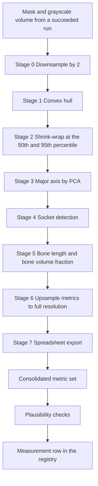

# Morphometry Guide

> **This guide describes the older in-app method, tagged SK, which the site no
> longer shows.** BV/TV and digit length now come from LeviDigit, the official
> method. See the [BV/TV & Digit Length Guide](/help/levidigit-guide). SK
> measurements are kept on the server and readable through the API.

Morphometry is the second half of microCT Lab: segmentation decides which voxels
are bone, and morphometry turns those voxels into numbers — how big the basal
socket is, how long the bone is, how much of the specimen is mineralised. It runs
as its own job against a finished run's mask. This guide covers what the
measurement reports, how to start one, what every metric means in both voxels and
millimetres, how to read the results panel, how to export the spreadsheet — and,
at length, how to read the quality warnings, which matter more here than anywhere
else in the app. No image-analysis background is assumed.

---

## Table of contents

1. [What morphometry measures](#what-morphometry-measures)
2. [The basal socket, in plain terms](#the-basal-socket-in-plain-terms)
3. [Before you measure: the CPU worker](#before-you-measure-the-cpu-worker)
4. [The anatomy gate](#the-anatomy-gate)
5. [Starting a measurement from a run](#starting-a-measurement-from-a-run)
6. [What the pipeline does](#what-the-pipeline-does)
7. [Every metric it reports](#every-metric-it-reports)
8. [Reading the results panel](#reading-the-results-panel)
9. [Why the quality warnings exist](#why-the-quality-warnings-exist)
10. [The warning codes](#the-warning-codes)
11. [High severity vs medium severity](#high-severity-vs-medium-severity)
12. [When no socket is detected](#when-no-socket-is-detected)
13. [Voxels, millimetres and spacing](#voxels-millimetres-and-spacing)
14. [Exporting the spreadsheet](#exporting-the-spreadsheet)
15. [Stopping a measurement](#stopping-a-measurement)
16. [What is not built yet](#what-is-not-built-yet)
17. [Quick reference](#quick-reference)
18. [FAQ and troubleshooting](#faq-and-troubleshooting)

---

## What morphometry measures

A segmentation **run** produces a mask — a volume in which each voxel is either
part of the specimen or not. That mask answers "where is the bone". It does not
answer "how big is it", and counting voxels by hand is not a measurement anybody
wants to defend in a figure.

A **measurement** is a separate job that takes a succeeded run's mask and its
grayscale volume and runs a vendored analysis pipeline called `digitpipe_v5` over
them. What comes back is a flat set of metrics — socket volume, socket radius,
phalanx volume, bone length, the straight-line distance from the socket to the far
end of the bone, bone-volume fraction, convex-hull and shrink-wrap volumes, the
specimen's major axis — each in the pipeline's native **voxels** and in
**millimetres**.

Three things are worth fixing in your head before anything else:

- **A measurement is a job, not a property of the run.** It has its own row, its
  own **queued** → **running** → **succeeded** lifecycle, its own log, its own
  output folder, and its own record of which machine ran it.
- **It runs on the CPU.** Segmentation wants a GPU; morphometry does not use one
  at all. That is why it can be worked by a separate worker process on a different
  machine. See [Before you measure](#before-you-measure-the-cpu-worker).
- **The pipeline is built for one anatomy.** It expects a mouse terminal phalanx
  scanned at roughly 4 µm. Point it at anything else and it will still give you a
  complete, confident, entirely ordinary-looking set of numbers that mean nothing.
  This is the single most important fact in this guide and it has its own section:
  [Why the quality warnings exist](#why-the-quality-warnings-exist).

> Note: morphometry is optional. Nothing else in microCT Lab depends on it — you
> can catalogue scans, run segmentations and review them without ever measuring
> anything.

---

## The basal socket, in plain terms

The terminal phalanx is the last bone in a digit — the one under the claw or nail.
At its **proximal** end (the end nearer the body) it does not come to a flat face;
it is hollowed into a cup where it meets the bone before it. That cup is the
**basal socket**. Its size is the quantity the original pipeline was written to
measure.

The pipeline does not recognise a socket anatomically. It finds it geometrically,
in four steps:

1. **Shrink-wrap the mask.** A tight surface is fitted around the segmented bone,
   which removes surface noise without swallowing real shape.
2. **Take the 3D convex hull of that.** The convex hull is the smallest convex
   solid containing the bone — imagine cling film pulled taut over it, bridging
   straight across every hollow.
3. **Subtract.** Whatever is inside the hull but outside the bone is, by
   definition, a concavity. Those voxels are eroded and then dilated to drop thin
   surface film and keep solid pockets.
4. **Keep the largest remaining blob.** That blob is reported as the socket.

This is the whole of the logic, and it is why the checks in this guide exist. Step
4 does not ask whether the blob it kept is *anatomically* a socket. On a terminal
phalanx the deepest concavity is the basal socket; on a tumour, an implant, a
fractured bone or a badly segmented volume, the deepest concavity is whatever
happens to be deepest.

Two derived quantities follow from the socket:

- **Socket radius** — the radius of a sphere with the same volume as the socket
  blob, computed as `(3V / 4pi)^(1/3)`. It is a size summary, not a measured
  distance across the cup.
- **Bone length** — a line is drawn from the socket's centre of mass to the bone
  voxel furthest from it. The line is split at the first bone voxel it enters. The
  part *inside* the bone is the bone length; the part *outside* is reported
  separately.

> Note: because bone length starts from the socket centroid, everything the socket
> touches is downstream of the socket being correct. If the socket is wrong, the
> bone length is wrong too, even though nothing about the length itself looks odd.

---

## Before you measure: the CPU worker

Queuing a measurement only writes a row saying "this should be measured". Something
has to pick it up. That something is a **worker**, and microCT Lab has two kinds:

- **`microct-worker`** — with no arguments, runs both job kinds. With
  `--kind segmentation`, runs only segmentation jobs. Segmentation wants a GPU.
- **`microct-measure-worker`** — runs only measurement jobs; identical to
  `microct-worker --kind measurement`. CPU only.

If no worker capable of measurements is running, a queued measurement stays at
**queued** forever. It will not time out, error, or warn you. This is the most
common support question in the whole product, and it looks exactly the same for
segmentation runs.

Running a separate `microct-measure-worker` is worth it as soon as you do both
kinds of work: a ten-minute morphometry job would otherwise sit behind hours of GPU
segmentation, because a worker takes one job at a time.

The morphometry pipeline also needs a scientific Python stack that the base install
does not include. The `[morph]` extra is **seven** packages — `nibabel`, `scipy`,
`scikit-image`, `scikit-learn`, `trimesh`, `pandas` and `openpyxl` — installed
with `pip install -e ".[morph]"`. (`trimesh` is not imported by any vendored file
today; it is carried for the mesh work the pipeline is heading toward, and it
installs whether you want it or not.) None of these are in the bundled offline
wheelhouse, so on a machine that has never had internet, enqueuing a measurement
will fail until they are installed. Installing packages and running workers is
the administrator's job; see the [Administrator Guide](/help/admin-guide) for the
commands.

> Tip: the panel tells you which case you are in. **Queued — waiting for a
> measurement worker** means the job is fine and nothing is listening. Status
> **failed** with an import error in the log means the `[morph]` packages are
> missing.

---

## The anatomy gate

Before any of the above can happen, the dataset has to be **marked as the right
anatomy**. This is a deliberate roadblock, and it is worth understanding why it
exists rather than working around it.

Everything in this guide assumes a mouse terminal phalanx. Point the pipeline at
a femur, a tumour, a whole paw, or anything else and it does not refuse and does
not crash. It runs all eight stages, exits cleanly, and reports a socket volume,
a socket radius and a bone length — numbers that look entirely ordinary and mean
nothing at all. Warnings after the fact are useful, but they arrive once the
result already exists and can be copied into a spreadsheet.

So the server checks first. A run can only be measured if its dataset carries one
of the configured anatomy **tags** — `phalanx` by default.

### What you see when it blocks

The **Morphometry** panel shows an amber notice instead of the measure button:

> **Blocked — R2 is not marked as the expected anatomy**
> This pipeline is built for a mouse terminal phalanx. On other anatomy it does
> not fail — it returns plausible-looking numbers that mean nothing, so the
> server refuses rather than letting a wrong result into your records.

It names the tag that would unblock it, read from the server rather than assumed,
so if your administrator has configured a different tag the panel says that one.

### Unblocking a dataset

1. Open the **Datasets** page (route: `/datasets`) and click the dataset.
2. In the **Catalogue** section, add `phalanx` to **Tags** — the tag chips
   already used elsewhere are offered as one-click suggestions.
3. **Save changes**, then return to the run. The measure button is now live.

> Safety note: tagging a dataset `phalanx` is a claim about the specimen, not a
> way to dismiss a dialog. If it is not a terminal phalanx, the numbers you get
> after tagging it will be exactly as meaningless as the gate was trying to
> prevent — the gate simply stops being in the way. Tag what things actually are.

### Turning the gate off

An administrator can lift it for a server where it does not apply:

| Setting | Default | Effect |
|---|---|---|
| `MICROCT_MORPH_REQUIRE_ANATOMY` | `true` | Set `false` to allow measuring any succeeded run |
| `MICROCT_MORPH_ANATOMY_TAGS` | `phalanx` | Comma-separated list of tags that satisfy the gate |

Both appear in `GET /api/config`, which is how the panel knows what to tell you.
Turning the check off does not turn the warnings off — see
[Why the quality warnings exist](#why-the-quality-warnings-exist). The gate stops
the obvious mistake; the warnings still catch a mis-tagged or genuinely unusual
specimen.

---

## Starting a measurement from a run

Morphometry is started from a run, and only from a run. There is no **Measure**
button on the **Datasets** page and no measurements entry in the left nav.

### Queue the job

1. Open the **Runs** page (route: `/runs`) and click the run you want. The detail
   page is `/runs?id=<n>`.
2. Scroll the right-hand column to the **Morphometry** panel. It is only present
   when the run's status is **succeeded** — a mask that does not exist cannot be
   measured, so the panel is not rendered at all on a **failed**, **canceled**,
   **queued** or **running** run.
3. If nothing has been measured yet, the panel explains what morphometry does and
   offers one button: **📏 Measure morphometry**.
4. Optionally tick **Skip visualisation stages (faster)** — see the caveat below.
5. Click **📏 Measure morphometry**. A toast confirms `Queued measurement #<id>`
   and the panel switches to its in-flight state.

The server refuses the request outright if the run is not **succeeded**, if its
mask file is missing from disk, or if its grayscale input volume is missing. It
does this before queuing rather than letting the worker discover it ten minutes
later.

### About the "skip visualisation" checkbox

The checkbox is honest about its intent and currently has no effect. It passes
`--skip-viz` through to the vendored pipeline, and this version of `digitpipe_v5`
accepts that flag and never reads it — it has no visualisation stage to skip.
Leaving it ticked or unticked will not change how long a measurement takes. It is
documented here rather than quietly omitted because the option is visible in the
interface and you would otherwise wonder why it made no difference.

### Measuring the same run again

Clicking **📏 Measure morphometry** again after a result exists is not offered by
the panel — once a measurement exists, the panel shows that measurement. A second
measurement of the same run is possible through the API, and the panel would then
show only the newest one; the earlier measurement stays in the registry but the
run page has no way to reach it.

> Tip: expect roughly ten minutes per measurement on a normal desktop. The two
> succeeded measurements in the demo registry took about 600 seconds each on a
> 16-core machine, essentially all of it inside the pipeline itself. (There are
> three measurement rows against run 1 — ids 1, 2 and 3 — but id 3 was canceled
> and archived, which is where the archived-measurement behaviour described in
> [Stopping a measurement](#stopping-a-measurement) comes from.)

---

## What the pipeline does

The vendored pipeline runs eight stages in order. Stages 0 to 5 work on a volume
**downsampled by a factor of 2** for speed; stage 6 scales the results back up.
Everything microCT Lab reports is in full-resolution voxels.

What each stage contributes:

- **Downsample** — halves the grid in each direction and records the original and
  downsampled shapes.
- **Convex hull** — the smallest convex solid enclosing the mask, plus how far it
  had to expand to get there.
- **Shrink-wrap** — a tight surface at two tightness settings, the 50th and 95th
  percentile. The 95th-percentile result is what the app reports as **phalanx
  volume**; the 50th-percentile result is kept as a cross-check.
- **Major axis** — principal component analysis over the mask's voxel
  coordinates, giving the proximal-distal direction, its length, and how much of
  the specimen's variance that one direction explains.
- **Socket detection** — hull minus shrink-wrapped mask, eroded, dilated, largest
  component kept. Records the socket volume, its centroid, its equivalent radius,
  and how many separate components the concavity broke into.
- **Bone length** — the line from socket centroid to furthest bone voxel, split at
  the first bone voxel, plus bone volume and bone-volume fraction. This stage also
  writes the 7-class annotated label volume.
- **Upsample** — rescales the bone-length metrics from the downsampled grid to full
  resolution.
- **Spreadsheet export** — writes `output.xlsx`.

After the pipeline exits, microCT Lab does three things of its own: it consolidates
every stage's output into one flat metric set, recomputes every millimetre value
from the run's actual voxel spacing, and runs the plausibility checks.

> Safety note: the vendored pipeline catches every per-stage exception, prints
> `[FAIL]`, and still exits with code 0 — its exit code proves nothing. microCT Lab
> therefore reads the stage output line by line and fails the measurement if any
> stage reported a failure, rather than recording a result with a silent hole in
> it. A partially measured specimen would quietly drag down every cohort average
> that included it.

---

## Every metric it reports

Five metrics are promoted to headline tiles and to their own database columns, in
both units. These are also the five aggregated by the statistics endpoint.

| Metric | Voxel key | Millimetre key | What it is |
|---|---|---|---|
| **Socket volume** | `socket_volume_voxels` | `socket_volume_mm3` | Volume of the largest concavity found between the shrink-wrapped bone and its convex hull |
| **Socket radius** | `socket_radius_voxels` | `socket_radius_mm` | Radius of a sphere with the same volume as the socket |
| **Phalanx volume** | `phalanx_volume_voxels` | `phalanx_volume_mm3` | Volume of the 95th-percentile shrink-wrapped mask — the bone as a solid body |
| **Bone length** | `bone_length_voxels` | `bone_length_mm` | Length of the measurement line lying inside bone |
| **Euclidean distance** | `euclidean_distance_voxels` | `euclidean_distance_mm` | Straight-line distance from the socket centroid to the furthest bone voxel |

Everything else lives in the full metric set behind **Show all metrics**. The
groups you are most likely to want:

- **The measurement line** — `line_outside_bone_voxels` and `_mm` for the part of
  the line before it enters bone, and the three voxel coordinates it was built
  from: `line_socket_com`, `line_furthest_point`, `line_first_intersection`.
  `line_inside_bone_*` is emitted too and is identical to bone length by
  definition; both names exist because the two readings are asked for separately.
- **Bone volume fraction** — `bv_tv_primary` with its `tv_primary_voxels` and
  `bv_primary_voxels`, measured on the segmentation mask; `bv_tv_secondary` with
  its pair, measured on the 50th-percentile shrink-wrapped mask.
- **Cross-check volumes** — `phalanx_shrunk50_volume_voxels` and `_mm3` for the
  50th-percentile mask, `bone_volume_voxels` and `_mm3`.
- **Hulls and shrink-wrap** — `hull_volume_*`, `hull_original_volume_*`,
  `hull_containment_ratio`, `hull_expansion_ratio`, and `hull3d_volume_*` for
  stage 4's own hull, which is a different hull to stage 1's. Each shrink-wrap
  percentile gets a full block: `shrink50_*` and `shrink95_*`.
- **Major axis** — `major_axis_length_voxels` and `_mm`,
  `major_axis_explained_variance`, `major_axis_center`, `major_axis_direction`.
- **Socket detail** — `socket_num_components`, `socket_centroid` and its
  `socket_centroid_i` / `_j` / `_k` components.
- **Provenance** — `volume_shape`, `downsampled_shape`, `downsample_factor`,
  `spacing_um`, `spacing_mm`, `voxel_volume_mm3`, `pipeline_version`, and
  `bone_length_metrics_source`, which records whether the bone-length numbers came
  from the pipeline's own pre-scaled file or were scaled by microCT Lab.
- **Cross-check against the pipeline's spreadsheet** — every `xlsx_` key is the
  corresponding value read back out of `output.xlsx`. They exist so a disagreement
  is visible rather than invisible; see
  [Exporting the spreadsheet](#exporting-the-spreadsheet) for why they can
  legitimately differ.
- **Timings** — `prepare_seconds`, `pipeline_seconds`, `parse_seconds` and
  `total_seconds`.
- **Quality** — `qc_warnings`, `qc_checked`, `qc_error`, `no_socket_detected`.
  These drive everything in the next four sections.

---

## Reading the results panel

The **Morphometry** panel on a run's detail page has five faces, one per state of
the measurement job.

**Nothing measured yet.** A short explanation, the **📏 Measure morphometry**
button, and the **Skip visualisation stages (faster)** checkbox.

**In flight.** A spinner reading **Queued — waiting for a measurement worker**,
**Measuring morphometry**, or **Stopping…**, a live stopwatch, and a red **■ Stop**
button. The measurement log can be expanded and follows the tail while the job
runs. The panel refreshes itself every four seconds.

**Failed or canceled.** The recorded error, with the log expanded by default for a
failure and collapsed for a cancel.

**Succeeded.** This is the one that needed care, and it is laid out deliberately:

1. **The quality banner comes first, always.** Nothing about the numbers is
   readable above it. If warnings tripped, they are listed in full, expanded, never
   behind a disclosure. If the checks ran and nothing tripped you get a short grey
   note instead — deliberately not a green tick. If the checks did not run at all
   you get an amber **Plausibility checks did not run** note, which is not an
   all-clear.
2. **Five headline tiles**, each showing the millimetre value large and the voxel
   value beneath it. A tile named by an outlier warning is outlined in red and
   carries a **⚠**.
3. **Show all metrics** — a disclosure over the complete flat metric set as a
   two-column table, with a count of values and the voxel spacing used beside it.
4. **The measurement log**, collapsed.
5. **A metadata grid** — measurement id, pipeline version, case name, spacing, host
   machine, start time and duration.

The panel header carries the measurement's status badge and, on success, the
**⭳ Spreadsheet** download.

> Note: this is not the same thing as the **QC & failure modes** panel further down
> the same page. That panel records *your* verdict on the segmentation —
> **unreviewed**, **pass**, **minor** or **fail**, with a failure-mode vocabulary.
> The morphometry warnings are the software's verdict on its own arithmetic.
> Neither replaces the other, and a run you passed at QC can still produce a
> measurement that trips every check.

---

## Why the quality warnings exist

This is the section to read even if you skip the rest.

The vendored `digitpipe_v5` pipeline was written for one thing: a **mouse terminal
phalanx at about 4 µm isotropic**. Point it at some other anatomy and it does not
crash, refuse, or complain. It runs all eight stages, exits cleanly, and emits a
full set of numbers that look entirely ordinary. Stage 4 will happily label
whatever concavity it finds as "the basal socket", because finding the deepest
concavity is all it knows how to do.

That is not hypothetical. It is documented from a real run in this registry.
Measurement **#2** in the demo database was run over **R2**, a glioblastoma-model
segmentation — not a phalanx, not a bone, not a digit. It reported status
**succeeded**, took ten minutes, and produced:

| Reported | Value | Reference cohort |
|---|---|---|
| Socket volume | 0.3071 mm³ | 0.012795 ± 0.004336 mm³ — **+68 SD** |
| Socket radius | 0.4186 mm | 0.1436 ± 0.0147 mm — **+19 SD** |
| Phalanx volume | 0.7894 mm³ | 0.183885 ± 0.031703 mm³ — **+19 SD** |
| Socket components | 10 | should be 1 |
| Socket as a share of the bone | 38.9% | about 7% |
| Major axis variance explained | 86.3% | above 90% |

Nothing in the pipeline flagged any of it. Every one of those numbers would paste
into a figure without looking wrong. A socket volume twenty-four times the
reference mean is not a subtle error — it is nonsense — and it took a separate
check to say so.

So microCT Lab scores every result against a reference population: the mean and
standard deviation of **n=20** real mouse terminal phalanx samples reported by the
pipeline's own authors. Anything more than **5 standard deviations** out is called
out. Five is deliberately loose — real biological variation, a different mouse age
or a genuinely unusual specimen should pass quietly. What the checks are built to
catch is the wrong-anatomy case, which misses by one to two orders of magnitude.

Three design decisions follow from this, and they shape everything you see:

- **The checks are advisory, never fatal.** A measurement that trips every check is
  still recorded, still shown, still exportable. The reviewer decides what is real,
  not the software.
- **An empty warning list is not a clean bill of health.** The panel says so in as
  many words: it only means the values sit inside the reference mouse-phalanx
  range.
- **"Checked and clear" and "never checked" must never look alike.** The server
  writes `qc_checked` explicitly on every measurement, so the interface can tell an
  all-clear from an unknown. If the checks could not run, you get an amber note,
  not a grey one, and the metrics are gated exactly as if a high-severity warning
  had fired.

> Safety note: the reference constants are species-, anatomy- and
> resolution-specific. If microCT Lab is ever pointed at a different structure with
> a purpose-built pipeline, those constants must be **replaced**, not stretched.
> Widening the thresholds so your specimen passes converts a useful check into
> decoration.

---

## The warning codes

Each warning carries a severity, a machine-readable code, and a sentence of plain
English with the actual numbers in it. The code is printed in small type under the
message so you can search for it.

| Code | Severity | Trips when |
|---|---|---|
| `socket_fragmented` | **high** above 3 components, otherwise **medium** | The concavity broke into more than one disconnected component. A basal socket is one region; several blobs means stage 4 latched onto surface concavities rather than a socket |
| `socket_fraction` | **high** | Socket volume is below 1% or above 25% of phalanx volume. The reference cohort sits at about 7%. A socket that is a third of the whole bone is not a socket |
| `outlier_socket_volume_mm3` | **high** above 20 SD, otherwise **medium** | More than 5 SD from 0.012795 mm³, SD 0.004336 |
| `outlier_socket_radius_mm` | **high** above 20 SD, otherwise **medium** | More than 5 SD from 0.1436 mm, SD 0.0147 |
| `outlier_phalanx_volume_mm3` | **high** above 20 SD, otherwise **medium** | More than 5 SD from 0.183885 mm³, SD 0.031703 |
| `outlier_bone_length_mm` | **high** above 20 SD, otherwise **medium** | More than 5 SD from 1.2820 mm, SD 0.1476 |
| `weak_major_axis` | **medium** | The first principal component explains less than 90% of the specimen's variance. A terminal phalanx is markedly elongated; a low value means this specimen is not, and the proximal-distal axis — along with the bone length measured on it — is poorly defined |
| `no_socket` | **medium** | Socket volume is exactly zero. See [When no socket is detected](#when-no-socket-is-detected) |

Two things about this table are easy to misread:

- **The outlier checks compare millimetre values, not voxel counts.** A specimen
  scanned at a different resolution can therefore trip them purely on scale. That
  is intentional: the reference cohort is defined in physical units, and a phalanx
  is a phalanx whatever the voxel size.
- **`socket_fragmented` counts the components before the largest was kept.** The
  socket volume you see is the biggest blob alone. A count of 10 does not mean the
  reported volume is ten blobs added together; it means the concavity the pipeline
  was looking at was scattered, which is itself the evidence that it was not a
  socket.

---

## High severity vs medium severity

The two severities mean genuinely different things and produce different behaviour.

- **high** — near-certainly the wrong anatomy. The banner turns red and its heading
  reads **Do not use these numbers without review**. The metrics are hidden behind
  an acknowledgement. The spreadsheet downloads marked `UNVERIFIED`.
- **medium** — worth a human glance. The banner is amber and reads *N metrics worth
  checking*. The metrics are shown normally, with the named tiles flagged.

The acknowledgement is a single button reading **I have read the warnings — show
the metrics**. Clicking it reveals the tiles with a persistent red **Unverified —
see the warnings above** label above them. It is not a dismissal and it does not
stick: it applies to that panel, in that browser tab, until you navigate away.

It exists for one reason. The pipeline's failure mode is a plausible number, and a
number read without its warning is exactly the failure the warnings were built to
prevent. Making the numbers unavailable until the warnings have been on screen is
the only mechanism the interface has for guaranteeing the two travel together.

The **unchecked** case is gated identically. If `qc_checked` is not an explicit
`true` — an older server, or the check module failing to import — the metrics are
hidden behind the same acknowledgement and the amber **Plausibility checks did not
run** note explains why, with the recorded reason if there is one. An empty warning
list from checks that never ran carries no information at all, and the failure it
would have caught is silent, so the only safe reading is "not cleared".

> Safety note: treat the red banner as a stop sign, not a suggestion. If you are
> measuring anything other than a mouse terminal phalanx, the numbers need a human
> to confirm the segmentation is the right structure before they are used for
> anything.

---

## When no socket is detected

A socket volume of exactly zero is a **valid scientific result**, not an error. The
pipeline ran correctly and this specimen has no measurable concavity. The
measurement is recorded as **succeeded** and a **medium** `no_socket` warning
appears.

The interface treats this case specially, and the distinction matters:

- The socket-derived tiles — socket volume, socket radius, bone length and
  euclidean distance — show **—** with the note *undefined — no socket detected*.
  They are **not** rendered as a measured zero. Phalanx volume is unaffected and
  still shown, because it does not depend on the socket.
- The banner adds a sentence saying so explicitly: the metrics are undefined for
  this sample, not zero.

Underneath, two independent signals are consulted. The pipeline driver writes
`no_socket_detected` at the point it has established that the hull genuinely
enclosed the mask and there was simply no concavity — that flag is authoritative
and is present even when the plausibility pass did not run. The `no_socket` warning
is the separate advisory check. Reading only the warning would mean a socketless
specimen whose checks did not run renders a zero as though zero had been measured.

There is one case that looks like "no socket" and is not: the hull computation
itself failing. The vendored hull routine swallows every exception, including
running out of memory, and a crashed hull also produces a socket volume of zero.
The two are told apart by the hull itself — a working hull always encloses more
than the shrink-wrapped mask, so a hull that does not is a crashed hull. microCT
Lab checks this and **fails** the measurement with an explicit message rather than
recording a socketless result. If you see that error, the specimen is probably too
large for the available memory rather than genuinely socketless.

---

## Voxels, millimetres and spacing

Every quantity is reported twice: in **voxels** (the pipeline's native unit, a pure
count) and in **millimetres** (voxels multiplied by the physical voxel size). The
voxel figures are always exactly right. The millimetre figures are only as right as
the spacing they were multiplied by.

The spacing comes from the **run**, not from the dataset — specifically from the
run's own `spacing_mm` parameter, which is the spacing the segmentation actually
baked into the mask's geometry, and which is an immutable snapshot of that run. The
dataset's current voxel size is neither of those things: it can be overridden per
run for a binned reconstruction, and re-ingesting a dataset rewrites it in place.
Using the dataset's value would describe a mask made at one scale with a spacing
from another — every volume off by the cube of the ratio and every length off by
the ratio, with nothing raising an error and the voxel values staying perfectly
correct. The dataset's voxel size is used only as a fallback for runs that predate
this rule.

When you queue a run from the interface there is no spacing field, so the run
inherits the dataset's recorded voxel size. The demo datasets **R2** and **R4**
both record 4.000059 µm, read from the reconstruction log.

The spacing actually used is visible in three places on a measurement: the
**Spacing** row of the metadata grid, the note beside **Show all metrics**, and the
`spacing_um` / `spacing_mm` / `voxel_volume_mm3` keys in the full metric set. It is
worth checking, because it explains any discrepancy you find. The two succeeded
demo measurements were both taken from the same mask of run 1 and report
**identical voxel counts** — 4,799,016 voxels of socket in each — but slightly
different millimetre values, because one was queued with a spacing of 4.000059 µm
and the other with 4.0 µm.

> Tip: if two measurements disagree, compare the voxel columns first. If those
> match, the difference is spacing and has nothing to do with the specimen.

---

## Exporting the spreadsheet

A succeeded measurement shows a **⭳ Spreadsheet** control in the **Morphometry**
panel header. It downloads the workbook the pipeline itself wrote.

The file has two sheets:

- **All_Measurements** — one row per sample, with the columns `Sample`,
  `Socket_Volume_voxels`, `Socket_Volume_mm3`, `Socket_Radius_voxels`,
  `Socket_Radius_mm`, `Bone_Length_voxels`, `Bone_Length_mm` and `BV_TV_primary`.
- **Summary_Statistics** — count, mean, standard deviation, minimum and maximum
  over the numeric columns of that sheet. Since microCT Lab feeds the pipeline one
  sample at a time, this sheet summarises a single row and is not very informative.

Three limitations to know before the file leaves your machine:

- **It is a subset.** Phalanx volume, euclidean distance, the hull and shrink-wrap
  volumes, the major axis and the line coordinates are not in it. The complete set
  is in the app under **Show all metrics**, and at
  `/api/measurements/<id>/metrics.json`.
- **Its millimetre columns are not the app's.** The vendored pipeline hard-codes a
  4.0 µm voxel when writing its own workbook; microCT Lab recomputes every
  millimetre value from the run's real spacing, so the two can legitimately differ.
  Where they do, the app's value is the correct one — and the workbook's numbers
  are also surfaced in the metric set under `xlsx_` keys so the disagreement is
  visible rather than silent.
- **It contains none of the quality warnings.** A workbook is precisely the copy
  that escapes the interface — mailed to a collaborator, pasted into a figure,
  opened six months later by somebody who never saw the banner.

Because of that last point, a suspect measurement downloads with the word
**UNVERIFIED** in its filename: `R2_morphometry_UNVERIFIED.xlsx` rather than
`R2_morphometry.xlsx`. "Suspect" means any high-severity warning, or plausibility
checks that did not run. The download control itself turns amber and gains a **⚠**,
so you can see it before the click rather than after. Writing a warnings sheet into
the workbook itself would be better and is not built.

> Safety note: if a file lands in your downloads folder with `UNVERIFIED` in the
> name, do not rename it. That word is the only part of the artifact that carries
> the warning.

---

## Stopping a measurement

A measurement that is **queued** or **running** shows a red **■ Stop** button.

- A **queued** measurement cancels immediately — nothing has started.
- A **running** measurement moves to **canceling**, and the worker kills the
  pipeline process and its children within a few seconds. The panel shows
  **Stopping…** until it lands on **canceled**.
- Stopping something already **canceling** does nothing and is safe to repeat.
- A terminal measurement — **succeeded**, **failed** or **canceled** — cannot be
  stopped; the server rejects the request.

If a worker is restarted while a measurement is in flight, that measurement is not
left dangling. On startup the worker sweeps its own job kind: anything that was
**canceling** becomes **canceled**, and anything that was **running** becomes
**failed** with *worker restarted while this measurement was in progress*. A CPU
measurement worker never touches the GPU worker's in-flight runs, and vice versa.

Like runs, measurements are **never deleted** — only archived. Archiving hides a
terminal measurement from the default views while keeping the row and its outputs.
The endpoint exists and refuses to archive anything still in progress; there is no
button for it in the interface yet.

---

## What is not built yet

Being straight about the gaps is more useful than a tour of what exists.

- **There is no measurements page.** Morphometry lives entirely inside a run's
  detail page. There is no list of every measurement, no filter by dataset, and no
  route in the left nav.
- **Aggregate statistics are not on screen.** The server can return n, mean,
  standard deviation, minimum, maximum and standard error over the five headline
  metrics, for one dataset or for all of them, and the component that renders that
  table exists — but it is not mounted on any page. The numbers are reachable at
  `/api/measurements/stats` today. Note that it aggregates every succeeded,
  non-archived measurement **including ones whose checks failed**, because the
  server has no way to know which of those a reviewer accepted.
- **The annotated volume is not rendered.** Every measurement produces a 7-class
  label volume — 1 bone, 2 socket, 3 measurement line outside bone, 4 measurement
  line inside bone, 5 furthest point, 6 socket centroid, 7 first intersection —
  meant to be overlaid on the run's grayscale volume so you can *see* what the
  pipeline called a socket. The file is written and the server serves it; nothing
  in the interface displays it yet. Until it does, the log and the metrics are the
  only evidence of where the socket was.
- **Measurements cannot be flagged or annotated from the interface.** The
  measurement row carries notes, a flag and an archived state, and the server
  accepts changes to all three, but no control exists. Record your verdict in the
  run's **QC & failure modes** panel instead.
- **Morphometry does not appear on Compare, Timeline, Insights or Projects.** Those
  pages are about segmentation runs.
- **A measurement is not re-runnable from the panel** once one exists. See
  [Starting a measurement](#starting-a-measurement-from-a-run).

---

## Quick reference

| Thing | Where |
|---|---|
| Start a measurement | **Morphometry** panel on `/runs?id=<n>`, succeeded runs only |
| Worker that runs it | `microct-measure-worker`, or `microct-worker --kind measurement` |
| Extra install it needs | `pip install -e ".[morph]"` — not in the offline wheelhouse |
| Hardware | CPU only; no GPU used at any point |
| Typical duration | About 10 minutes per specimen |
| Pipeline | `digitpipe_v5`, 8 stages, vendored |
| Statuses | **queued**, **running**, **canceling**, **succeeded**, **failed**, **canceled** |
| Headline metrics | Socket volume, socket radius, phalanx volume, bone length, euclidean distance |
| Units | Voxels and millimetres, always both |
| Reference cohort | n=20 mouse terminal phalanx, 5 SD warning threshold |
| Severity gate | **high** hides the metrics behind an acknowledgement |
| Flagged export | Filename gains `_UNVERIFIED` |
| Full metric set | **Show all metrics**, or `/api/measurements/<id>/metrics.json` |
| Aggregate statistics | `/api/measurements/stats` — no page yet |
| Log | Expandable in the panel, or `/api/measurements/<id>/log.txt` |

Related reading: the [User Guide](/help/user-guide) for runs and QC review, the
[Viewer Guide](/help/viewer-guide) for looking at masks, the
[Administrator Guide](/help/admin-guide) for workers and installation, and
[Support](/help/support) when something is stuck.

---

## FAQ and troubleshooting

**I clicked Measure morphometry an hour ago and it still says queued.**
No worker is picking it up. A queued measurement waits forever rather than timing
out. Start `microct-measure-worker` on a machine that can reach the same registry —
or `microct-worker` with no arguments, which does both job kinds. If a segmentation
worker is running but measurements are not moving, it was probably started with
`--kind segmentation`.

**There is no Morphometry panel on my run.**
The panel only appears when the run's status is **succeeded**. Morphometry needs a
finished segmentation mask, so there is nothing it could do on a **failed**,
**canceled**, **queued** or **running** run.

**The measurement failed immediately with an import error.**
The `[morph]` packages are missing. The extra installs `nibabel`, `scipy`,
`scikit-image`, `scikit-learn`, `trimesh`, `pandas` and `openpyxl`, and they are
deliberately not part of the base install. `scikit-learn` in particular is not
optional — the pipeline imports it at module load and cannot even start without
it.

**Why can I not see my numbers? There is a button in the way.**
A high-severity plausibility check fired, or the checks did not run. Read the
warnings above the button, then click **I have read the warnings — show the
metrics**. Nothing is being withheld permanently; the gate exists so that a number
and its warning are never separated.

**The warnings all fired but my segmentation is definitely correct.**
Then you are almost certainly not measuring a mouse terminal phalanx. The checks
compare against n=20 real phalanx samples, and any other structure will miss by a
wide margin no matter how good the segmentation is. That is the checks working
correctly — and it also means the metrics themselves are not measuring what their
names say. A perfect segmentation of the wrong anatomy still produces meaningless
morphometry.

**No warnings tripped. Does that mean the measurement is verified?**
No, and the panel says so. It means the values sit inside the reference
mouse-phalanx range. It does not mean the segmentation is the right structure, that
the socket the pipeline found is the anatomical socket, or that anybody looked.

**It says the plausibility checks did not run. Is that the same as no warnings?**
No — it is the opposite. Nothing compared these numbers against anything. The
metrics are gated exactly as if a high-severity warning had fired, and the amber
note carries the recorded reason. Treat them as unverified.

**Socket volume shows a dash instead of a number.**
No socket was detected. That is a valid result, not a failure: this specimen has no
measurable concavity, so socket volume, socket radius, bone length and euclidean
distance are undefined for it. They show **—** rather than zero on purpose, so an
absence is never mistaken for a measurement.

**The measurement failed saying the convex hull does not enclose the mask.**
That is the case that *looks* like "no socket" but is not: the hull computation
itself failed, most often on memory, and a failed hull also yields a socket volume
of zero. microCT Lab tells the two apart and fails the measurement rather than
recording a fake socketless result. Try a machine with more RAM.

**The spreadsheet's millimetre numbers do not match what the app shows.**
Expected. The vendored pipeline hard-codes a 4.0 µm voxel when it writes its own
workbook; microCT Lab recomputes every millimetre value from the run's actual
spacing. The app's numbers are the correct ones. The workbook's numbers are also
kept in the metric set under `xlsx_` keys so the difference stays visible.

**Why is my download called UNVERIFIED?**
Because the measurement carried a high-severity warning, or its checks did not run.
The workbook contains the numbers and none of the warnings, so the filename is the
only part of it that can carry the caveat. Do not rename it.

**Two measurements of the same run give slightly different millimetre values.**
Compare the voxel columns. If those are identical, the difference is voxel spacing,
not the specimen — check the **Spacing** row in each measurement's metadata grid.

**Ticking "skip visualisation stages" made no difference to the runtime.**
Correct. The flag is passed to the pipeline, and this version of `digitpipe_v5`
accepts it and never acts on it — there is no visualisation stage in it to skip.

**Can I delete a measurement I do not want?**
No. Like runs, measurements are only ever archived, never deleted. The archive
endpoint exists on the server and refuses anything still in progress, but there is
no button for it in the interface yet.

**Where can I see what the pipeline actually called the socket?**
Not in the interface yet. Every measurement writes a 7-class annotated label volume
marking the bone, the socket, the measurement line inside and outside the bone, the
furthest point, the socket centroid and the first intersection — and the server
serves it — but nothing renders it. For now the measurement log, which prints each
stage's own findings, and the socket centroid coordinates in the metric set are the
best evidence available.
