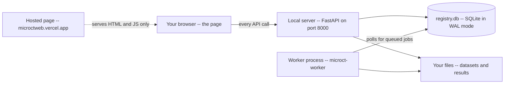

# Support & Troubleshooting

This is the page to open when something is wrong. microCT Lab is two halves — a
**local server** running on your own machine and a **web interface** that is only
a page — and almost every problem is really the question "which half is
unhappy?". This guide starts with a symptom index, then works through each
problem class: connection failures, jobs that never start, runs that fail, the
viewer, browsers, speed, disk, updates, and recovery after a crash. It also
quotes the exact error messages the software produces, so you can search for the
one on your screen. No specialist background is assumed.

---

## Table of contents

1. [Symptom index](#symptom-index)
2. [How the pieces fit together](#how-the-pieces-fit-together)
3. [The app cannot reach the server](#the-app-cannot-reach-the-server)
4. [Token needed appears unexpectedly](#token-needed-appears-unexpectedly)
5. [Jobs stay at queued forever](#jobs-stay-at-queued-forever)
6. [A run failed: reading the log](#a-run-failed-reading-the-log)
7. [Runs stuck at running or canceling](#runs-stuck-at-running-or-canceling)
8. [The viewer shows a preview instead of the 3D view](#the-viewer-shows-a-preview-instead-of-the-3d-view)
9. [Safari and other browser limits](#safari-and-other-browser-limits)
10. [Slow performance and what is actually expensive](#slow-performance-and-what-is-actually-expensive)
11. [Disk filling up](#disk-filling-up)
12. [Deployments and updates not taking effect](#deployments-and-updates-not-taking-effect)
13. [Restoring after a crash](#restoring-after-a-crash)
14. [BV/TV and digit-length numbers to check](#bvtv-and-digit-length-numbers-to-check)
15. [Error messages, word for word](#error-messages-word-for-word)
16. [Known limitations](#known-limitations)
17. [Collecting information before you ask for help](#collecting-information-before-you-ask-for-help)
18. [Quick reference](#quick-reference)
19. [FAQ and troubleshooting](#faq-and-troubleshooting)

---

## Symptom index

Find the thing you are actually seeing, then jump to the section that explains
it. Nothing here requires you to know which component failed — that is what the
sections are for.

| What you see | Where to go |
|---|---|
| Red **Disconnected** dot; **Can't reach the local lab server** panel | [The app cannot reach the server](#the-app-cannot-reach-the-server) |
| Amber **Token needed** dot; **Connected, but the token is missing or wrong** | [Token needed appears unexpectedly](#token-needed-appears-unexpectedly) |
| Every page is empty but the header says **Connected** | [The app cannot reach the server](#the-app-cannot-reach-the-server) |
| A run sits at **queued** and never moves | [Jobs stay at queued forever](#jobs-stay-at-queued-forever) |
| BV/TV & digit length says *Queued, waiting for a measurement worker* | [Jobs stay at queued forever](#jobs-stay-at-queued-forever) |
| A run is **failed** and you want to know why | [A run failed: reading the log](#a-run-failed-reading-the-log) |
| A run has been **running** since before the last reboot | [Runs stuck at running or canceling](#runs-stuck-at-running-or-canceling) |
| **Stop run** did nothing and the status stays **canceling** | [Runs stuck at running or canceling](#runs-stuck-at-running-or-canceling) |
| A flat image instead of the interactive 3D view | [The viewer shows a preview instead of the 3D view](#the-viewer-shows-a-preview-instead-of-the-3d-view) |
| *Interactive viewer unavailable — … Showing the server-rendered preview.* | [The viewer shows a preview instead of the 3D view](#the-viewer-shows-a-preview-instead-of-the-3d-view) |
| Nothing works in Safari, works elsewhere | [Safari and other browser limits](#safari-and-other-browser-limits) |
| A run took hours; the viewer takes a minute to open | [Slow performance and what is actually expensive](#slow-performance-and-what-is-actually-expensive) |
| The results drive is full | [Disk filling up](#disk-filling-up) |
| You changed `.env` and nothing changed | [Deployments and updates not taking effect](#deployments-and-updates-not-taking-effect) |
| The machine crashed and you want your catalogue back | [Restoring after a crash](#restoring-after-a-crash) |
| BV/TV looks wrong, or **No digit length** | [BV/TV and digit-length numbers to check](#bvtv-and-digit-length-numbers-to-check) |
| A message not listed above | [Error messages, word for word](#error-messages-word-for-word) |

> Tip: before diving in, open `http://127.0.0.1:8000/api/health` in a browser tab
> on the server machine. If you get JSON back, the server is alive and your
> problem is on the browser side. If you get nothing, the server is not running.
> That one test splits this whole guide in half.

---

## How the pieces fit together

Knowing the shape of the system tells you where to look. There are three moving
parts and they fail in three different ways.



- **The page** — served either from `https://microctweb.vercel.app` or by the
  local server itself. It holds no data. When it is unhappy you get connection
  panels and empty screens.
- **The server** — `microct-web`. It answers `/api/*`, reads and writes the
  registry, and serves files. If it is stopped, everything is **Disconnected**.
- **The worker** — `microct-worker` for segmentation and `microct-measure-worker`
  for measurements (BV/TV, digit length). It is a *separate process*. The server never runs a job
  itself; it only writes a **queued** row and waits for a worker to claim it. If
  no worker is running, the app looks perfectly healthy and nothing ever
  finishes.

Your data never leaves your machine in any of this. The hosted page is only HTML
and JavaScript; once loaded in your browser it talks to `localhost` and nowhere
else, and volumes travel over loopback rather than the internet.

---

## The app cannot reach the server

The header shows a red dot labelled **Disconnected**, and the page body is
replaced by a panel titled **Can't reach the local lab server** with three
numbered steps. That panel is doing real work — it names the three causes in
order of likelihood.

The underlying error is `Could not reach the local server`. The browser's `fetch`
cannot tell a refused connection apart from a blocked one, so this one state
covers both "the server is not running" and "the server is running but refused
this page".

### Work through it in order

1. **Is the server running?** Look for its console window. It should have printed
   `microCT Segmentation Lab  ->  http://127.0.0.1:8000` followed by a line from
   uvicorn. If the window is gone, start it again: activate the virtual
   environment and run `microct-web`.
2. **Was it started with the right allowed origin?** Open `.env` on the server
   machine and check `MICROCT_ALLOWED_ORIGINS`. For the hosted page it must read
   exactly `MICROCT_ALLOWED_ORIGINS=https://microctweb.vercel.app` — no trailing
   slash, and not a per-deployment hostname like `microctweb-a1b2c3.vercel.app`.
   The check is an exact string match. **Restart the server after editing
   `.env`**; it is read only at startup.
3. **Is the base URL right?** Click **Connection** in the header. The **API base
   URL** field defaults to `http://localhost:8000`. If your server prints a
   different port, change it here. If your machine resolves `localhost` and
   `127.0.0.1` differently, try `http://127.0.0.1:8000` instead.

### The decisive test

Open `http://127.0.0.1:8000/api/health` directly in a tab on the server machine.

- **You get JSON** — something like
  `{"ok": true, "app": "microct-seg-lab", "version": "0.1.0", "auth_required": false}`
  — so the server is fine and the problem is step 2 or step 3.
- **You get a connection error** — the server really is down. Start it.

> Tip: `curl` working while the browser fails is the signature of a cross-origin
> rejection, not a server fault — `curl` does not enforce browser rules. Open the
> browser devtools **Network** tab and look at the failed `OPTIONS` preflight; its
> response names what was disallowed.

### If the header says Connected but the pages are empty

That is usually correct behaviour on a fresh install: the catalogue is genuinely
empty. The **Datasets** page (route: `/datasets`) says so and points you at **⟳
Ingest datasets**; the **Models** page (route: `/models`) points at **＋ Register
model**. Loading your first scan is covered in the
[Getting Started guide](/help/getting-started).

---

## Token needed appears unexpectedly

The header dot turns amber and reads **Token needed**, the **Connection** panel opens
by itself, and the page body is replaced by a panel titled **Connected, but the
token is missing or wrong**.

This means the server answered — so it is running *and* your origin is allowed,
which are the hard parts — but it rejected the request with HTTP 401 and the
detail `missing or invalid API token`.

### Why it appeared when you never set one

By default microCT Lab needs **no token at all**. One is required only when
`MICROCT_API_TOKEN` is set in `.env`. Three things bring this state on:

- **Someone set `MICROCT_API_TOKEN`** on that server — for a shared or less
  trusted machine, say.
- **`MICROCT_REQUIRE_TOKEN_LOCAL=true` was set.** Normally a caller that passes
  the server's local test is exempt, so the interface served at
  `http://127.0.0.1:8000` works with nothing pasted. This setting demands the
  token from everyone, localhost included.
- **A stale token is cached in your browser.** The value lives in `localStorage`
  under `microct_api_token`. If the server's token was regenerated, yours is now
  wrong — click **Reset** in the **Connection** panel, then **Save & reconnect**.

### Getting the right token

All three of these run on the **server** machine:

- Run `microct-token` in a terminal. It prints the token, the base URL, and the
  allowed origins.
- Open `http://127.0.0.1:8000/api/token` in the address bar.
- Read the last line of `.env`. The server also prints it at startup.

Paste it into **Connection → Access token** and click **Save & reconnect**. The
field's hint tells you which case you are in: *"Required: this server allows a
non-localhost origin, so every request must carry a bearer token"* versus
*"Optional: this server is not currently requiring a token"*.

### Who is exempt, precisely

Worth knowing before you conclude the token is broken. Once `MICROCT_API_TOKEN`
is set, the server exempts a caller only if **one** of these is true:

- the request carries an **`Origin` header naming `localhost` or `127.0.0.1`** on
  any port and either scheme — a page served from that machine; or
- the request carries **no `Origin` header at all** *and* arrives from a loopback
  address — `curl` on the server, or a URL typed into the address bar there.

Everything else needs the token, including a script on another PC that sends no
`Origin`. That second condition is the one to remember if you run with
`MICROCT_HOST=0.0.0.0`: a LAN caller is **not** exempt just because it omits a
header, and it should not be.

> Safety note: `/api/token` deliberately refuses any request carrying an `Origin`
> header, so **no web page can read it** — not even one from an allowed origin —
> and it refuses any caller that is not on loopback. If a page or a colleague on
> the network is asking you for this token, that request is not coming from
> microCT Lab.

---

## Jobs stay at queued forever

This is the single most common support question, and nothing is broken.

A run appears with status **queued** and never moves. Its progress banner reads
*Queued* with the detail *waiting for a free worker*. A measurement shows
*Queued, waiting for a measurement worker*. Hours pass and the status is
unchanged.

**The cause is always the same: no worker process is running.** The server writes
the queued row; a separate program executes it. Starting `microct-web` alone is
not enough.

### Fix it

Open a second terminal on the server machine, activate the same virtual
environment, and run one of:

- **`microct-worker`** — the default. Works both segmentation and measurement
  jobs.
- **`microct-worker --kind segmentation`** — segmentation only. Use this on a GPU
  box so long CPU measurements cannot block GPU work.
- **`microct-measure-worker`** — measurements only, CPU. Identical to
  `microct-worker --kind measurement`.

A healthy worker prints:

```
[worker] ready (all). polling every 2.0s. results -> C:\...\results
```

and then, when it claims a job:

```
[worker] run 3: dataset=1 model=1 (v1)
[worker] run 3: succeeded
```

Jobs are claimed oldest first, and **one at a time**. There is no parallelism
inside a worker.

### If a worker is running and the job still will not start

- **Wrong kind.** A worker started with `--kind segmentation` will never touch a
  queued measurement, and `microct-measure-worker` will never touch a queued run.
  Check which one you started.
- **Something is ahead of it.** The worker takes one job at a time. Look at the
  **Runs** page (route: `/runs`) for an older job still **running**.
- **The worker is looking at a different registry.** Both processes read `.env`
  from the repository root, so a worker started from another install points at a
  different `MICROCT_STATE_DIR` and sees an empty queue. Start it from the same
  folder, in the same virtual environment.

Closing the worker's window mid-job does not lose the run. On its next start the
worker sweeps up anything left **running** and marks it **failed** with `worker
restarted while this run was in progress`.

---

## A run failed: reading the log

Open the run — the **Runs** page, then the row, or go straight to `/runs?id=5`.
The report has a **Run log** panel showing the worker's raw output, with a
**reload** button. While a run is active it refreshes and follows the tail the
way a terminal would.

### The error field first

The run's recorded error appears in exactly one place on the page: **inside the
black Viewer stage**, as the message where the volume would have been. It is
*not* in the **Summary** panel — that panel carries only Dataset, Model, Version,
Status, ROI volume, Duration, Machine and Device, and never shows the error, the
exit code or a log tail. So on a failed run, read the Viewer rectangle rather
than looking down the right-hand column for it.

For a failed segmentation the error has a fixed shape:

```
exit code 1
<the last 8 lines of the log>
```

Those eight lines are usually the whole story. When they are not, read the log.

> Note: **⭳ Export report** does not carry the error. The downloaded Markdown
> holds the summary, the parameters, the environment debrief and the QC section —
> not the `error` field and not the log. When you send a report about a failure,
> paste the Viewer message or the tail of the **Run log** panel alongside it.

### Reading the log

The log begins with the exact command the worker ran, prefixed with `$ `, so you
can reproduce it in a terminal. After that the phases are tagged:

| Marker in the log | Phase | What it means |
|---|---|---|
| `[convert] 459 slices, 1128x1128 -> volume` | Converting slices to volume | Reading the BMP stack |
| `[convert] 200/459` | Converting | Progress through the stack |
| `[convert] wrote …_0000.nii.gz` | Loading model | Conversion finished |
| `model loaded`, `predicting ===` | Segmenting | nnU-Net sliding-window inference |
| `123/456` inside the predict block | Segmenting | Patches done out of total |
| `prediction done` | Finalizing | Inference over |
| `[preview] slice 233 (largest ROI)` | Finalizing | Preview image written |
| `[bmp]`, `[result]` | Finalizing | Mask BMPs and the result JSON |
| `DONE` | Complete | The run succeeded |

The progress banner derives its percentage from exactly these markers, which is
why a run whose log stops mid-`[convert]` shows a bar frozen in the low teens.

### Common causes, read from the log

- **`No slices matched '*rec*.bmp' in <folder>`** — the dataset's slice folder is
  gone, renamed, or on a drive that is not mounted. Datasets store **absolute
  paths**, so a moved folder breaks them. Restore the path, or re-ingest.
- **A `ModuleNotFoundError` for `torch` or `nnunetv2`** — the segmentation extras
  are not installed in the worker's environment. Segmentation needs
  `pip install -e ".[seg]"` plus a torch build; measurements need
  `pip install -e ".[morph]"` (a `nibabel`, `scipy`, `skimage` or `matplotlib`
  error in a measurement log means this one).
- **An out-of-memory error during inference** — see
  [Slow performance and what is actually expensive](#slow-performance-and-what-is-actually-expensive).
- **`dataset or model missing`** — the run's dataset or model row disappeared
  from the registry between queueing and execution.
- **`mask not found: …`**, **`input volume not found: …`**, **`measurement driver
  not found: …`** — measurement-specific. The files a measurement was queued
  against are no longer on disk, or the measurement driver is missing.
- **`Unexpected voxel spacing for …`** — a LeviDigit measurement on a scan that
  is not 4 µm isotropic. LeviDigit is defined only at 4 µm and refuses rather
  than guess; there is no override.

A failed run is never deleted, so there is no rush. Use **⭳ Export report** on the
run page to save a Markdown file with the summary, every parameter, the full
environment debrief and the QC section — most of what someone helping you will
want. Add the **Run log** contents by hand, because they are not in it.

---

## Runs stuck at running or canceling

Two related states, one cause: the worker that owned the job is gone, so nothing
is left to move the row forward.

### Stuck at running

The row says **running** but no worker window is open and the log has not grown.
The status only changes when a worker writes to it, so a killed worker leaves the
row frozen.

**Fix:** start a worker of the matching kind. On startup it sweeps every job left
in **running** or **canceling** and finalizes it — **running** becomes **failed**
with `worker restarted while this run was in progress`, and **canceling** becomes
**canceled** with `aborted by user`. Only the kinds that worker handles are
swept, so a measurement worker never disturbs a genuinely in-flight
segmentation.

### Stuck at canceling

**■ Stop run** does not kill anything directly. It sets the status to
**canceling**, and the *worker* notices within a couple of seconds and kills the
subprocess. With no worker running, nothing notices, and the row stays
**canceling** indefinitely.

This is a genuine dead end from inside the interface: a **canceling** run cannot
be stopped again (canceling is idempotent) and cannot be archived — **🗄
Archive** is offered only on a terminal run, and the server answers `run is in
progress — stop it first`. The demonstration registry contains a run stuck this
way for exactly that reason.

**Fix:** start `microct-worker`, or `microct-measure-worker` for a measurement.
It finalizes the row to **canceled** on startup, after which you can archive it
normally.

This also blocks tidying elsewhere. A dataset with an active run refuses to be
removed, with `dataset has active runs; stop them first` — and a stuck
**canceling** run counts as active.

### Archive vs delete

Worth stating plainly, because people go looking for a delete button that does
not exist:

- **Runs are never deleted.** They are the provenance record — which model
  version, which parameters, which machine. `DELETE /api/runs/{id}` answers
  `runs cannot be deleted — archive it instead`. Use **🗄 Archive**; archived runs
  drop out of default views and return with **⇤ Unarchive**.

> Safety note: **write the run id down before you archive it.** There is no way
> back to an archived run from any list in this interface. The **Runs** page
> filters on status, QC and failure mode only — it has no "show archived"
> control, and the request it makes never sets `include_archived`, so an archived
> run is absent from every table, tile and chart. **⇤ Unarchive** exists only on
> the run's own detail page, which you can now reach in exactly one way: type
> `/runs?id=<the id>` into the address bar. The server itself is fine —
> `GET /api/runs?include_archived=true` lists them — but nothing in the interface
> sends that. Treat archive as "hide, and remember the number" until a filter
> exists.
- **Datasets with runs are archived, not deleted.** Deleting one returns
  `{"archived": <id>, "reason": "has runs (kept for provenance)"}`. Only a
  run-free dataset is genuinely removed from the registry — and its files on disk
  are untouched either way.
- **Measurements** follow the same rules: cancel first, then archive.

---

## The viewer shows a preview instead of the 3D view

The **Viewer** panel has two modes. The interactive one is a WebGL volume viewer
with the segmentation mask overlaid in red; the fallback is the flat **preview
image** the server rendered during the run. Seeing the flat image is not
necessarily a fault.

### The three reasons you get the flat image

- **The run has not succeeded.** The panel says `<status> — the viewer appears
  once the mask is ready.` Only a succeeded run has a mask to show.
- **You are looking at a dataset, not a run.** In the dataset drawer the 3D view
  sits behind a button on purpose — the server has to build a viewable volume
  from the raw slice stack on first request, and it would be rude to start that
  merely because someone opened a metadata panel. Click **⬡ Visualize — build a
  3D volume**.
- **The interactive path failed.** You get a note reading *Interactive viewer
  unavailable — `<message>`. Showing the server-rendered preview.* That message
  is the real cause.

### Reading the failure message

- **`Could not reach the local server`** — the server stopped between loading the
  page and loading the volume. See
  [The app cannot reach the server](#the-app-cannot-reach-the-server).
- **`file not available`** (HTTP 404) — the mask or input volume recorded for this
  run is no longer where the registry says it is. Check that the run's results
  folder still exists on this machine.
- **A WebGL or parsing error** — the machine's graphics stack cannot host the
  volume. The fallback exists exactly for this: a lab machine with weak WebGL
  still sees the segmentation as an image, and **⭳ Download full-resolution
  mask** on the rail still works.

> Note: the viewer never loads the full-resolution volume. It requests a
> downsampled copy — roughly 11 MB of grayscale plus a much smaller mask — capped
> so the longest axis is about 512 voxels, because full resolution overflows the
> browser's WebGL buffers. The full-resolution mask remains available as a
> download.

### Viewer controls, when it does load

The shortcuts are bound to the **whole page**, not to the viewer rectangle, so
you do not need to click the image first: **F** maximize, **Esc** restore,
**Space** play or pause the cine loop, **←** and **→** step one slice, **+** and
**−** zoom, **0** reset the view, **P** toggle pan mode. **Ctrl** with the scroll
wheel also zooms. Three things switch them off — the volume is not loaded yet,
the **Viewer** panel is collapsed, or you are typing in a field. The flip side of
page-level binding is that pressing **0** while reading the metrics panel will
reset the viewer above it. The rail on the left carries the same controls plus
the mask opacity slider. Fuller coverage is in the
[Viewer Guide](/help/viewer-guide).

---

## Safari and other browser limits

A public HTTPS page reaching a loopback address is exactly the pattern browser
vendors have been tightening, so support is uneven — and worth stating honestly
rather than promising.

| Browser | Status |
|---|---|
| Chrome / Edge | **Verified working.** Expect a one-time prompt asking permission to access devices on your local network — allow it. |
| Firefox | Expected to work; it treats `localhost` as trustworthy and does not require the extra preflight. **Not verified here.** |
| Safari | **Likely blocked.** Safari does not implement the private-network preflight and is stricter about HTTPS pages reaching localhost. |

### The fallback that always works

Serve the interface from your own machine instead of from the hosted site. The
page and the server are then the same address, so none of the browser's
cross-origin rules apply at all — no allowed origin, no preflight, no token, no
browser caveats, and it works with no internet connection.

1. The server already ships with a working built-in interface. Just open
   `http://127.0.0.1:8000` instead of the hosted address. You can drop
   `MICROCT_ALLOWED_ORIGINS` entirely in that case.
2. To serve the newer interface locally, build the frontend (`npm install`, then
   `npm run build`, which produces `out/`) and point the server at it in `.env`:

   ```ini
   MICROCT_WEB_DIR=C:\microct\microctweb\out
   ```

   Restart the server. `http://127.0.0.1:8000` now serves the new interface
   directly from your machine.

> Tip: treat the hosted page as the convenience path and local serving as the
> reliable one. It is also the answer for an air-gapped machine. If the
> configured `MICROCT_WEB_DIR` does not exist, the server quietly falls back to
> its bundled interface rather than going dark.

---

## Slow performance and what is actually expensive

Most of what feels slow in microCT Lab is not the interface. Here is where the
time genuinely goes, with real numbers from the demonstration registry.

- **Segmentation without a GPU is the big one.** A single 459 × 1128 × 1128 scan
  at 4 µm took **6,582 seconds — about 110 minutes — on CPU**. On a suitable
  NVIDIA GPU the same work is a different order of magnitude. Open **＋ New run**
  and read the **Compute available** panel: if the GPU row says *none detected*
  and **auto →** shows `cpu`, plan for hours, not minutes.
- **Measurements are CPU-only by design and quick.** A LeviDigit BV/TV and
  digit-length measurement takes seconds on a typical digit; the publication
  figure adds a little. **Skip figures (faster)** in the panel leaves it out.
- **The first viewer load of a run is slow; later ones are not.** The downsampled
  volume is built on demand and cached next to the run's outputs as
  `view_input.nii.gz` and `view_mask.nii.gz`. The first request pays for reading,
  shrinking and re-compressing; every later one is a file read. The spinner tells
  you which stage you are in — *downloading the downsampled volume…* then
  *decoding and uploading to the GPU…*
- **A dataset's 3D view is built from the raw slice stack** the first time you ask
  for it, then cached under the state directory. That is why it sits behind a
  button.
- **Mask BMP export writes hundreds of files.** See
  [Disk filling up](#disk-filling-up).

### Levers that actually help

- **Folds** — in **＋ New run**, `0` uses a single fold and is the fast option;
  `0 1 2 3 4` ensembles all five and is roughly five times the work.
- **Test-time augmentation** — leave it off unless you need it; it multiplies
  inference time.
- **Step (overlap)** — the default `0.5` controls sliding-window overlap. A larger
  value means fewer patches, so a faster and slightly coarser run.
- **Device** — set it explicitly rather than trusting `auto` if you know the
  machine has a GPU that torch cannot see.

If inference runs out of memory, the fix is normally a larger step value or a
machine with more VRAM, not a smaller scan. The **Run environment** panel records
**Peak RAM** and **Peak VRAM**, so a successful run on similar data tells you
what the job actually needs.

---

## Disk filling up

Everything microCT Lab produces stays on your machine, and some of it is large.
The current locations are in the sidebar's storage box, and in full at
`GET /api/config`, which reports `data_root`, `results_root`, `models_root`,
`state_dir` and `analyses_dir`.

What consumes space, roughly in order:

- **Mask BMP stacks.** The **🖼 Mask BMPs** button on a run writes one BMP per
  slice into the run's results folder. For one 459-slice scan in the
  demonstration registry that is **459 files and 584 MB**. They are a convenience
  export, not a dependency — the mask NIfTI is the real artifact. Deleting a BMP
  folder is safe, and the button rebuilds it; when a stack already exists it says
  so rather than redoing the work.
- **Per-run output folders** — `<results_root>/<dataset>__<model>__run<id>/`,
  holding the input volume, the mask, the preview image, `run.log`, and the
  cached downsampled view volumes.
- **Per-measurement folders** — `<results_root>/<case>__levidigit__m<id>/`,
  holding LeviDigit's derived masks, labelmaps, landmarks, figure,
  `measurements.csv` and `measure.log`. Older SK measurements use
  `__bvtv__m<id>` and `__morph__m<id>`.
- **Cached view volumes** — `view_input.nii.gz` and `view_mask.nii.gz` beside a
  run's outputs, and `dataset_<id>_view.nii.gz` under `<state_dir>/cache`. All are
  regenerable: delete them and they are rebuilt on the next viewer load.
- **Thumbnails** — small, one per dataset, under `<state_dir>/thumbnails`.

> Safety note: deleting a run's *files* does not delete its *row*. The registry
> keeps the run for provenance, and the viewer then reports `file not available`.
> If you want a run out of the way, **🗄 Archive** it in the interface; if you want
> the disk space back, delete the folder and accept that the record becomes a
> record of something you no longer have.

---

## Deployments and updates not taking effect

Four things get read once or cached, and each has its own reset.

### The server reads .env only at startup

Every `MICROCT_*` setting — the allowed origin, the token, the data roots, the
web directory — is read when the process starts. Editing `.env` while the server
runs changes nothing. **Stop it with `Ctrl+C` in its window and start it again.**
The worker needs the same treatment.

### The browser holds your connection settings

The **API base URL** and **Access token** live in your browser's `localStorage`
under `microct_api_base` and `microct_api_token`. They are deliberately *not*
part of the deployed build, so the same page works against any machine — which
also means a colleague's instructions never change what your browser remembers.
If you are pointed at the wrong server, fix it in **Connection**, or click
**Reset** to return to `http://localhost:8000` with no token.

### A new hosted deployment is a new origin

Preview deployments get their own hostnames, and only the exact strings in
`MICROCT_ALLOWED_ORIGINS` are accepted. A preview URL is refused unless you add
it. Test against the production alias `https://microctweb.vercel.app` unless you
have a reason not to.

### A locally served build is a copy

If you set `MICROCT_WEB_DIR`, the server serves whatever is in that folder. A
`git pull` on the frontend does nothing until you re-run `npm run build` and
restart the server. And if the configured directory does not exist, the server
silently serves its bundled interface instead — which looks exactly like "my
update did not deploy".

One check covers all four: the **Connection** panel prints what the server reports
about itself, for example `microct-seg-lab 0.1.0`. If that string does not change
after you upgrade the server, you restarted something else.

---

## Restoring after a crash

The registry is a single SQLite database at `<state_dir>/registry.db`, running in
**WAL mode**. That one detail is the whole story of backup and restore.

### Never copy registry.db on its own

A committed write does not necessarily live in `registry.db` yet — it can sit in
`registry.db-wal` until a checkpoint. Copying the one file while the server is
running produces a database that is *valid* but *stale*: nothing errors, you just
quietly lose recent work. On this install that gap was once large enough that a
naive copy was **missing the entire measurements table**.

### Take backups the right way

```
python scripts/backup_registry.py --out backup.db
python scripts/backup_registry.py --out bundle.zip --with-thumbnails
```

This uses SQLite's online backup API, which is safe against a running server and
always produces one consistent file with the WAL folded in.

### Restore

1. **Stop the server**, and the worker.
2. Put the backup at `<state_dir>/registry.db`.
3. **Delete any `registry.db-wal` and `registry.db-shm` sitting beside it.** Those
   belong to the previous database and would otherwise be replayed over what you
   just restored.
4. Start the server again.

### Moving to another machine

The registry stores **absolute paths** — dataset slice folders, model folders,
per-run output directories, mask and preview and log files, thumbnails. A
database moved somewhere those paths do not exist gives you a catalogue whose
every record points at nothing.

See what you depend on:

```
python scripts/backup_registry.py --report-paths
```

It lists each path prefix, how many records reference it, and whether it exists
here. Then retarget as you copy:

```
python scripts/backup_registry.py --out moved.db --rewrite "C:\old\root=D:\new\root"
```

The rewrite covers the path columns *and* the JSON blobs that embed paths, and it
refuses to write the backup at all if a substitution would have corrupted the
JSON.

> Safety note: after any restore, open the **Datasets** page and confirm a
> thumbnail or two actually render, then open one succeeded run and confirm the
> viewer loads. Those two checks exercise the stored paths end to end.

---

## BV/TV and digit-length numbers to check

BV/TV and digit length come from **LeviDigit**, the official method. It refuses
input it is not defined for (wrong spacing, a non-binary mask), so most bad
input fails loudly. What it cannot catch is a mask or threshold that is wrong
but valid. Check these before a number goes into a figure.

### BV/TV looks too high or too low

- **The threshold.** BV is every mask voxel at or above the bone threshold
  (grey 0 to 255), so BV/TV moves with it. The result shows the threshold the
  measurement used. If it is not your lab's value, set
  `MICROCT_LEVIDIGIT_BONE_THRESHOLD` on the server (or type the value in the
  panel) and **Measure again**.
- **The mask.** TV is the whole mask. An artifact or a neighbouring structure
  inside the mask, or bone left outside it, changes both BV and TV. Look at the
  mask in the viewer; **✂ Crop mask** removes extra regions without re-running
  segmentation.
- **A different method.** Older BV/TV values (the interim method, tagged SK) used
  800 HU converted per scan, about grey 77 to 80. They are not comparable with
  LeviDigit's and the site no longer shows them.

### Digit length says "not measured"

The dataset is not categorized as `digit`, so only BV/TV ran. Set its subtype in
the dataset drawer and measure again.

### "No digit length"

LeviDigit could not find a defensible concavity on this mask (its message is in
**Details** and the measurement log). This is **not a length of zero**, and no
length is reported. Usually the mask is fragmented or the base of the digit is
cut off. Check the mask, crop it if needed, and measure again.

> Safety note: a succeeded measurement means LeviDigit computed a number, not
> that the mask was the right structure. A human has to confirm the segmentation
> before any number leaves the app.

What each number means is covered in the
[BV/TV & Digit Length Guide](/help/levidigit-guide).

---

## Error messages, word for word

These are the strings the software actually produces, so you can search for the
one on your screen.

**`Could not reach the local server`**
The request never arrived. Covers both "the server is not running" and "the
server refused this origin" — the browser cannot tell them apart. See
[The app cannot reach the server](#the-app-cannot-reach-the-server).

**`missing or invalid API token`** (HTTP 401)
The server is up and your origin is allowed, but the bearer token is absent or
wrong. See [Token needed appears unexpectedly](#token-needed-appears-unexpectedly).

**`The access token is readable only from this machine.`** (HTTP 403)
You asked `/api/token` from somewhere other than loopback. Run `microct-token` on
the server instead.

**`The access token cannot be read by a web page.`** (HTTP 403)
A browser page tried to fetch `/api/token`. Open the URL directly in the address
bar, or run `microct-token`.

**`file not available`** (HTTP 404)
A mask, input volume, preview image, annotated volume or spreadsheet is not where
the registry says it is. The record survived; the file did not.

**`run not found`**, **`dataset not found`**, **`measurement not found`** (HTTP 404)
The id in the URL does not exist — usually a stale bookmark or a hand-edited
query string such as `/runs?id=99`.

**`runs cannot be deleted — archive it instead (POST /api/runs/{id}/archive)`** (HTTP 405)
Working as designed. Use **🗄 Archive**.

**`run is in progress — stop it first`** (HTTP 409)
You tried to archive a run that is **queued**, **running** or **canceling**. If it
is stuck in one of those, see
[Runs stuck at running or canceling](#runs-stuck-at-running-or-canceling).

**`cannot stop a run that is succeeded`** (HTTP 409)
Cancel applies only to jobs that have not finished.

**`dataset has active runs; stop them first`** (HTTP 409)
Removing a dataset is blocked while a run against it is in flight.

**`run 5 is failed — only succeeded runs can be measured`** (HTTP 400)
A measurement needs a finished mask. The interface disables **📏 Measure
BV/TV + digit length** for exactly this reason and says why in its tooltip.

**`run 5 has no mask on disk (mask_nii unset)`** (HTTP 400)
The run succeeded but its mask file is missing, or was never recorded.

**`folder is outside the configured data roots`** (HTTP 403)
**Open folder** refuses any target that is not under the data, results, models,
analyses or NAS roots. A deliberate guard, not a bug.

**`not a folder on this machine: <path>`** (HTTP 404)
**Open folder** resolved to something that is not an existing directory here —
typically a path belonging to another machine.

**`No slices matched '*rec*.bmp' in <folder>`**
From the segmentation script, in the run log. The dataset's slice folder is
missing, or its files do not match the pattern. Files with `_spr` or `_pp` in the
name are reconstruction previews and are always skipped.

**`worker restarted while this run was in progress`**
The worker was killed mid-job and swept the row on its next start. Re-queue the
run.

**`aborted by user`**
The recorded reason for a canceled job. Normal.

**`exit code 1`** followed by log lines
A failed run. Those lines are the tail of the log; read the rest in the **Run
log** panel.

**`(no log yet)`**
The job has not started, or its log file does not exist yet. Normal for a
**queued** job.

**`System info unavailable — not connected.`**
The sidebar storage box could not read `/api/config`. A connection problem, not a
configuration one.

---

## Known limitations

Stated plainly, because working around a limitation is easier than debugging one.

- **No parallelism.** A worker executes one job at a time, in creation order.
  Queue five runs and they run one after another.
- **No job priority and no reordering.** You cannot move a job up the queue; the
  only control is canceling something ahead of it.
- **A stuck `canceling` job cannot be cleared from the interface.** It needs a
  worker restart. See
  [Runs stuck at running or canceling](#runs-stuck-at-running-or-canceling).
- **An archived run cannot be found again from any list.** No page offers a
  "show archived" filter, so **⇤ Unarchive** is reachable only by typing
  `/runs?id=<id>`. Note the id before you archive. See
  [Archive vs delete](#archive-vs-delete).
- **Skip visualisation stages does nothing.** The flag reaches the pipeline and
  the pipeline ignores it. See
  [Slow performance and what is actually expensive](#slow-performance-and-what-is-actually-expensive).
- **Two endpoints emit timestamps without a UTC marker.** `GET /api/stats` and
  `GET /api/timeline` return naive datetimes, so the **Overview** page's
  **Created** column and the **Timeline** feed are displayed shifted by your UTC
  offset. Every other view is correct.
- **Dataset `organism`, `tags`, `notes` and the flag cannot be set anywhere.**
  Ingest never fills them and no screen edits them, so the **Datasets**
  organism/tag filters and the **Tree** view have nothing to group on. Only
  `PATCH /api/datasets/{id}` writes them.
- **Measurements are 4 µm only.** LeviDigit refuses any other voxel spacing.
- **Digit length only on digit datasets.** Other datasets get BV/TV only.
- **The site shows only LeviDigit.** Older SK measurements stay in the registry
  and in the API (`source_tag: "SK"`) but are not displayed.
- **The linked comparison viewer handles two runs at a time**, even when
  `/compare?ids=1,2,3` lists more.
- **Firefox is untested.** It is expected to work; nobody has verified it here.
- **Binary assets need a token-aware fetch.** Thumbnails, previews and volumes
  cannot carry an `Authorization` header as a bare image source, so the interface
  fetches them itself and hands over a `blob:` URL. Pasting one of those addresses
  into a tab on a token-protected server gives you a 401 — expected, not a bug.
- **There is no scheduled backup.** `scripts/backup_registry.py` is a manual step.

---

## Collecting information before you ask for help

Five things answer most questions. Gather them before writing.

### The app and server versions

Click **Connection** in the header. The panel prints what the server reports about
itself — for example `microct-seg-lab 0.1.0` — alongside the base URL you are
pointed at. Include both, plus your browser and its version, and whether you are
on the hosted page or `http://127.0.0.1:8000`.

### The server log

The `microct-web` console window. Copy the startup banner — it names the allowed
origins and whether a token is required — and anything printed around the time of
the problem. If you run the server redirected to a file, send the tail of it.

### The worker output

The `microct-worker` window. The `[worker] ready …` line confirms which kinds it
handles and where results go; the `[worker] run N: …` lines say what it picked up
and how it ended.

### The run log and report

On the failing run's page use **⭳ Export report** to download
`run_<id>_report.md`. It contains the summary, every parameter, the complete
environment debrief and the QC section in one file. Add the contents of the **Run
log** panel if the failure happened mid-run.

### The environment panel

The **Run environment** panel on the run report lists the machine, OS, CPU, core
counts, RAM, device, GPU, VRAM, CUDA, torch and nnU-Net versions, peak memory and
per-phase timings. For a question about the machine rather than a specific run,
`GET /api/system/compute` reports the same probe live — including
`recommended_device`, which tells you whether `auto` would pick `cuda` or `cpu`.

> Tip: say what you expected and what happened, in that order, and paste error
> text verbatim rather than describing it. `run 5 has no mask on disk` is
> searchable; "it says something about a mask" is not.

---

## Quick reference

| Task | Where |
|---|---|
| Check the server is alive | `http://127.0.0.1:8000/api/health` in a tab |
| Change the base URL or token | **Connection** button in the header |
| Clear stored connection settings | **Connection → Reset**, then **Save & reconnect** |
| Start the server | `microct-web` |
| Start a worker for both job kinds | `microct-worker` |
| Start the GPU segmentation worker only | `microct-worker --kind segmentation` |
| Start the CPU measurement worker | `microct-measure-worker` |
| Find the access token | `microct-token` on the server machine |
| Read a run's log | Run page → **Run log**, or `/api/runs/{id}/log.txt` |
| Save everything about a run | Run page → **⭳ Export report** |
| Stop a job | Run page → **■ Stop run** (needs a live worker to take effect) |
| Hide a finished run | Run page → **🗄 Archive** (runs are never deleted) |
| Back up the registry | `python scripts/backup_registry.py --out backup.db` |
| See which paths the registry needs | `python scripts/backup_registry.py --report-paths` |
| Retarget paths for another machine | `--rewrite "OLD=NEW"` |
| Check compute on this machine | Sidebar storage box, or `/api/system/compute` |
| See the configured folders | `/api/config` |

**Statuses.** Runs and measurements share a lifecycle: **queued** → **running** →
**succeeded**, **failed** or **canceled**, with **canceling** as the transient
state between a stop request and the worker acting on it.

**QC outcomes.** A reviewed run carries one of **unreviewed**, **pass**, **minor**
or **fail**, plus any number of failure-mode tags.

---

## FAQ and troubleshooting

**I started the server, opened the page, and everything is blank. Is it broken?**
Almost certainly not. A fresh install has no scans in it. Go to **Datasets** and
click **⟳ Ingest datasets** to scan your data root, then **Models → ＋ Register
model**. If instead you see a red **Disconnected** dot, that is a different
problem — see [The app cannot reach the server](#the-app-cannot-reach-the-server).

**My run has said "queued" for two hours.**
No worker is running. The server queues jobs; a separate `microct-worker` process
executes them. Open a second terminal and start it. This is the most common
report by a wide margin, and it is not a fault.

**I clicked Stop run and the status is still "canceling".**
**■ Stop run** asks the worker to kill the process, and with no worker running
nobody is listening. Start `microct-worker` — it finalizes stuck rows on startup.
Until then the run cannot be archived either.

**Where is the delete button for a run, and why did my deleted dataset come back as archived?**
Neither is a bug. A run records which model version produced which mask on which
machine, so it is kept forever — use **🗄 Archive** to get it out of your default
views and **⇤ Unarchive** to bring it back. A dataset with any runs against it is
archived rather than removed for the same reason: the runs must outlive it. Only
a run-free dataset is genuinely deleted, and its files on disk are never touched
either way.

**The header says Connected but I keep getting "Token needed".**
`/api/health` is the one endpoint exempt from the token check, so a healthy probe
does not prove your token is right. Get the current value with `microct-token` on
the server machine and paste it into **Connection → Access token**. If you never
set a token, either someone set `MICROCT_API_TOKEN` on that server or a stale
value is cached in your browser — click **Reset**.

**It works in Chrome and not in Safari.**
Expected. Safari will not let an HTTPS page reach your own machine. Open
`http://127.0.0.1:8000` instead — the server includes a working interface — or use
Chrome or Edge. If Chrome asks permission to access devices on your local
network, allow it: that prompt is the browser confirming the hosted page may talk
to your own machine, which is exactly what microCT Lab does.

**I edited .env and nothing changed.**
The server reads `.env` only at startup. Press `Ctrl+C` in its window and start
`microct-web` again. The worker needs restarting too.

**A run took nearly two hours. Is that normal?**
On CPU, yes — a full-resolution scan took about 110 minutes in the demonstration
registry. Check **＋ New run → Compute available**: if the GPU row says *none
detected*, that is your answer. Reduce the work with a single fold (`0`), leave
test-time augmentation off, or move to a GPU machine.

**The viewer is showing a flat image instead of the 3D view.**
Either the run has not succeeded, or you are in a dataset drawer where the 3D
view sits behind the **⬡ Visualize — build a 3D volume** button, or the
interactive path failed and said why in a small note under the image. See
[The viewer shows a preview instead of the 3D view](#the-viewer-shows-a-preview-instead-of-the-3d-view).

**My results drive is full. What is safe to delete?**
The mask BMP stacks are the usual culprit — 584 MB for a single 459-slice scan in
the demonstration registry — and they are a convenience export you can regenerate
from the run page. The cached `view_*.nii.gz` files rebuild themselves too.
Deleting a run's mask or input volume, on the other hand, leaves a run record
pointing at nothing.

**I copied registry.db to another machine and lost recent work — or restored it and every dataset points at nothing.**
Two halves of the same trap. A plain copy of `registry.db` can be missing
anything still sitting in `registry.db-wal`, and it opens without complaint, so
always use `python scripts/backup_registry.py` and delete the `-wal` and `-shm`
files beside the database you replace. And because the registry stores absolute
paths, run `python scripts/backup_registry.py --report-paths` to see which roots
it expects, then rebuild the backup with
`--rewrite "C:\their\path=C:\your\path"`.

**My BV/TV changed compared with an older measurement. Which is right?**
Check the threshold first: LeviDigit uses a fixed grey threshold, while the
older interim BV/TV (tagged SK) used 800 HU converted per scan, about grey 77 to
80. Different thresholds give different BV/TV on the same mask. The official
number is LeviDigit's, at your lab's threshold.

**A measurement succeeded. Does that mean the numbers are right?**
No. It means LeviDigit computed them from the mask it was given. Confirm the
segmentation is the structure you think it is, and that the threshold is your
lab's, before using anything.

**Timestamps look wrong to me.**
Most of the API emits UTC with a trailing `Z` and the interface renders that in
your local timezone, so a few hours' offset from what you expected is usually
just your machine's timezone. **Two endpoints are a genuine exception** and are
worth knowing about before you blame yourself: `GET /api/stats` and
`GET /api/timeline` build plain dictionaries and hand back the raw datetime with
no `Z` — for example `2026-07-16T03:51:46.017532`. The interface parses a bare
value like that as *local* time, so the **Created** column on the **Overview**
page and every entry in the **Timeline** feed are shifted by your UTC offset. The
same run opened from the **Runs** table shows the correct time, because that
response is serialized properly. If two pages disagree about one run, the run
report is the one to believe.

**How do I report a problem so it can actually be fixed?**
Send five things: the server version from the **Connection** panel, the
`microct-web` console output, the `microct-worker` console output, the downloaded
**⭳ Export report** for the affected run, and the **Run environment** panel if the
question is about the machine. See
[Collecting information before you ask for help](#collecting-information-before-you-ask-for-help).
