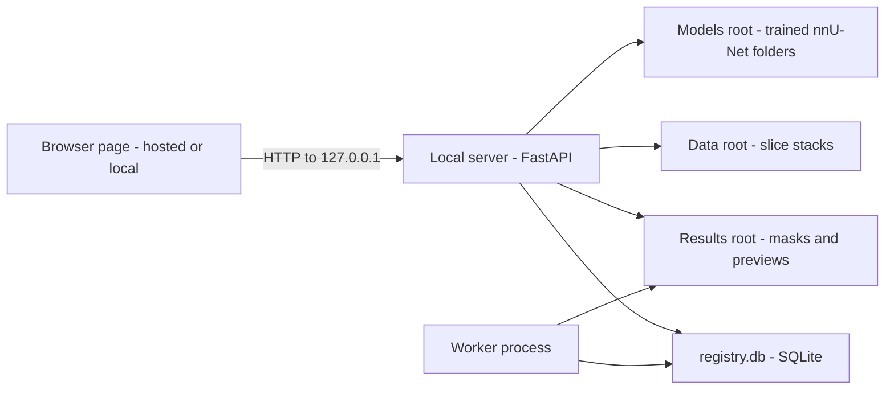
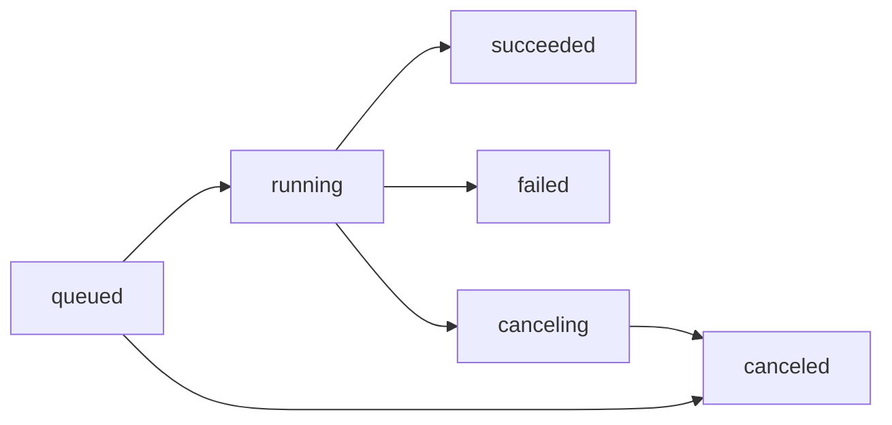
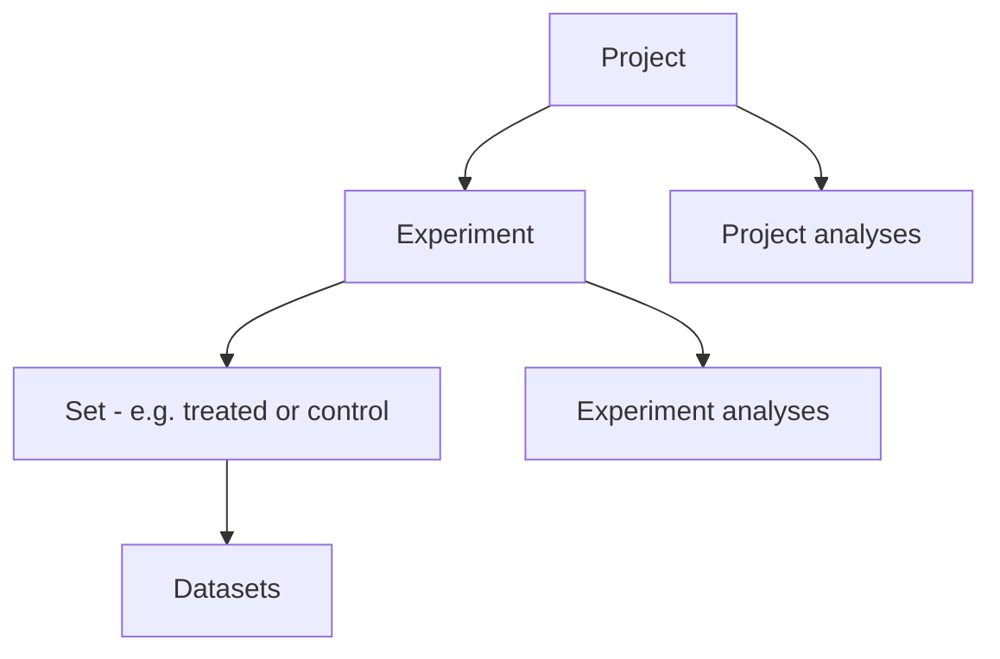

# User Guide

microCT Lab is a catalogue and workbench for microCT scans: it lists your
reconstructed slice stacks, runs a trained nnU-Net model over them, keeps every
result tied to the exact model version that produced it, lets you review the
masks, and measures BV/TV and digit length from them. Your job is mostly to pick a
scan, start a run, look at the mask, and say whether it is any good. This guide
covers every page in the app — **Overview**, **Projects**, **Datasets**,
**Models**, **Runs**, **Timeline** and **QC & Insights** — plus the run report,
QC review and comparison. No software or machine-learning background is assumed.

---

## Table of contents

1. [How the app is put together](#how-the-app-is-put-together)
2. [Getting around: the sidebar and page header](#getting-around-the-sidebar-and-page-header)
3. [Connecting to your local server](#connecting-to-your-local-server)
4. [The Overview page](#the-overview-page)
5. [Datasets: the scan catalogue](#datasets-the-scan-catalogue)
6. [Models and versions](#models-and-versions)
7. [Runs: queued to done](#runs-queued-to-done)
8. [Starting a run](#starting-a-run)
9. [The run report](#the-run-report)
10. [QC review: recording what you see](#qc-review-recording-what-you-see)
11. [Comparing runs](#comparing-runs)
12. [BV/TV and digit length on a run](#bvtv-and-digit-length-on-a-run)
13. [Projects, experiments, sets and analyses](#projects-experiments-sets-and-analyses)
14. [The Timeline](#the-timeline)
15. [QC and Insights](#qc-and-insights)
16. [Archive vs delete](#archive-vs-delete)
17. [Quick reference](#quick-reference)
18. [FAQ and troubleshooting](#faq-and-troubleshooting)

---

## How the app is put together

microCT Lab is two pieces, and knowing which is which explains almost every
surprise you will hit.

The **local server** runs on your own machine. It holds the registry (a SQLite
database), reads your scan folders, launches segmentation and measurement jobs,
and serves every number and image you see. The **web interface** — the thing you
are clicking — is only a page. It may be loaded from the hosted address
`https://microctweb.vercel.app` or served by the local server itself; either way
it holds no data of its own. Every screen is drawn from `/api/*` calls to your
machine.



Two consequences worth internalising:

- **Nothing leaves your machine.** Scans, masks, measurements and the registry
  all stay in folders on local disk. The page is static files; it never uploads
  your data anywhere.
- **The server does the bookkeeping, and a separate worker does the computing.**
  The server only *queues* jobs. A worker process picks them up. If no worker is
  running, everything you start sits at **queued** forever — this is by far the
  most common "nothing is happening" report. See
  [Runs: queued to done](#runs-queued-to-done).

Installing and running the server and its workers is
[Getting Started](/help/getting-started) and
[Administrator Guide](/help/admin-guide) territory; this guide assumes both are
already running.

---

## Getting around: the sidebar and page header

The left sidebar is on every screen. From top to bottom:

- The **microCT Lab** wordmark, with the subtitle *segmentation registry*.
- **The navigation list** — **Overview** (route: `/`), **Projects**
  (`/projects`), **Datasets** (`/datasets`), **Models** (`/models`), **Runs**
  (`/runs`), **Timeline** (`/timeline`), **QC & Insights** (`/insights`) and
  **Help** (`/help`). The page you are on is highlighted.
- **＋ New run** — the primary button near the bottom. It opens the
  [New segmentation run](#starting-a-run) dialog from anywhere, with nothing
  pre-selected.
- **The storage box** — a small footer panel listing the server's **data**,
  **results** and (if configured) **NAS** roots, plus the **compute** this
  machine offers, e.g. `cpu · CPU` or `cuda · NVIDIA RTX A5000`. If it reads
  *System info unavailable — not connected*, the page cannot reach your server.

Every page has a sticky header carrying the page title, a subtitle, any
page-specific action buttons on the right, and the **connection indicator** at the
far right. The **☰** button at the far left of the header hides the sidebar
entirely to give the content more room; click it again to bring it back. Your
choice is remembered in this browser.

One page is not in the nav: **Compare** (`/compare?ids=1,2`), which you reach from
the **Runs** table or from a run report.

**Help** (`/help`) is where you are reading this. It opens on a search box over
every guide, a **New here?** panel pointing at
[Getting Started](/help/getting-started), and a card for each of the seven
guides. The search box repeats at the top of every guide page, so you never have
to come back here to use it: type two or more characters and it lists matching
*sections* rather than whole guides, and picking one jumps straight to that
heading. Across some fifty thousand words, searching for the exact string on your
screen — an error message, a button label, a metric name — is usually faster than
guessing which guide owns it. **Help** is also the one part of the app that keeps
working when the server does not: the guides ship with the interface as static
files, so they are deliberately not behind the connection check that blanks every
other page.

> Note: detail pages are addressed with a query string, not a path segment — a run
> is `/runs?id=5` and a project is `/projects?id=3`. Those URLs are stable, so you
> can bookmark a run report or paste one to a colleague working against the same
> server. Filters live in the URL too, so `/datasets?type=uct&sort=slices` is a
> shareable view.

---

## Connecting to your local server

The indicator in the top-right corner is the health of the link between this page
and your machine. It shows one of four states:

- **Connected** — green. The server answered and any required token was accepted.
- **Checking…** — grey and pulsing. The first health probe has not come back yet.
- **Token needed** — amber. The server is running and is happy to talk to this
  page, but it rejected the request for lack of a valid access token.
- **Disconnected** — red. Nothing answered at the address shown beside the dot.

Click the indicator to open the **Local server connection** panel. It has two
fields: **API base URL** (where the server is listening — `http://localhost:8000`
by default) and **Access token**. **Save & reconnect** applies them; **Reset**
puts both back to defaults. Both are stored in this browser only, under the
`localStorage` keys `microct_api_base` and `microct_api_token`, and neither is
baked into the deployed page — which is why the same page works against any
machine.

When a page cannot load, the app replaces the content with a diagnostic panel
rather than a spinner, and names the three things that are ever actually wrong:
the server is not running; the server was started without allowing this page's
origin; or the base URL is wrong. The allowed-origin case is the common one — the
server's `.env` must name this page's origin in `MICROCT_ALLOWED_ORIGINS` before a
browser will let the page talk to it. A token is not required by default; setting
`MICROCT_API_TOKEN` makes one mandatory for every caller except a page whose
`Origin` is `localhost` or `127.0.0.1`, and a caller that sends no `Origin` at
all from a loopback address. Anything else — including the hosted page, and
including a script on another machine — has to send it.

> Tip: to tell the two failures apart in one move, open
> `http://127.0.0.1:8000/api/health` directly in a browser tab. If that shows
> JSON, the server is fine and the problem is the allowed-origin setting.

Chrome and Edge are verified. Safari will most likely refuse to let an HTTPS page
reach `localhost` at all; if you are on Safari, serve the interface from the local
server itself (the `MICROCT_WEB_DIR` setting) instead of using the hosted address.

---

## The Overview page

The **Overview** page (route: `/`) is the home screen: six counters and your most
recent runs.

The tiles are clickable and each lands somewhere useful:

- **Datasets** — how many scans are catalogued. Opens the **Datasets** page.
- **Models** — how many model versions are registered, with the number of families
  underneath. Opens **Models**.
- **Runs** — every run ever started. Opens the full **Runs** table.
- **Succeeded** — runs that produced a mask. Opens **Runs** filtered to status
  **succeeded**.
- **Running / Queued** — work in flight right now.
- **Failed** — runs that errored. Opens **Runs** filtered to **failed**.

Below the tiles, **Recent runs** lists the last eight runs with their dataset,
model and version, status, ROI volume and creation time. Click any row to open its
[run report](#the-run-report); **View all** opens the **Runs** table.

On a brand-new install the table reads *No runs yet — register a model, ingest
datasets, then start a run*, which is exactly the right order to do things in.

> Note: the **Running / Queued** tile adds running and queued together, but
> clicking it filters the run table to **running** only. If the count looks higher
> than the list, switch the status filter to **queued** to see the rest.

---

## Datasets: the scan catalogue

The **Datasets** page (route: `/datasets`) is the catalogue of everything the server
has found on disk. A dataset is one reconstructed slice stack — a folder of
`*rec*.bmp` or `*rec*.tif` files with the SkyScan `*_rec.log` beside it.

### Filling the catalogue

Click **⟳ Ingest datasets** in the page header. The server walks the configured
data root, and for every `*_rec.log` with an actual slice stack beside it it reads
the scan metadata (scanner, voxel size, frame size, bit depth, kV, µA, filter,
scan date, study), counts the slices, measures the total size, and renders a
thumbnail from the middle slice. A toast reports the outcome, e.g.
`Ingest: +2 new, 0 updated`.

Ingest is safe to repeat. A folder already in the catalogue is *updated* in place
rather than duplicated, so re-running it after a new scan lands is the normal way
to keep the list current. Folders with a log but no slices are silently skipped.

### Searching, filtering and sorting

The toolbar above the results holds, left to right:

- **Search datasets…** — matches the dataset name. It waits a moment after you
  stop typing before querying, so you can type freely.
- **All types** — the dataset type, e.g. `uct`.
- **All studies** — the study name read from the scan log.
- **Any tag** — any tag applied to a dataset.
- **Sort** — **Newest**, **Name**, **Voxel size**, **Slices**, **Scan date** or
  **Type**.
- **↓ / ↑** — descending or ascending.
- **🌳 Tree / ▦ Grid** — switch between the two layouts.

Every one of these is written into the URL, so a filtered catalogue is a link you
can share or bookmark.

### Grid view vs tree view

**Grid** is the default: one card per dataset showing the thumbnail, the name, an
amber **★** if the dataset is flagged, a chip with the run count, the study, voxel
size and dimensions, and the scanner and scan date. Each card carries **◉
Visualize** (opens the drawer) and **▶ Run** (opens the New run dialog with this
dataset already ticked).

**Tree** reorganises the same datasets by **type → organism**, which is the faster
way to find something once the catalogue grows. Each leaf shows the slice count and
run count, and clicking one opens the same drawer.

### The dataset drawer

Clicking a card or a tree row opens a drawer with everything known about that
scan:

- A viewer at the top. It loads nothing until you click **⬡ Visualize — build a 3D
  volume**, because the server has to build a downsampled volume from the slice
  stack the first time you ask. Until then you get the thumbnail. The viewer's
  controls are documented in the [Viewer Guide](/help/viewer-guide).
- **Type**, **Organism**, **Study**, **Scanner**, **Voxel size**, **Dimensions**,
  **Bit depth**, **Source** (kV / µA), **Filter**, **Scan date**, **Size** and the
  full **Path** on disk.
- Any **tags** and **notes**.
- **Runs on this dataset** — every run made from this scan with its model version,
  status, ROI and QC outcome. Click a row to open that run's report. This is the
  panel you use to compare model versions on one specimen.
- **📂 Open folder** opens the dataset's folder in the file manager *on the machine
  running the server*, and **▶ New run** starts a run on it.

> Note: the drawer is read-only in this version. There is no delete or archive
> control for datasets on this page either; see
> [Archive vs delete](#archive-vs-delete).

**Organism, tags, notes and the flag cannot be set from anywhere in this app.**
This is worth stating plainly rather than leaving you hunting for the control.
Ingest reads the scanner log, which does not record any of them, so a freshly
ingested dataset has `organism` empty, `tags` empty, `notes` empty and the flag
off — and nothing in the interface can change that. There is no editor in the
drawer, no bulk action on the **Datasets** page, and no command-line tool
(`microct-ingest` and `microct-register-model` are the only catalogue commands
and neither writes these fields). The single route is a direct API call:

```
PATCH /api/datasets/{id}
{"organism": "mouse", "tags": ["treated", "R13"], "notes": "…", "flagged": true}
```

Two visible consequences follow, and neither is a fault in what you are looking
at. The **All studies** filter works, because `study` does come from the scan
log — but **Any tag** and the organism grouping have nothing to offer. And
**Tree** view, which organises by **type → organism**, collapses to a single
`uct` bucket with every dataset under one unnamed organism. Until an editor
exists, use **Projects → experiments → sets** for grouping; that hierarchy *is*
editable from the interface and does the same job.

---

## Models and versions

The **Models** page (route: `/models`) lists the trained nnU-Net models the
registry knows about, grouped by **family**. A family is a lineage — `v1`, `v2`,
`v3` of the same model — and grouping them is what makes "did the retrain actually
help" an answerable question.

Each card shows:

- The **display name**, the **version** tag and the nnU-Net **configuration**
  (e.g. `3d_fullres`).
- The **CV Dice** — the model's own cross-validation Dice score, read out of the
  training folder, in large green type. This is how the model scored during its
  own cross-validation; it is not a score for your scans.
- **Labels** it predicts, **Train spacing** (its training resolution in µm),
  **Train cases**, the weight **Fingerprint**, and when it was added.

The buttons on a card are **Run…** (opens the New run dialog with this model
selected), **✎ Rename** (changes the display name and description without touching
the folder on disk) and **＋ Version** (opens registration pre-filled with this
family, for adding the next version).

### Registering a model

Click **＋ Register model** in the header. There are two ways in:

- **Scan models root** — the server walks the configured models root, finds every
  trained folder, and registers the new ones in one go. Start here.
- **Register** one folder by path. The **Model folder path** must be the folder
  that *directly* contains `plans.json`, `dataset.json` and `fold_0 … fold_4`.
  **Name**, **Family** and **Version** are optional: the family defaults to the
  training dataset name and the version auto-increments to the next `vN` in that
  family.

Registration reads the folder and computes a fingerprint of the weights. If a
model with the same fingerprint is already registered, the existing one is
returned instead of a duplicate — so scanning the models root repeatedly is
harmless.

> Note: every run stores a *snapshot* of the model at the moment it started — name,
> family, version, fingerprint, path, configuration and CV Dice. Renaming a model
> later does not rewrite history; old run reports keep showing what was actually
> true when they ran.

---

## Runs: queued to done

A **run** is one model applied to one dataset. The **Runs** page (route: `/runs`)
is the full processing history.

### The statuses



- **queued** — created, waiting for a worker to pick it up.
- **running** — a worker has claimed it and the segmentation is executing.
- **succeeded** — finished; mask and preview written, metrics recorded.
- **failed** — the job exited non-zero or produced no result. The report carries
  the tail of the log.
- **canceling** — you asked it to stop and the worker has not killed the process
  yet. Usually a few seconds.
- **canceled** — stopped before completion.

**A queued run needs a worker.** The server enqueues; a separate process executes.
`microct-worker` handles segmentation and wants a GPU; `microct-measure-worker`
handles BV/TV and digit-length measurements and is CPU-only. If nothing ever leaves **queued**, the answer
is almost always that no worker is running on that machine.

### The table

Three dropdowns above the table filter it: **All statuses**, **All QC**
(unreviewed / pass / minor / fail) and **Any failure mode** (the failure-mode
vocabulary). Like the dataset filters they live in the URL — which is how the tiles
and charts elsewhere in the app link into a pre-filtered run list.

The columns are a selection checkbox, **Run** number, **Dataset**, **Model** with
its version tag, **Status**, **ROI volume**, **Duration**, **Machine**, **QC** (the
outcome pill plus an amber **⚑** when flagged for retraining), and **Created**.
Clicking anywhere on a row opens the report.

At the right end of each row:

- **■** — stop a queued or running run.
- **🗄** — archive a finished run. Runs are never deleted; see
  [Archive vs delete](#archive-vs-delete).

Tick two or more rows and use **⇄ Compare selected** in the header to open them
side by side.

> Note: the status dropdown lists queued, running, succeeded, failed and canceled,
> but not **canceling**. A run mid-cancel appears under **All statuses** and
> nowhere else. It is a transient state, so this rarely matters.

---

## Starting a run

Open the **New segmentation run** dialog from **＋ New run** in the sidebar, from
**▶ Run** on a dataset card, from **▶ New run** in the dataset drawer, or from
**Run…** on a model card. The dialog is the same wherever you start it, and
whatever you started from is pre-selected.

1. **Model & version** — pick the model. Each option shows the family, the version
   and the model's CV Dice.
2. **Compute available** — not an input, a readout. It names this machine, its CPU
   and thread count and RAM, its GPUs (or *none detected*), and what **auto** will
   resolve to. Read it before choosing a device.
3. **Datasets** — tick one or more. The field header counts your selection and each
   row shows the dataset's voxel size. Ticking several queues one run per dataset.
4. **Folds** — which cross-validation folds to run. `0` is a single fold and the
   right first pass. `0 1 2 3 4` is the five-fold ensemble: the most accurate
   option and roughly five times the work.
5. **Device** — `auto`, `cuda` or `cpu`, restricted to what the machine actually
   offers. `auto` shows what it will pick.
6. **Step (overlap)** — the sliding-window step, `0.5` by default. A larger value
   such as `0.7` moves the window further each time, so the run is faster with
   less overlap averaging.
7. **Test-time augmentation** — predicts several mirrored variants and merges them.
   More accurate, substantially slower. Off by default.

Click **Queue run(s)**. A toast confirms how many were queued and you land on the
**Runs** table with them sitting at **queued**.

> Tip: on a GPU a scan is typically minutes. On CPU it can be hours — the seeded
> example run in the demo registry took 6,582 seconds on a 24-thread CPU with no
> GPU. Check the **Compute available** box before you queue twenty datasets.

If the dialog says *No models registered yet* or *No datasets yet*, it points you
at the step you skipped. Nothing can be queued without one of each.

---

## The run report

Clicking any run opens its report at `/runs?id=N`. The header names the run, the
dataset and the model version, and carries the run's actions:

- **⇄ Compare dataset runs** — opens [Compare](#comparing-runs) with every run on
  this dataset. Needs at least two.
- **🖼 Mask BMPs** — succeeded runs only. Writes the mask as one BMP per slice into
  the run's results folder, named to line up with your input slices. Once present
  the button shows a ✓ and the slice count, and clicking again reuses the existing
  stack rather than rebuilding it.
- **⭳ Export report** — downloads a Markdown summary of the whole report: summary,
  parameters, environment debrief, QC outcome, failure modes, flag and note.
- **■ Stop run** — only while queued or running.
- **🗄 Archive** / **⇤ Unarchive** — only once the run has finished.
- **← All runs**.

### While it is running

A progress banner sits above everything, polling every few seconds. It names the
phase — **Starting**, **Converting slices → volume**, **Loading model**,
**Segmenting — nnU-Net inference**, **Finalizing — mask, preview, BMPs** — with a
percentage, elapsed time and a rough time remaining. The percentage is driven by
nnU-Net's completed sliding-window patches; when the log has not yet produced a
patch count the bar animates as an indeterminate sweep instead of showing a number
it cannot justify.

### The panels

The left column holds two panels:

- **Viewer** — the grey scan with the segmentation drawn over it in red, for
  succeeded runs. **▾ / ▸** collapses it without discarding the loaded volume. All
  of its controls, keyboard shortcuts and cine playback are in the
  [Viewer Guide](/help/viewer-guide).
- **Run log** — the worker's raw output, following the tail as lines arrive, with a
  **reload** button. This is where a failure explains itself.

The right column stacks:

- **Summary** — dataset, model, version, status, ROI volume, duration, machine and
  device, with the status badge in the panel header.
- **Segmentation metrics** — **ROI volume** (mm³), **ROI voxels**, **ROI (µm³)**,
  **best slice**, **peak RAM** and the model's **Dice (CV)** from the snapshot.
- **BV/TV & digit length** — succeeded runs only. See
  [BV/TV and digit length on a run](#bvtv-and-digit-length-on-a-run).
- **Parameters** — folds, TTA, step, device, spacing in mm, the slice-file pattern
  and the model fingerprint. This is the reproducibility record.
- **Run environment** — the machine debrief captured automatically when the run
  executed: OS, CPU, cores, RAM, device, GPU and VRAM, CUDA / torch / nnU-Net
  versions, peak memory and per-phase timings.
- **QC & failure modes** — the review form, covered next.

---

## QC review: recording what you see

This is the part of the app only you can do, and it is what makes the rest of it
worth having. The **QC & failure modes** panel at the bottom of a run report has
four controls.

**Outcome.** Pick one of three:

- **pass** — the mask is usable as-is.
- **minor** — usable, with caveats worth writing down.
- **fail** — the mask is rejected.

**Failure modes.** Click as many chips as apply. The vocabulary is fixed so the
same problem is always named the same way:

| Failure mode | What it means |
| --- | --- |
| False positive outside specimen | Mask voxels outside the sample entirely |
| Boundary leak / bleed | The mask spills past the true edge |
| Under-segmentation | Part of the ROI is missing |
| Over-segmentation | Extra tissue included |
| ROI entirely missed | Nothing useful was found |
| Fragmented / split ROI | One structure came out as several pieces |
| Ring/beam-hardening artifact segmented | A reconstruction artifact was labelled |
| Sample holder / mounting segmented | Hardware labelled as specimen |
| Low-contrast region | Failure attributable to weak contrast |
| Noisy reconstruction | Failure attributable to reconstruction noise |
| Resolution / spacing mismatch | Scan resolution unlike the model's training resolution |

**Note.** Free text — what went wrong, or what to study later.

**⚑ Flag for retraining.** Tick this when the *data* is worth adding to the next
training round. That is a different judgement from "this run was bad": a run can
fail for boring reasons and be useless for training, and a run can pass and still
be an interesting edge case.

Click **Save review**. **View all failure modes →** takes you to
[QC and Insights](#qc-and-insights).

### Why tagging is worth the thirty seconds

Tags are how a pile of individual disappointments becomes a work list. Because
every tag comes from the same vocabulary, the **Failure modes** chart can rank what
actually goes wrong across the whole registry, and one click on a bar pulls up
every case with that problem. "Show me every boundary leak" is what tells you
whether the next model needs more edge cases in training or whether your scans need
a different filter. Untagged failures cannot be counted, so they cannot be
prioritised.

> Note: the outcome buttons offer only pass, minor and fail. Saving a review while
> the run still reads **unreviewed** records **pass**. There is no way back to
> **unreviewed** from the interface, so treat the first save as a commitment.

---

## Comparing runs

Comparison is how you answer "is `v2` better than `v1` on this specimen". There are
two ways in: tick two or more rows on the **Runs** table and click **⇄ Compare
selected**, or open a run report and click **⇄ Compare dataset runs**, which selects
every run on that dataset for you. Both land on `/compare?ids=…`.

What you get depends on what you picked:

- **Two or more succeeded runs** — a linked side-by-side viewer under one shared
  toolbar, capped at two panes. Scrubbing or moving the crosshair in one pane moves
  the other to the same place, so you are always comparing the same location. The
  controls are in the [Viewer Guide](/help/viewer-guide).
- **Anything else** — a grid of the server-rendered preview images, each with its
  ROI volume and its percentage difference against the first run selected, plus an
  **Open report** button.

Below either view, the **Metric comparison** table covers *every* run you selected,
one column each: model and version, weight **fingerprint**, status, ROI volume, ROI
voxels, duration, machine, device, GPU, peak RAM, folds, TTA, QC outcome and failure
modes.

The fingerprint row is what makes the comparison trustworthy. Two runs labelled
`v1` and `v2` with the same fingerprint are the same weights under two names, and
any difference between them is not the model.

> Tip: comparison is most useful within one dataset. Comparing ROI volumes across
> two different specimens tells you about the specimens, not the models.

---

## BV/TV and digit length on a run

Once a run has succeeded, its report grows a **BV/TV & digit length** panel,
marked **LeviDigit · official**. This is a second, optional job that measures,
from the run's segmentation mask:

- **BV/TV** — bone volume (mask voxels at or above the bone threshold) divided by
  total volume (all mask voxels), shown as a percent, with BV and TV in mm³.
- **Digit length** — from the centroid of the digit's largest concavity to its
  distal tip, counting only the parts of that line inside the mask, in mm and µm.

Check the **bone threshold** (a grey value, 0 to 255, inclusive; the box shows
the server's default) and click **📏 Measure BV/TV + digit length**. **Skip
figures (faster)** leaves out the publication figure. It runs on CPU, usually in
seconds, and needs a measurement worker (`microct-measure-worker`, or a plain
`microct-worker`) or it will sit at **queued**.

The result shows the two numbers as tiles, LeviDigit's figure (the bone, the BV
inside it, and the measured line), **Details** (voxel counts, the counted
fraction of the line, landmark coordinates), and **⭳ CSV**. **Measure again**
queues another measurement, for example at a different threshold; earlier ones
are kept, and each records the threshold it used.

Things to know:

- **Digit length only on digits.** A dataset whose subtype is not `digit` gets
  BV/TV only, and the panel says so before you queue. Set the subtype in the
  dataset drawer.
- **No digit length is not zero.** If LeviDigit cannot find a defensible
  concavity on the mask, the panel says **No digit length** and reports none.
  That usually means the mask needs work: crop it (**✂ Crop mask**) and measure
  again.
- **4 µm only.** LeviDigit refuses scans that are not 4 µm isotropic (within 1%),
  and the measurement fails with that reason rather than producing a number.

> Safety note: a measurement is only as good as the mask under it. Review the
> segmentation before you put a number in a figure.

The full method and every field are in the
[BV/TV & Digit Length Guide](/help/levidigit-guide).

---

## Projects, experiments, sets and analyses

The **Projects** page (route: `/projects`) is the organisational layer on top of the
catalogue. It exists so that "the treated group in experiment 2" is something the app
understands, rather than something you keep in a spreadsheet.



The list shows one card per project with its tags, description and three counts:
**Experiments**, **Datasets**, **Analyses**. **＋ New project** asks for a name, a
description and comma-separated tags, then opens the new project straight away.

### Inside a project

The project page (`/projects?id=N`) renders the whole hierarchy on one screen. The
header carries **✎ Edit**, **＋ Experiment**, **＋ Analysis** and **← Projects**.

Each **experiment** is a panel with a name and a **type** — `uct`, `scrna`,
`spatial`, `omics` or `other` — which sets its icon and travels with it into its
statistics and export bundle. Its actions are:

- **📈 Stats** — per-set descriptive statistics, described below.
- **⭳ Export** — builds a zip on the server, then offers it for download.
- **＋ Set** — add a group.
- **＋ Analysis** — attach an analysis to this experiment rather than the project.
- **✎** and **✕** — edit or delete the experiment.

Each **set** inside it lists its datasets, with **＋ datasets** to edit membership.
That dialog shows the datasets already in the set plus every dataset that belongs to
no set at all; ticking adds, unticking removes. Unticking only unlinks — the dataset
and all its runs are untouched. Datasets attached to an experiment but to no set
appear under **Not in any set**.

### Statistics

**📈 Stats** compares sets on one metric: **ROI volume in mm³, taken from each
dataset's latest successful run**. You get **n**, **mean**, **sd**, **min** and
**max** per set, and — when the experiment has two or more sets — a comparison of
the first two: the mean difference, the test used, its p-value, and a Mann–Whitney
p-value where applicable.

A set can legitimately show **n = 0** while listing datasets. That means those
datasets have never been segmented successfully; the modal says so explicitly rather
than leaving you with a puzzling zero.

### Export

**⭳ Export** is deliberately two steps. First the server builds the archive and
tells you its filename, size and where it was written on the server machine; then
**⭳ Download zip** copies it to you. The bundle contains `manifest.json`,
`stats.json`, and each successful run's preview, log and result JSON. **Full masks
are not included** — they are large, and they are already on disk next to the run.

### Analyses

An **analysis** is a *pointer*, not an upload. Your R code and figures already live
in the shared Analyses folder; an analysis record says where. Give it a **title**,
an optional **type / comparison** (e.g. "treated vs control") and a **files folder**
relative to the Analyses root. Leave the path blank and it uses a default
`analysis_<id>` folder.

Opening one shows the figures in that folder as a grid and its other files as a
downloadable table. The app only ever reads that folder. If the folder does not
exist on the machine running the server, the modal says so — which usually means you
are looking at the right record from the wrong machine.

---

## The Timeline

The **Timeline** (route: `/timeline`) is one chronological feed of everything that
has happened, newest first, grouped under a heading per day. Three kinds of event
appear, each with its own glyph and colour:

- **▦ Dataset** — a scan entering the catalogue. Clicking it opens the dataset drawer
  without leaving the feed.
- **▶ Run** — a segmentation run, with its current status and the dataset it ran on.
  Clicking it opens the run report.
- **▣ Project** — a project being created. Clicking it opens the project.

The subtitle counts the events. There are no filters here and none are needed — the
point is recency, not search. When there is nothing to show it says so, and explains
what would put something here.

---

## QC and Insights

**QC & Insights** (route: `/insights`) is the review dashboard: the answer to "how
much have we actually looked at, and what keeps going wrong". Everything on it is
read-only, and everything on it is a link into a filtered **Runs** table.

Across the top, four registry totals: **Runs** (with how many are in flight),
**Succeeded** (with its share of all runs), **Failed** and **Unreviewed**.

Below that, **Review status** and four QC tiles — **pass**, **minor**, **fail**,
**unreviewed** — each showing its count and its share of all runs. An empty tile
shows what the bucket *means* instead of a dead link: *mask accepted as-is*, *usable
with caveats*, *mask rejected*, *no QC review saved yet*. A tile with rows behind it
is clickable and takes you to those runs.

Two panels sit underneath:

- **Failure modes** — a ranked bar chart of what actually goes wrong. Bar width is
  relative to the biggest mode, not to the run count, so the ranking stays legible
  with only a handful of reviews. Click a bar to open every run tagged with it.
  Counts are per tag and one run can carry several, so they will not add up to the
  number of reviewed runs. With nothing tagged yet, the panel explains what fills it
  and lists the modes available.
- **⚑ Flagged for retraining** — the shortlist you built with the flag checkbox,
  with each run's dataset, model version, QC outcome and how many modes it carries.
  This is the hand-off to whoever assembles the next training set.

---

## Archive vs delete

The rule across the whole app is that **provenance is never destroyed**, and it
plays out differently for each kind of object.

**Runs are never deleted, only archived.** An archived run drops out of the default
views but keeps its metrics, parameters, environment debrief and QC review. Archive
with **🗄** on the run report or the run row; put it back with **⇤ Unarchive**. A run
must be finished first — the server refuses to archive something still queued,
running or canceling, and asks you to stop it. The delete endpoint exists only to
return an explicit error telling you to archive instead.

> Safety note: **note the run number before you archive it.** Nothing in this
> interface lists archived runs. The **Runs** page filters on status, QC outcome
> and failure mode and has no "show archived" option; the **Overview** tiles, the
> **Timeline** and **QC & Insights** all read the same default views. **⇤
> Unarchive** lives only on the run's own report, which — once the run is out of
> every table — you can reach in exactly one way: type `/runs?id=<the number>`
> into the address bar. The record is safe and the server can list archived runs
> perfectly well; it is the interface that has no way in yet. So archiving is
> reversible in principle and one-way in practice unless you wrote the id down.

**Datasets are archived when they have runs.** Removing a dataset that has never
been run removes it from the registry, and the files on disk are untouched. Removing
a dataset that *has* runs archives it instead, because a run is a provenance record
that must outlive the thing it points at. A dataset with runs still queued or in
flight cannot be removed at all until those stop.

**Deleting inside a project removes structure, never data.** Each confirmation tells
you exactly what happens:

- **Experiment** — its sets go with it, but their datasets are only unlinked.
- **Set** — its datasets are only unlinked; they stay in the catalogue and keep their
  runs.
- **Analysis** — only the record is removed; the R code and figures on disk are
  untouched.

> Safety note: the only genuinely destructive action anywhere in this interface is
> deleting an analysis record, and even that leaves every file where it was. Nothing
> in the app deletes a mask, a scan or a result folder.

---

## Quick reference

| Page | Route | What it is for |
| --- | --- | --- |
| Overview | `/` | Counters and the last eight runs |
| Projects | `/projects` | Projects, experiments, sets, analyses |
| Project detail | `/projects?id=3` | One project's whole hierarchy |
| Datasets | `/datasets` | The scan catalogue; ingest lives here |
| Models | `/models` | Registered models and versions |
| Runs | `/runs` | Processing history and filters |
| Run report | `/runs?id=5` | One run: viewer, metrics, log, QC |
| Compare | `/compare?ids=1,2` | Side-by-side runs and metric table |
| Timeline | `/timeline` | Everything, newest first |
| QC & Insights | `/insights` | Review status and failure-mode ranking |

| Term | Meaning |
| --- | --- |
| Dataset | One reconstructed slice stack plus its scan metadata |
| Model | One trained nnU-Net folder, registered with a version and a fingerprint |
| Family | A model lineage — `v1`, `v2`, `v3` of the same model |
| Run | One model applied to one dataset |
| ROI volume | Segmented volume in mm³ — the headline result number |
| CV Dice | The model's own cross-validation score, not a score for your scan |
| Fingerprint | A hash of the model weights; proves two runs used the same model |
| Measurement | A LeviDigit BV/TV + digit-length job over a succeeded run's mask |
| Set | A group of datasets inside an experiment, e.g. treated or control |

---

## FAQ and troubleshooting

**My run has said "queued" for an hour and nothing is happening.**
The server only queues jobs; a separate worker executes them. If no worker process
is running on that machine, queued runs wait forever. Start `microct-worker` for
segmentation, or `microct-measure-worker` for measurements, and the queue drains in
order. This is the single most common support question.

**Every page says it can't reach the local lab server.**
Three things cause this, in order of likelihood. The server is not running — start
it and leave it running. The server was started without allowing this page's origin,
so the browser refuses to talk to it; the origin has to be listed in
`MICROCT_ALLOWED_ORIGINS` in the server's `.env`. Or the base URL is wrong — click
the connection indicator and check it. Opening `http://127.0.0.1:8000/api/health` in
a tab settles it: if that shows JSON, the server is fine and it is the allowed-origin
setting.

**The indicator says "Token needed".**
The server answered, so it is running and your origin is allowed — the hard parts are
done. It is configured with `MICROCT_API_TOKEN`, so every `/api/*` call from a
non-local page has to carry that token. Click the indicator and paste the token your
server printed at startup. It is stored in this browser only.

**Nothing loads in Safari but the server is definitely up.**
Safari will most likely not let an HTTPS page reach `localhost` at all. Use Chrome or
Edge, both of which are verified, or serve the interface from the local server itself
via `MICROCT_WEB_DIR` so the page and the API share an origin.

**I clicked "Ingest datasets" and nothing new appeared.**
Ingest only picks up folders that contain a SkyScan `*_rec.log` *and* an actual slice
stack beside it (`*rec*.bmp`, `*rec*.tif` or `*rec*.tiff`). A folder with a log but no
slices is skipped. Check too that the folder sits under the server's configured data
root — the sidebar's storage box shows which one that is.

**Will re-ingesting duplicate my datasets or lose my tags?**
No. A folder already in the catalogue is updated in place, not added again. Ingest
refreshes the metadata read from the scan log; it does not touch the runs made from
that dataset.

**I registered the same model twice by mistake.**
You did not. Registration fingerprints the weights, and a folder whose fingerprint is
already registered returns the existing model instead of creating a second one.
Scanning the models root repeatedly is safe.

**The Dice score on the model card looks great, but my mask is bad.**
CV Dice is the score the model achieved during its own cross-validation, on its own
training data. It says nothing about how the model performs on *your* scan, especially
if your voxel size differs from the model's train spacing. That gap is exactly what
the [QC review](#qc-review-recording-what-you-see) exists to record.

**I can't set a run back to "unreviewed".**
There is no control for it. The outcome buttons are pass, minor and fail, and saving a
review while the run still reads unreviewed records **pass**. If you saved by accident,
the honest fix is to set the correct outcome and explain it in the note.

**My run failed. Where do I find out why?**
Two places. The recorded error — the exit code plus the last eight lines of the log —
is printed **inside the black Viewer panel**, where the volume would have been on a
succeeded run. It is not in **Summary**; that panel only ever shows dataset, model,
version, status, ROI volume, duration, machine and device. For the whole story open
the **Run log** panel, which is the worker's raw output and where the failure almost
always explains itself in the last few lines. **Run environment** tells you which
machine and device it ran on, which matters when a run works on one box and not
another.

**I stopped a run and it is stuck on "canceling".**
Canceling flags the run, and the worker kills the segmentation process the next time it
polls — usually within a few seconds — after which the run becomes **canceled**. If it
stays there, the worker is not running. A worker started afterwards cleans up jobs left
mid-flight when it starts.

**How do I delete a run I don't want cluttering the list?**
You archive it. Runs cannot be deleted, because they are the provenance record for
every number derived from them. **🗄** on the row or the report hides it from the
default views, and **⇤ Unarchive** brings it back. See
[Archive vs delete](#archive-vs-delete).

**The digit length says "not measured" or "No digit length".**
"Not measured" means the dataset is not categorized as `digit`, so only BV/TV
ran; set its subtype and measure again. "No digit length" means LeviDigit found
no defensible concavity on this mask. Neither is a length of zero. Check the mask,
crop it if needed, and measure again.

**Comparison only shows two viewers even though I selected four runs.**
The linked view is capped at two panes — a third volume will not fit alongside the
first two in browser memory, and three-way visual comparison is not readable at that
size. The **Metric comparison** table below covers every run you selected.

**Where are my files? Can I just copy them?**
Datasets, results, models and the registry all live in ordinary folders on disk, listed
in the sidebar's storage box, and **📂 Open folder** in the dataset drawer opens the
right one. You can copy the data folders freely. The registry database is the
exception: it is SQLite in WAL mode, and copying `registry.db` on its own silently
loses recent work — it has dropped an entire table that way. Back it up with
`scripts/backup_registry.py`, which uses the online backup API, and use
`--rewrite OLD=NEW` when moving to another machine so the absolute paths stored
throughout get retargeted. Full instructions are in the
[Administrator Guide](/help/admin-guide).

**Can a colleague open this page and see my data?**
They will see the interface, because it is just a page — but it will show *their*
machine's data, or nothing at all. The page always talks to the server named in its own
connection settings, and by default that is `127.0.0.1`. Sharing a registry means
pointing the base URL at a machine that is serving one and is configured to allow it,
which is covered in the [Administrator Guide](/help/admin-guide).
