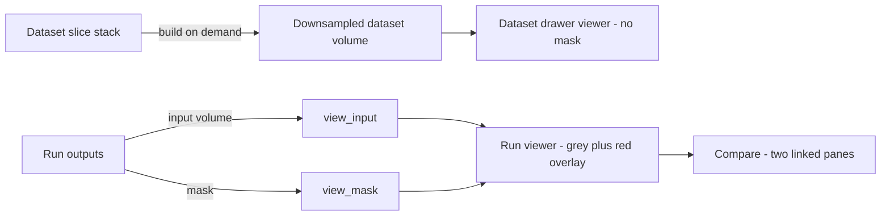
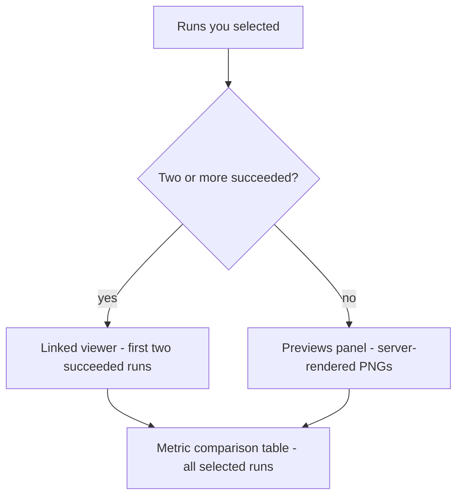

# Viewer Guide

The viewer is where you actually look at a scan and at what the model made of it —
the grey microCT volume underneath, the segmentation drawn over it in red, and a
set of controls for moving through the stack. Your job here is to *judge*: does
the red land where the anatomy is, and does it stop where the anatomy stops. This
guide covers loading a volume, the control rail, the five view modes, cine
playback, the keyboard shortcuts, the 3D rotate pad, comparing two runs side by
side, and what to do when the interactive viewer will not start. No graphics or
imaging-software background is assumed.

---

## Table of contents

1. [What the viewer shows you](#what-the-viewer-shows-you)
2. [Where the viewer appears](#where-the-viewer-appears)
3. [Loading a volume: why it is downsampled](#loading-a-volume-why-it-is-downsampled)
4. [The control rail](#the-control-rail)
5. [View modes and the crosshair](#view-modes-and-the-crosshair)
6. [Zoom, pan and contrast](#zoom-pan-and-contrast)
7. [Mask opacity](#mask-opacity)
8. [The cine bar and the slice scrubber](#the-cine-bar-and-the-slice-scrubber)
9. [The 3D rotate pad](#the-3d-rotate-pad)
10. [Maximize and reset](#maximize-and-reset)
11. [Keyboard shortcuts](#keyboard-shortcuts)
12. [Comparing two runs side by side](#comparing-two-runs-side-by-side)
13. [When the viewer falls back to the preview image](#when-the-viewer-falls-back-to-the-preview-image)
14. [Downloading the mask](#downloading-the-mask)
15. [Quick reference](#quick-reference)
16. [FAQ and troubleshooting](#faq-and-troubleshooting)

---

## What the viewer shows you

Two things are stacked on top of each other in every run viewer, and it helps to
know which is which before you touch a control.

**The scan.** The bottom layer is your reconstructed microCT volume — the same
slice stack you ingested, in greyscale. Bright is dense, dark is air. Nothing has
been added to it.

**The mask.** The top layer is the **segmentation mask**. In plain terms, a mask
is a second volume laid out on exactly the same grid of voxels as the scan, where
every voxel holds a label instead of a brightness: `0` means "background" and `1`
means "this is the region of interest". It is not a picture and not an outline —
it is one yes-or-no answer per voxel, produced by the nnU-Net model that ran on
this scan. The viewer paints it on screen so you can see it, but underneath it is
just labels.

**The red is the mask, and only the mask.** Every voxel the model labelled `1`
is tinted red; everything labelled `0` is left completely transparent. That is
why the red never covers the whole image — the overlay is configured to show only
values from `0.5` upward, so background contributes nothing. Red means *the model
called this the ROI*. It does not mean the model was right.

That distinction is the whole point of looking. The mask is what every downstream
number is computed from: **ROI voxels** and **ROI volume** on the run's
**Segmentation metrics** panel, and every BV/TV and digit-length measurement derived from it
later. If the red is in the wrong place, the numbers are wrong too, however
confident they look.

> Note: the viewer is read-only. You cannot paint, erase or edit a mask here, and
> there is no brush or contour tool anywhere in microCT Lab. What you can do is
> record a verdict — see the QC controls described in the
> [User Guide](/help/user-guide) — or fix the input and run the model again.

> Safety note: a mask that looks convincing on screen can still be wrong in ways
> that only show up in the numbers. BV/TV and digit length are computed inside
> whatever the mask contains, so check it here before trusting a measurement.
> See the [BV/TV & Digit Length Guide](/help/levidigit-guide).

---

## Where the viewer appears

There are three places to look at a volume, and they are deliberately not the
same.

- **A run's report** — the **Runs** page (route: `/runs`), then open a run
  (route: `/runs?id=1`). The **Viewer** panel sits at the top left and shows the
  scan with the run's mask over it. It starts loading as soon as the page does.
  The **▾** button in the panel header collapses it and **▸** brings it back;
  collapsing hides the viewer without throwing the volume away, so re-opening is
  instant.
- **A dataset** — the **Datasets** page (route: `/datasets`), then open a
  dataset to get its detail drawer. This viewer shows the raw scan with **no
  mask**, because a dataset has no segmentation of its own. It does not load
  automatically: you get a **⬡ Visualize — build a 3D volume** button first
  ([why](#loading-a-volume-why-it-is-downsampled)).
- **Compare** — route `/compare?ids=1,2`. Two runs, two panes, one shared
  toolbar. See [Comparing two runs side by side](#comparing-two-runs-side-by-side).
  Compare has no entry in the left navigation; you always arrive from a
  selection.

Because a mask only exists once a run has finished, the run viewer only offers
the interactive path for a run with status **succeeded**. For a run that is
**queued**, **running**, **failed**, **canceled** or **canceling** the panel
shows a line of text instead — for example `running — the viewer appears once the
mask is ready.` For a **failed** run the panel shows the run's error message.

---

## Loading a volume: why it is downsampled

The first time you open a viewer it says `downloading the downsampled volume…`,
then `decoding and uploading to the GPU…`, with a note that the first load is the
slow one. Both messages are literal, and the word *downsampled* matters.

A real microCT volume is far too large for a browser. The R2 scan in this
system is 1128 × 1128 × 459 voxels at 4 µm, and the run's input file
`R2_0000.nii.gz` is about 298 MB on disk. Handing that to WebGL does not work —
it overflows the browser's texture and buffer limits and the tab dies.

So the local server prepares a **view copy**. It shrinks the volume by a whole
number of voxels in each direction, choosing the smallest factor that brings the
longest axis down to roughly 512. For R2 that factor is 3, giving a view volume
of 376 × 376 × 153 — about 11.7 MB for the greyscale layer and about 56 KB for
the mask. That is what the viewer downloads, and it is small enough to be
comfortable on a laptop.

These view copies are cached, so the wait happens once:

| Viewer | Endpoint | Cached where |
| --- | --- | --- |
| Run — scan | `/api/runs/{id}/view_input.nii.gz` | beside the run's outputs, as `view_input.nii.gz` |
| Run — mask | `/api/runs/{id}/view_mask.nii.gz` | beside the run's outputs, as `view_mask.nii.gz` |
| Dataset | `/api/datasets/{id}/view_volume.nii.gz` | the server's `state/cache/` folder, as `dataset_{id}_view.nii.gz` |

The dataset case is the expensive one. There is no NIfTI file to shrink yet, so
the server reads the raw slice images off disk, skips the SkyScan `_spr` and
`_pp` preview images, converts everything to 8-bit greyscale, subsamples, and
writes a new volume. That is why the dataset drawer puts the work behind
**⬡ Visualize — build a 3D volume** instead of starting it merely because you
opened a metadata panel.

> Note: what you are looking at is a *preview resolution* volume, at roughly a
> third of the linear scale for a typical SkyScan scan. Thin structures, single-
> voxel specks and hairline boundary leaks can disappear at that scale. Use the
> viewer to judge shape, placement and gross errors; use the metrics and the
> full-resolution mask for anything quantitative.

Because the mask layer is tiny compared with the greyscale layer, the download you
are waiting on is essentially all scan and no segmentation. A slow first load on a
run is normal; a slow *second* load means the cache file is not being written,
which is usually a disk-permissions problem on the results folder.

---

## The control rail

In the run and dataset viewers, every control lives in the narrow vertical rail
down the left edge of the black stage. Each button carries a tooltip with its
name and its keyboard shortcut. Top to bottom:

| Button | Label | What it does |
| --- | --- | --- |
| **▦** | Multiplanar (MPR) | Three orthogonal planes at once |
| **A** | Axial | Single axial plane |
| **C** | Coronal | Single coronal plane |
| **S** | Sagittal | Single sagittal plane |
| **⬡** | 3D render | Volume rendering |
| **＋** | Zoom in | 1.25× per click |
| **－** | Zoom out | 1.25× per click |
| **✋** | Pan mode | Makes left-drag pan instead of adjusting contrast |
| **α** | Mask opacity | Vertical slider, only when there is a mask |
| **▲ ◄ ► ▼** | Rotate | Only in **3D** mode |
| **⟲** | Reset view | Back to the starting view |
| **⤢** / **⤡** | Maximize / Restore | Fill the page, or come back |
| **⭳** | Download full-resolution mask | Only when a mask exists |

Two of these are conditional, and their absence is not a fault:

- The **α** slider is missing in the dataset drawer, because a dataset has no
  mask to fade.
- The rotate pad only appears while **3D** is the active mode. Switch to **⬡**
  and it appears between the **✋** button and the separator above **⟲**.

Below the stage, a **cine bar** appears in the three single-plane modes only —
see [The cine bar and the slice scrubber](#the-cine-bar-and-the-slice-scrubber).

The **Compare** page uses a different arrangement: a single horizontal toolbar
across the top of both panes, with the mode buttons spelled out as words
(**MPR**, **Axial**, **Coronal**, **Sagittal**, **3D**) rather than glyphs. It
has **＋**, **－**, **✋**, **⟲**, a **sync panes** checkbox, one opacity slider
per pane, and **⤢**. It has no rotate pad and no download button.

---

## View modes and the crosshair

The five mode buttons decide how the volume is sliced on screen.

- **MPR** (**▦**) — the default. Axial, coronal and sagittal planes side by side,
  all three tied to one crosshair position. Best for finding your way around and
  for checking that a structure looks right from all three directions at once.
- **Axial** (**A**) — one plane, stepping through the slice stack the way the
  scanner acquired it.
- **Coronal** (**C**) — one plane, front to back.
- **Sagittal** (**S**) — one plane, side to side.
- **3D** (**⬡**) — a rendered view of the volume rather than a cut through it.
  This is the mode where a mask that has picked up the sample holder, or a spray
  of false positives out in the air, becomes obvious in a second.

The crosshair is drawn in orange and is visible in the 3D render as well as in
the flat planes. Clicking inside a plane moves the crosshair there, and in
**MPR** the other two planes jump to match — that is the standard way to chase a
feature from one orientation into another.

Each single-plane mode steps along a different axis of the volume, which is why
the slice counts differ between them. For the R2 view volume, which is
376 × 376 × 153:

| Mode | Steps along | Slices in the R2 view volume |
| --- | --- | --- |
| Axial | the third axis | 153 |
| Coronal | the second axis | 376 |
| Sagittal | the first axis | 376 |

Those counts come from the **downsampled** volume, not the original scan. R2 was
acquired as 459 slices; the axial scrubber shows 153 because the view copy was
shrunk by 3. This trips people up constantly and it is working as designed — see
[Loading a volume](#loading-a-volume-why-it-is-downsampled).

**MPR** and **3D** have no single axis to step along, so they have no slice
counter and no cine bar at all.

---

## Zoom, pan and contrast

### Zooming

Three ways, all doing the same thing to the same shared zoom value:

1. Click **＋** or **－** in the rail — 1.25× in or out per click.
2. Press `+` (or `=`) and `-` (or `_`) — the same 1.25× step.
3. Hold **Ctrl** and scroll the wheel over the image — a slightly gentler 1.15×
   per notch.

Zoom is clamped between **0.4×** and **10×**, so you cannot lose the volume off
the end of the scale in either direction.

> Note: **Ctrl + scroll** is wired up in the single viewer only. On the
> **Compare** page use the **＋** and **－** buttons or the keyboard; a plain
> wheel over a compare pane is handled by the underlying renderer and moves
> through slices rather than zooming.

### Panning, and the contrast surprise

The **✋** button toggles **pan mode**, and the button lights up while it is on.
What it actually changes is what a left-drag inside the image does:

- **Pan mode on** — left-drag moves the image around inside the frame.
- **Pan mode off** (the default) — left-drag adjusts **contrast**, the way it
  does in most medical image viewers: drag to brighten, darken and stretch the
  greyscale window.

That default catches nearly everyone once. If you drag expecting to move the
image and instead the picture goes washed-out or inky, you were in contrast mode.
Press `P`, or click **✋**, and drag again. To undo the contrast change, press
`0` for [Reset](#maximize-and-reset).

One convenience is built in: **zooming past about 1× turns pan mode on for you**,
because a zoomed-in image you cannot drag is a trap — you would be stuck looking
at the middle of the volume with no way to reach the edges.

---

## Mask opacity

The **α** slider in the rail controls how strongly the red mask is painted over
the greyscale. It runs from `0` to `1` in steps of `0.05` and starts at **0.5**,
which is deliberately half-and-half: enough red to see the segmentation, enough
grey to see what it is sitting on.

Two positions are worth knowing by name:

- **α = 0** — the mask is invisible and you are looking at the raw scan. This is
  the honest way to check whether a boundary the model drew actually corresponds
  to an edge in the data, or whether it cut across uniform grey.
- **α = 1** — the mask is opaque. Useful for reading the shape of the
  segmentation itself, especially in **3D**, where a fully opaque mask makes
  fragmentation and stray specks easy to count.

Dragging the slider back and forth between roughly 0 and 0.7 while watching one
boundary is the single most useful QC gesture in this application.

> Tip: **⟲ Reset** does **not** touch mask opacity. If you left the slider at 0
> and later wonder where the segmentation went, check the **α** slider before
> concluding the mask is empty.

On the **Compare** page there are two sliders instead of one, labelled
**α #<run id>** for each pane, so you can fade one run's mask while leaving the
other solid. They are independent — nothing links them, and the **sync panes**
checkbox does not affect them.

---

## The cine bar and the slice scrubber

The cine bar appears along the bottom of the stage whenever the current mode has
a single axis to step along — that is, in **Axial**, **Coronal** and **Sagittal**.
It is absent in **MPR** and **3D**, by design and not by accident.

From left to right:

- **⏮ Previous slice** — one step back. Also the `←` key.
- **▶ / ⏸ Play / pause** — starts and stops cine playback. Also the `Space` key.
  The button shows **⏸** while playing.
- **⏭ Next slice** — one step forward. Also the `→` key.
- **The scrubber** — drag to jump anywhere in the stack.
- **The counter** — reads `n / total`, one-based, so the first slice is `1 / 153`
  and not `0 / 153`.
- **fps** — the playback rate, chosen from **6**, **12**, **20** and **30**.
  The default is **12**.

Playback and stepping both **wrap around**: run off the end of the stack and you
come back at the beginning, so a cine loop plays forever until you stop it.

Playback stops by itself the moment you take manual control. Stepping with the
buttons or arrow keys, dragging the scrubber, and switching view mode all pause
the cine. Changing **fps** does not — the loop simply speeds up or slows down
underneath you.

### Reading a stack well

1. Switch to **Axial** (or whichever plane cuts across the structure you care
   about).
2. Set **fps** to **6** for a first pass. Twelve frames per second is pleasant
   but too fast to catch a single bad slice.
3. Press `Space` and watch one thing at a time — first the outer boundary of the
   red, then whether the red ever appears outside the specimen.
4. When something looks wrong, press `Space` again, then use `←` and `→` to walk
   slice by slice through it.
5. Note the slice number from the counter. It gives you something concrete to put
   in a QC review note.

> Tip: the model's own best guess at the most informative slice is on the run's
> **Segmentation metrics** panel as **Best slice** — it is the slice with the
> largest segmented area, and it is the slice the server-rendered preview image
> shows. Bear in mind it is numbered in the full-resolution volume, so it will
> not line up with the scrubber's downsampled numbering.

---

## The 3D rotate pad

Switch to **3D** (**⬡**) and a small four-way pad appears in the rail, between
the **✋** button and the separator above **⟲**:

- **▲ Rotate up** — raises the elevation by 20°.
- **▼ Rotate down** — lowers the elevation by 20°.
- **◄ Rotate left** — turns the azimuth 20° one way.
- **► Rotate right** — turns the azimuth 20° the other way.

Every press is a fixed 20° step, so nine presses of **►** brings you 180° around
the specimen. The pad is only rendered in **3D** mode; in the flat modes there is
nothing to rotate and the buttons are simply not there.

The home orientation is azimuth 180° and elevation 15° — a slightly-above-level
view from one side. **⟲ Reset** returns the rotation to exactly that. Note,
though, that **⟲** also switches the mode back to **MPR**, so after a reset you
will need to press **⬡** again to get back to the 3D render. That is the intended
behaviour of reset, not a bug, but it does mean **⟲** is a blunt instrument while
you are working in 3D.

The rotate pad is not offered on the **Compare** page. Both compare panes can be
switched to **3D** and they will both render, but there is no rotation control in
the compare toolbar.

---

## Maximize and reset

### Maximize

**⤢ Maximize** (`F`) expands the viewer to fill the entire browser page. The
button changes to **⤡ Restore**, and either that button or the `Esc` key brings
you back.

This is deliberately *not* the browser's fullscreen mode. It is a page-filling
layout, which means no permission prompt from the browser, the app's own styling
and controls stay exactly where they were, and `Esc` always works. While
maximized, the page behind stops scrolling so a stray wheel gesture cannot drag
the rest of the report out from under you; normal scrolling comes back when you
restore.

Maximize works the same way on the **Compare** page and expands both panes
together.

### Reset

**⟲ Reset view** (`0`) puts the viewer back to how it started. Specifically it:

- stops cine playback,
- returns zoom to 1×,
- turns **pan mode** off,
- returns the 3D rotation to azimuth 180° / elevation 15°,
- re-centres the 2D pan, which also clears any contrast adjustment you made by
  dragging,
- and switches the mode back to **MPR**.

It does **not** change the current slice index and does **not** change mask
opacity. If you have scrubbed to slice 90 and faded the mask to 0.1, a reset
leaves you on slice 90 with the mask still at 0.1, in MPR, unzoomed.

Reset is the fastest way out of a viewer you have got lost in — a half-panned,
over-zoomed, over-contrasted image. Press `0` and start again.

---

## Keyboard shortcuts

Every shortcut below works on the run viewer, the dataset viewer and the compare
view.

| Key | Action | Notes |
| --- | --- | --- |
| `F` | Maximize / restore | Same as **⤢** / **⤡** |
| `Esc` | Restore from maximize | Does nothing if not maximized |
| `Space` | Play / pause cine | Only in Axial, Coronal, Sagittal |
| `←` | Previous slice | Only when the cine bar is showing |
| `→` | Next slice | Only when the cine bar is showing |
| `+` or `=` | Zoom in | 1.25× per press |
| `-` or `_` | Zoom out | 1.25× per press |
| `Ctrl` + wheel | Zoom | 1.15× per notch, single viewer only |
| `0` | Reset view | Also switches back to **MPR** |
| `P` | Toggle pan mode | Same as **✋** |

Three conditions govern all of them:

- **The volume must be loaded.** Shortcuts do nothing while the spinner is up. On
  the **Compare** page, *both* panes must be ready before any key responds.
- **The panel must not be collapsed.** On a run report, collapsing the **Viewer**
  panel with **▾** also switches its shortcuts off, so `0` and `F` will not fire
  at a viewer you cannot see.
- **You must not be typing.** Keys are ignored while the focus is in a text box,
  a text area, a dropdown or any editable field — so typing a QC review note
  containing the word `space` will not start a cine loop.

> Note: the shortcuts are bound to the whole page, not to the viewer rectangle.
> On a run report you do not need to click the image first — but equally,
> pressing `0` while reading the metrics panel will reset the viewer above it.

---

## Comparing two runs side by side

Comparing is how you answer "did the new model version actually help". Two runs
appear in adjacent panes under one toolbar, and the controls drive both at once.

### Opening a comparison

Two routes in, both landing on `/compare?ids=…`:

1. From the **Runs** page (route: `/runs`) — tick the checkbox on two or more
   rows, then click **⇄ Compare selected**. Fewer than two and you get the toast
   `Tick ≥2 runs to compare`.
2. From a run's own report — click **⇄ Compare dataset runs**, which pulls in
   every run on that run's dataset. If the dataset only has one run you get
   `Need ≥2 runs on this dataset to compare`.

You can also type the route directly: `/compare?ids=1,2`.

### What you get

The interactive linked view needs **two runs with status succeeded**. It takes
the first two succeeded runs from your selection and shows those. If you selected
five, you still get two panes — three volumes will not fit alongside each other
in the browser's graphics memory, and three-way visual comparison is unreadable
at this size anyway. The **Metric comparison** table underneath always covers
every run you selected, however many that is.

If fewer than two of your selection succeeded, the linked view is replaced by a
**Previews** panel: the server-rendered preview image for each run, its ROI
volume, the percentage difference against the first run in the list, and an
**Open report** button. Runs that did not succeed show their status in place of
an image.

Each live pane is tagged in its top-left corner with the run number (`#1`) and
the model version that produced it, so you always know which side is which.

### What sync panes actually does

**sync panes** is a checkbox in the compare toolbar, **on** by default, and it is
narrower than it sounds. It controls **crosshair mirroring only**: when it is on,
moving the crosshair in one pane moves the crosshair in the other to the matching
position, so both panes stay on the same anatomy. Turn it off and each pane's
crosshair moves independently.

Everything else in the toolbar drives both panes at all times, whether **sync
panes** is ticked or not:

- the view mode buttons,
- zoom and pan,
- **⟲ Reset**,
- **⤢ Maximize**,
- and the cine bar, including the scrubber and playback.

So unticking **sync panes** and then dragging the scrubber will still move both
panes together. If you want two genuinely independent views, open the two runs in
two browser tabs.

The two mask-opacity sliders are the exception in the other direction: they are
per-pane and are never synced, whatever the checkbox says. That is the point of
having two of them.

> Tip: the most direct A-vs-B read is to switch to **Axial**, find a slice where
> the two masks disagree, then fade one pane's **α** to 0 and back while watching
> the other. Differences that are invisible at 0.5 opacity on both panes jump out
> immediately.

---

## When the viewer falls back to the preview image

The interactive viewer needs WebGL, a working graphics stack, and a volume it can
download and parse. When any of that fails, the panel does not go blank — it
falls back to a flat image.

### What the preview image is

Every succeeded run has a server-rendered PNG produced at the end of segmentation.
It is a single slice — specifically the slice with the largest segmented area,
which is also reported as **Best slice** on the run's **Segmentation metrics**
panel. The greyscale is dimmed under the mask and the red channel pushed to full,
which is why it looks like the same red overlay you get in the live viewer. It is
one slice, it is not interactive, and it is generated once when the run finishes.

### When you see it instead of the viewer

- **Before you load a dataset volume.** The dataset drawer shows the dataset's
  thumbnail with the **⬡ Visualize — build a 3D volume** button underneath. This
  is normal, not a failure.
- **When the run has not succeeded.** The panel shows the status instead —
  `queued — the viewer appears once the mask is ready.` and so on.
- **When the interactive path fails.** You get the preview image plus a line of
  small text: `Interactive viewer unavailable — <reason>. Showing the
  server-rendered preview.` The reason is the actual error, which is usually
  either a failed download or a graphics failure.
- **When there is nothing to show at all.** If the preview PNG is missing or will
  not load either, you get plain text — `No preview available for this run.`, or,
  for a failed run, the run's own error message.

The **Compare** page fails differently: rather than degrading pane by pane, the
whole linked view is replaced by a single message, and the **Metric comparison**
table below carries on working. Open either run individually for its preview
image.

### Why it usually happens

- **No usable WebGL** — an older lab machine, a locked-down browser profile, or a
  remote-desktop session with graphics acceleration disabled.
- **A lost graphics context** — the browser can reclaim GPU memory under
  pressure, particularly with two compare panes open. Reloading the page recovers
  it.
- **The volume did not download** — if the local server stopped, or the page is
  hosted and the server is not reachable, the fetch fails before the renderer is
  ever asked to do anything. See the [Getting Started](/help/getting-started)
  guide for the connection setup.

> Note: the fallback is a genuine safety net, not a degraded mode you should feel
> stuck in. The full-resolution mask stays downloadable, the metrics are
> unaffected, and QC review still works — you are just reviewing from one slice
> instead of the whole stack, which is worth saying explicitly in your review
> note.

---

## Downloading the mask

The **⭳** button at the bottom of the rail — tooltip **Download full-resolution
mask** — saves the run's mask as a NIfTI file named after the dataset, for
example `R2_mask.nii.gz`.

The important word is **full-resolution**. The file you download is the original
mask at the scan's own voxel grid, not the shrunken copy the viewer is displaying.
For R2 that means 1128 × 1128 × 459 at 4 µm, which is what you want if you are
taking the segmentation into another tool.

The button only appears where a mask exists, so you will find it on a succeeded
run's viewer and not in the dataset drawer. It is also offered as a plain link in
the fallback preview, so you can still get the mask when the interactive viewer
will not start.

If you need the mask as images rather than a volume, the run report has a
separate **🖼 Mask BMPs** action that writes one BMP per slice into the run's
results folder on the server — background 0, ROI 255. That is a server-side
export, not a browser download; see the [User Guide](/help/user-guide).

---

## Quick reference

| Control | Glyph | Key | Notes |
| --- | --- | --- | --- |
| Multiplanar | **▦** | — | Default mode; no cine bar |
| Axial | **A** | — | Cine along the slice axis |
| Coronal | **C** | — | Cine front to back |
| Sagittal | **S** | — | Cine side to side |
| 3D render | **⬡** | — | Shows the rotate pad; no cine bar |
| Zoom in | **＋** | `+` `=` | 1.25×; `Ctrl`+wheel is 1.15× |
| Zoom out | **－** | `-` `_` | Clamped to 0.4× – 10× |
| Pan mode | **✋** | `P` | Off means left-drag changes contrast |
| Mask opacity | **α** | — | 0 to 1, default 0.5; not affected by reset |
| Rotate | **▲ ◄ ► ▼** | — | 3D only, 20° per press |
| Reset view | **⟲** | `0` | Also returns to MPR |
| Maximize | **⤢** / **⤡** | `F` / `Esc` | Page-filling, not browser fullscreen |
| Download mask | **⭳** | — | Full resolution, not the view copy |
| Previous slice | **⏮** | `←` | Cine modes only |
| Play / pause | **▶** / **⏸** | `Space` | Wraps around; stops on manual input |
| Next slice | **⏭** | `→` | Cine modes only |
| Frame rate | fps | — | 6, 12, 20, 30; default 12 |
| Sync panes | checkbox | — | Compare only; crosshair mirroring only |

---

## FAQ and troubleshooting

**The viewer just spins on "downloading the downsampled volume" and never
finishes.**
The browser is waiting on the local server. Check that the server is still
running and reachable — `/api/health` in a browser tab is the quickest
independent check. For a dataset you have just clicked **⬡ Visualize** on, the
first build genuinely takes a while: the server is reading every slice image off
disk and writing a new volume. It is cached afterwards, so the second visit is
fast. If a *run* viewer hangs on the first load but the server is fine, the likely
cause is that the server cannot write its `view_input.nii.gz` cache file into the
run's results folder.

**Everything is grey — where is the red overlay?**
Check three things in order. First, the **α** slider: if it is at the bottom the
mask is fully transparent, and **⟲ Reset** will not bring it back. Second, the
slice you are on: a mask that is genuinely present may simply not intersect this
plane — press **⬡** for the 3D view, where any mask at all will show. Third, the
run's **ROI voxels** on the **Segmentation metrics** panel: if that is zero or
near zero, the model found nothing and there is no red to show.

**I dragged the image and it got washed out instead of moving.**
That is contrast adjustment, which is what left-drag does when **pan mode** is
off. Press `P` or click **✋** to switch to panning, and press `0` to undo the
contrast change.

**The slice counter says 153 but my scan has 459 slices.**
Both numbers are right. The viewer loads a downsampled copy of the volume so the
browser can hold it, and for a scan whose longest axis is 1128 voxels that copy is
shrunk by a factor of 3 — 459 slices become 153. Nothing has been thrown away
from the actual data: the mask, the metrics and the download are all at full
resolution. See [Loading a volume](#loading-a-volume-why-it-is-downsampled).

**Why can't I scrub through slices in MPR?**
MPR shows three planes at once, so there is no single axis a scrubber could step
along — which is why the cine bar is hidden in **MPR** and in **3D**. Switch to
**Axial**, **Coronal** or **Sagittal** and the bar appears. To move around in MPR
instead, click inside any of the three panes and all three follow the crosshair.

**The cine was playing and then stopped on its own.**
It stops whenever you take manual control: stepping with **⏮** or **⏭** or the
arrow keys, dragging the scrubber, or switching view mode. Changing **fps** is the
one control that does not stop it.

**I pressed 0 to undo a zoom and lost my 3D view.**
**⟲ Reset** switches the mode back to **MPR** along with everything else. Press
**⬡** to get back into the 3D render; the rotation will be at its home
orientation of azimuth 180°, elevation 15°.

**I selected four runs to compare but only two are shown.**
The linked viewer is capped at two panes — a third volume will not fit alongside
the first two in the browser's graphics memory. It shows the first two runs from
your selection that have status **succeeded**. The **Metric comparison** table
below still covers all four.

**I unticked sync panes but both panes still move together.**
**sync panes** only controls crosshair mirroring. The toolbar — mode, zoom, pan,
reset, maximize — and the cine scrubber always drive both panes. If you want two
fully independent views, open each run's report in its own browser tab.

**The compare page shows preview thumbnails instead of the interactive view.**
The linked viewer needs two runs with status **succeeded**. If your selection has
fewer than two, you get the **Previews** panel instead: one PNG per run, its ROI
volume, and the percentage difference from the first run.

**Can I fix the mask here — paint out the false positive?**
No. There are no editing tools in microCT Lab, and the viewer is strictly
read-only. What you can do is record what you saw with a QC outcome and a failure
mode from the standard vocabulary, and then either fix the input or run a
different model version. Mask editing is not built and is not planned in this
version — say so in your review note rather than assuming someone will clean it up
later.

**Nothing loads at all in Safari.**
This is a connection problem rather than a viewer problem. Safari will generally
refuse to let a page served over HTTPS reach a server on `localhost`, so the app
never gets the volume. Chrome and Edge are the verified browsers. The fallback is
to serve the interface from the local server itself instead of the hosted page —
see the [Administrator Guide](/help/admin-guide).

**Do I need a GPU to use the viewer?**
Not the kind you need for segmentation. The viewer renders through the browser's
own graphics stack, and integrated graphics handle a 376 × 376 × 153 volume
comfortably. If your machine has no usable graphics acceleration at all, the
viewer degrades to the preview image and everything else keeps working. The GPU
question that actually matters is about the segmentation worker, not the viewer —
see the [Administrator Guide](/help/admin-guide).

**The dataset viewer asks me to click a button, but the run viewer just loads.**
Deliberate. A run already has a viewable volume prepared beside its outputs, so
loading it is cheap. A dataset does not — the server has to read the whole raw
slice stack and build one, which is slow and writes a cache file. Making that a
button press means opening a dataset to check its voxel size does not kick off a
long job you did not ask for.

**Everything worked, then the viewer went black after I left the tab for a
while.**
The browser reclaimed the graphics context, which it is entitled to do —
especially with two compare panes open. Reload the page. The volume is cached on
the server, so the reload is fast.
